# Learning world models on simulated ICU patients

This is a learning log for someone meeting world models for the first time. Each
stage explains what we did, why, what the plots show, and what it teaches. All numbers
are from our own runs. Terms are defined in **bold** the first time they appear.

A **world model** is a model that learns how an environment changes over time, so that
you can ask it "what would happen next?" without touching the real environment. An
**action-conditioned** world model also takes the actions you could take (here: give a
vasopressor or not) and predicts what happens *under each action*. That is the point of
the whole project: in medicine we care less about "what will this patient's blood
pressure be?" and more about "what will it be *if I start this drug*?"

We build everything on a simulator first, because there we know the true answer and can
check whether the model got it right. On real ICU data you never can.

---

## Stage 1 - A simulated ICU

**What we did.** [`src/simulator.py`](src/simulator.py) creates 2000 patients, each
observed for 48 hours, one step per hour. Every patient has a **hidden state**: four
numbers the model will never see directly.

- `m`: mean arterial pressure (MAP), the blood pressure that matters for organ perfusion
- `s`: sepsis severity, from 0 (none) to 1 (severe); it pulls MAP down
- `c`: the effect of the vasopressor, which follows the infusion with a lag of about 2 hours
- `v`: extra fluid volume from boluses, 20% of which washes out each hour

Each hour a clinician picks an **action**: a vasopressor rate `u` (0 or 1) and a fluid
bolus `f` (0 or 0.5 L). What we get to see are noisy **observations**: MAP (±2 mmHg
noise) and heart rate, each missing 10% of the time, as in a real chart.

**The two datasets.** In the *policy* dataset a simulated clinician treats when MAP is
low: vasopressor with probability 0.8 if observed MAP < 65, a bolus if MAP < 60 and no
bolus in the last 3 hours. In the *explore* dataset the same clinician is overruled 60%
of the time by a random action.

**Why it was built this way: confounding.** **Confounding** means something drives
both the treatment and the outcome, so their raw association is misleading. Here,
patients with low MAP get the vasopressor, and patients with low MAP *also* tend to have
low MAP an hour later. So in the policy data, MAP one hour after `u=1` is **4.5 mmHg
lower** than after `u=0`, even though the drug *raises* MAP by **+3.0 mmHg** in that
hour. In the explore data the same raw comparison gives **+1.2 mmHg**: closer, because
most treatment decisions there are random and unrelated to MAP.

| | Policy | Explore |
|---|---|---|
| True MAP mean, range (mmHg) | 70.0, 50.7 to 104.7 | 86.2, 44.1 to 153.6 |
| Hours with vasopressor | 18.1% | 31.9% |
| Hours with a fluid bolus | 2.2% | 15.3% |
| Raw MAP(t+1 \| u=1) - MAP(t+1 \| u=0) | -4.5 mmHg | +1.2 mmHg |

**What the plots show.** [Policy patients](outputs/figures/patients_policy.png) and
[explore patients](outputs/figures/patients_explore.png), from no sepsis (left) to the
most severe (right). In the policy data the sickest patients hover around 60-65 mmHg:
the clinician keeps pulling them back up. In the explore data random fluids and
vasopressors push some patients far above normal.

**What it teaches.**
- Getting the *data* right took several rounds. With the first sepsis strength
  (`beta = 8`), untreated MAP fell towards 0; with `beta = 2` almost nobody needed
  treatment (4% of hours), so there would have been little treatment to learn from.
  We settled on `beta = 5` (untreated MAP settles at `m_base - 50*s`).
- A model can only learn the effect of an action it has seen, in situations where it
  has seen it. This requirement is called **positivity**; it returns in Stage 5.
- The simulator's dynamics are linear with additive noise. One consequence, which
  matters in Stage 5: the true effect of the vasopressor is the same for every patient.

---

## Stage 2 - Turning patients into tensors

**What we did.** [`src/data.py`](src/data.py) turns each patient into four arrays of
shape (48 hours, 2):

- `x`: MAP and HR as **z-scores**: (value - mean) / standard deviation, so both vitals
  are on a comparable scale. Missing values are set to 0.
- `mask`: 1 where the vital was measured. Without it, a missing value (0) would look like
  "exactly average".
- `delta`: hours since that vital was last measured (here never more than 4).
- `a`: the action chosen at that hour.

Patients are split 1400 / 300 / 300 into *train* (to fit the model), *validation* (to
decide when to stop training) and *test* (touched only in Stage 5). The split is by
patient, so no patient's hours leak between sets.

**One shared scale.** Both datasets are z-scored with the policy training set's
statistics (MAP 70.0 ± 6.5 mmHg, HR 90.4 ± 7.9 bpm). One z-unit then means the same
number of mmHg for both models. On this scale explore MAP averages +2.5 z with 2.35
times the spread: the explore model trains on a much wider range of patients.

**What it teaches.** Normalising with training statistics only is not pedantry: using
the test set's statistics leaks information about it. And the choice of shared scale is
part of making the two models comparable later.

---

## Stage 3 - The model

**What we did.** [`src/model.py`](src/model.py), 120,676 parameters. For each hour `t`:

1. **Token.** The hour's observation `[x, mask, delta]`, the *previous* action
   `a_{t-1}`, and a learned embedding of the hour number are each projected to 64
   numbers and added together.
2. **h, the history summary.** A small **causal transformer** (2 layers, 4 heads) reads
   the tokens. "Causal" means hour `t` can only look at hours `0..t`, never the future.
   Its output `h_t` is a 64-number summary of everything known up to hour `t`.
3. **Latent z.** A **latent** variable is one the model invents to explain the data; it
   is not measured. Here `z_{t+1}` is 8 numbers describing "what happens next".
4. **Prior** `p(z_{t+1} | h_t, a_t)`: the model's guess about `z_{t+1}` from the history
   and the action, *before* seeing hour `t+1`. It outputs a mean and a spread (a
   Gaussian distribution).
5. **Posterior** `q(z_{t+1} | h_t, a_t, x_{t+1})`: the same, but allowed to peek at the
   real next observation. It exists only during training.
6. **Decoder** `p(x_{t+1} | z_{t+1}, h_t)`: turns `z` back into a predicted MAP and HR,
   again as a mean and a spread.

This design (transformer history + stochastic latent per step) is called a **TSSM**,
transformer state-space model.

**The key design choice.** The decoder never sees the action. The only way an action can
change the predicted vitals is by changing the prior's distribution over `z`. So "what
does the model think the drug does?" is a question about the prior.

**Checks we ran.** Changing MAP at hour 30 leaves `h` for hours 0-29 unchanged (no
peeking at the future). Flipping the vasopressor at hour 30 leaves `h` up to hour 30
unchanged but changes the prior for hour 31 (the action reaches exactly the next step).

**What it teaches.** Reading the tensor shapes through one forward pass is the fastest
way to understand a model: 16 patients x 48 hours become tokens `(16, 48, 64)`, then the
model drops to 47 positions because the last hour has nothing left to predict.

---

## Stage 4 - Training

**What we did.** [`src/train.py`](src/train.py) trains one model per dataset with the
same settings, using the loss

`loss = reconstruction + beta x max(KL, free bits)`

- **Reconstruction**: how surprised the decoder is by the real next observation
  (Gaussian negative log-likelihood, counted only for measured vitals).
- **KL** (Kullback-Leibler divergence): a measure, in **nats** (the natural-log unit
  of information), of how different two distributions are. Here it measures how far
  the posterior (which saw the answer) moved away from the prior (which did not). It
  pushes the prior to predict what the posterior learns, and charges the posterior for
  every bit of information it uses.
- **Free bits**: the first 1 nat of KL per hour is free. Without it, the KL penalty can
  push the posterior to copy the prior exactly, so `z` carries no information at all.
  That failure is called **posterior collapse**.

Training stops when validation loss has not improved for 15 epochs (**early stopping**);
the best checkpoint is kept.

| | Policy | Explore |
|---|---|---|
| Best epoch (stopped at) | 67 (82) | 92 (107) |
| Validation reconstruction (nats/hour) | -0.03 | 0.06 |
| Validation KL (nats/hour) | 1.11 | 1.05 |
| Latent dimensions used (KL > 0.1 nats) | 1 of 8 | 1 of 8 |
| One-step MAP error, validation | 2.35 mmHg | 2.38 mmHg |
| Observed MAP inside the 10-90% band | 77% | 78% |

**What the plots show.**
- [Loss curves](outputs/figures/train_curves.png): train and validation stay close (no
  overfitting). Reconstruction falls below 0: that is fine, a narrow density can exceed
  1, so its negative log is negative. KL climbs to just above the free-bits line and
  stays there.
- [KL per latent dimension](outputs/figures/kl_per_dim.png): one dimension carries all
  of it; seven are unused.
- [One validation patient](outputs/figures/one_step_val_patient.png): the orange band is
  the honest one-hour-ahead prediction from the prior. It follows the hidden true MAP,
  and about 80% of measurements fall inside the 10-90% band, as they should.

**What it teaches.**
- **Not collapsed, but propped up.** The KL sits right on the free-bits floor. The
  posterior uses the 1 free nat and almost nothing more. The dotted green line in the
  patient plot shows what it spends it on: it follows each measurement exactly, noise
  included. So `z` mostly encodes the measurement noise of the next hour; the
  predictable part already lives in `h`.
- **A low KL does not mean actions are ignored.** The action moves the prior itself; the
  KL only counts what the posterior adds beyond the prior.
- **One-step accuracy is not the test.** Both models predict the next hour equally well
  (2.4 mmHg; the best possible is about 2 because of the measurement and process noise).
  That says nothing about whether they learned what the *drug* does.
- The band in the patient plot is **aleatoric uncertainty**: randomness the model
  expects even if it knew the dynamics perfectly (measurement noise, the patient's
  random drift). It cannot be reduced by more data.

---

## Stage 5 - Imagination and the causal test

**What we did.** [`src/rollout.py`](src/rollout.py) and
[`notebooks/causal_test.ipynb`](notebooks/causal_test.ipynb). A **rollout** (or
"imagination") means letting the model run forward on its own: give it the real history
up to hour 24, then for 12 hours sample `z` from the prior, decode a predicted
observation, and feed that prediction back in as if it had been measured. We do this
50 times per patient, once with the vasopressor on (`u=1`) and once off (`u=0`), no
fluids. The **predicted effect** is the difference of the two medians.

The **true effect** comes from the simulator: start from the patient's real hidden state
at hour 24, run 12 hours with `u=1` and with `u=0`, using the *same* random noise in both
arms so that only the action differs. This is a **counterfactual**: what would have
happened to the same patient under a different action. Only a simulator gives it to you.

Test patients with observed MAP below 70 at hour 24: 166 (policy), 33 (explore).

| Hours after hour 24 | +1 | +3 | +6 | +12 |
|---|---|---|---|---|
| True effect (mmHg) | 3.0 | 11.7 | 24.2 | 40.9 |
| Policy model | 2.6 | 9.1 | 15.8 | 22.7 |
| Explore model | 2.6 | 9.8 | 18.6 | 31.4 |

Where the error comes from, MAP at +12 h:

| | Imagined u=1 | True u=1 | Imagined u=0 | True u=0 |
|---|---|---|---|---|
| Policy model | 84.0 | 95.4 | 61.3 | 54.5 |
| Explore model | 89.0 | 89.2 | 57.6 | 48.3 |

**What the plots show.**
- [Predicted vs true effect](outputs/figures/causal_effect.png): both models start on
  the true curve and fall below it; the explore model (blue) stays closer. In the
  scatter, every patient's true effect at +6 h is the same 24.2 mmHg (a property of our
  linear simulator), so the vertical spread is pure model error.
- [Example patients](outputs/figures/rollout_examples.png): green is `u=1`, orange
  `u=0`; solid lines are imagined, dashed are true. The models' `u=0` lines level off
  around 57-61 mmHg while the true untreated patients keep falling.

**What it teaches.**
- **Confounding did not fool either model in the simple sense.** Both got the sign and
  the one-hour size right (2.6 vs 3.0 mmHg), even the policy model whose raw data says
  the drug *lowers* MAP. The reason: the clinician's decision depends only on observed
  MAP, and the model conditions on the observed history `h`. Conditioning on everything
  that drove the decision removes the confounding.
- **Positivity is what hurt.** Positivity (also called overlap) means every action you
  want to ask about must have been taken, at least sometimes, in comparable situations. A
  hypotensive patient left untreated for 12 hours essentially never occurs in either
  dataset (probability about 0.2^12 under the clinician, 0.38^12 in the explore data),
  so both models extrapolate the `u=0` arm and fall back on "MAP drifts back to the
  middle". The policy model also never saw sustained vasopressors in a patient whose
  MAP was already back to normal (the clinician stops at 65), so it gets the `u=1` arm
  wrong too.
- **Exploration buys coverage.** The explore model gets the `u=1` arm right to within
  0.2 mmHg; its whole error is in the `u=0` arm that even random exploration rarely
  produces for 12 hours in a row.
- **Imagination compounds.** Each imagined hour is built on the previous imagined hour,
  so small one-step errors grow over the horizon. One-step accuracy (Stage 4) was equal
  for both models; 12-hour counterfactuals are not.

---

## Stage 6 - Epistemic uncertainty with an ensemble

**What we did.** [`src/ensemble.py`](src/ensemble.py) trains 5 models per dataset that
differ only in their random seed (initial weights and the order of training batches);
seed 0 is the Stage 4 model. Each member reruns the Stage 5 causal test on the same
patients. For every patient and future hour we measure two spreads of imagined MAP:

- **Aleatoric** (within one model): the spread of its 50 samples, averaged over members.
  Randomness the model believes is in the world itself.
- **Epistemic** (between models): the spread of the 5 members' medians.
  **Epistemic uncertainty** is uncertainty about the model itself: how much the
  data failed to pin down the dynamics. More (or more varied) data can reduce it;
  aleatoric uncertainty it cannot.

The hope behind ensembles: where data is missing, independently trained models should
fill the gap in different ways and so *disagree*, flagging "I don't know".

**Results.** Spread of imagined MAP, standard deviation in mmHg, mean over patients:

| Dataset, arm | +1 h aleatoric / epistemic | +6 h | +12 h |
|---|---|---|---|
| Policy, u=0 | 2.75 / 0.54 | 3.44 / 0.66 | 3.45 / 0.76 |
| Policy, u=1 | 2.69 / 0.56 | 3.47 / 1.20 | 3.68 / 1.78 |
| Explore, u=0 | 2.83 / 0.57 | 3.83 / 0.70 | 4.00 / 0.64 |
| Explore, u=1 | 2.80 / 0.56 | 4.20 / 1.02 | 4.96 / 1.97 |

Compared with the truth at +12 h:

| Dataset, arm | Ensemble error (mean of 5) | Epistemic SD | Truth inside the 5 models' range |
|---|---|---|---|
| Policy, u=0 | +7.0 mmHg (too high) | 0.76 | 9% of patients |
| Policy, u=1 | -13.6 mmHg (too low) | 1.78 | 1% |
| Explore, u=0 | +9.1 mmHg (too high) | 0.64 | 3% |
| Explore, u=1 | -0.5 mmHg | 1.97 | 39% |

The predicted effect at +12 h ranges over 18.4-22.7 mmHg across the policy members and
29.6-34.1 across the explore members; the truth is 40.9 for both.

**What the plots show.**
- [Ensemble spread](outputs/figures/ensemble_spread.png), left: the 5 members' effect
  curves lie close together, all well below the true curve. Right: the dotted
  (aleatoric) lines are 3-5 mmHg; the solid (epistemic) lines are much smaller, and the
  `u=0` one (orange) stays flat at about 0.7 mmHg for all 12 hours.
- [Example patients](outputs/figures/ensemble_example.png): the five orange medians sit
  on top of each other, around 57 mmHg, while the true untreated MAP falls to 45-47.

**The answer to the question: no.** Disagreement does *not* grow in the `u=0` arm,
where data is missing. It grows in the `u=1` arm instead. The ensemble is most
confident exactly where it is most wrong: in the explore data, `u=0` has the lowest
epistemic spread (0.64) and an error of 9.1 mmHg, while `u=1` has the highest spread
(1.97) and almost no error.

**What it teaches.**
- **An ensemble only measures how much the members disagree, not how wrong they are.**
  All five share the same architecture, data and training recipe, so they share the
  same way of filling a gap. Here that is "without treatment, MAP drifts back towards
  the average patient", a sensible guess from data in which low MAP almost always got
  treated. Five models making the same mistake look certain.
- **Epistemic uncertainty from seeds is a lower bound.** It catches gaps that can be
  filled in several different ways; it misses gaps that every model fills the same way.
  Missing positivity (Stage 5) produces exactly the second kind.
- **Where the spread did grow, it meant something.** In the `u=1` arm the members drift
  apart with the horizon: each imagined hour compounds slightly different learned
  dynamics. That is real model uncertainty, but it is not where the big errors are.
- On real data, where there is no simulator to check against, a narrow ensemble band
  must never be read as "the model knows". The data's coverage of the action you ask
  about has to be checked separately.

---

## Stage 7 - Preparing real ICU data (MIMIC-IV)

**What we did.** [`src/mimic_data.py`](src/mimic_data.py) turns the real MIMIC-IV ICU
tables into exactly the tensors the simulator gave us (`x`, `mask`, `delta`, `a`), so
the same model and training loop run unchanged. **MIMIC-IV** is a public, de-identified
database of patients from one Boston hospital; we use four of its ICU tables:
`icustays` (admission and discharge times), `chartevents` (bedside measurements),
`inputevents` (drugs and fluids) and `procedureevents` (procedures such as ventilation).

Each ICU stay becomes 48 hourly steps from ICU admission:

- **5 vitals**: heart rate, respiratory rate, SpO2 (oxygen saturation), MAP (from the
  arterial line if there is one, otherwise the blood-pressure cuff) and temperature
  (Celsius, or Fahrenheit converted). Each hour gets the mean of its readings;
  impossible single readings (e.g. heart rate 900) are dropped first.
- **3 actions**:
  - *Vasopressor dose* as a **norepinephrine equivalent**: different vasopressors
    converted to the dose of norepinephrine with a similar effect (epinephrine x1,
    phenylephrine x0.1, dopamine x0.01, vasopressin 2.5 per unit/min). Infusions are
    recorded as "rate R from start to end", so each hour gets the **time-weighted**
    average: an infusion running for the second half of an hour counts half.
  - *Fluid bolus* in litres: saline or Ringer's lactate, but only orders in the
    "IV fluid bolus" category. In the local sample, only 79 of 1,325 saline rows are
    boluses; 848 are small volumes used to carry drugs.
  - *Invasive ventilation*: the fraction of the hour spent on a ventilator.
- **valid**: real stays are not all 48 hours long. Shorter stays are padded at the end,
  and the loss ignores padded hours. We checked that a stay padded after 30 hours gives
  exactly the same loss as the same stay cut to 30 hours.

**How it was tested.** The local `sample/` folder is incomplete (its event tables are
random rows from all of MIMIC, not complete stays), so it can only show that the code
runs: 1,386 stays, tensors of shape `(16, 48, 5)` and `(16, 48, 3)` per batch of 16. To
check the logic itself, a hand-made stay with known answers was run through it: a
norepinephrine infusion from 0:30 to 2:30 at 0.1 gives 0.05, 0.1, 0.05 in hours 0-2;
ventilation from 6:15 to 8:00 gives 0.75 then 1.0; 98.6 F becomes 37.0 C. That test
found one bug (an impossible reading spoiled its whole hour), now fixed.

[`notebooks/kaggle_mimic.ipynb`](notebooks/kaggle_mimic.ipynb) runs the extraction and
the Stage 4 training on the full tables on Kaggle (code attached as a private Kaggle
dataset, so no GitHub token is needed).

**The full run.** On Kaggle's CPU the whole run took about 3 h 50 min: 5 minutes of
extraction, then 120 epochs of about 113 seconds each.

- **Data**: 93,224 ICU stays of at least 6 hours, split by patient into 65,161 / 14,169
  / 13,894 stays. Most stays fill all 48 hours.
- **How often things are measured** (share of valid hours): HR 93%, RR 92%, SpO2 91%,
  MAP 87%, temperature 28%.
- **How often actions happen**: vasopressor 14.3% of hours, fluid bolus 2.5%, invasive
  ventilation 21.6%. Real care looks much like our simulated *policy* dataset
  (vasopressor 18%, bolus 2%), not the explore one.
- **Training**: early stopping at epoch 120, best epoch 105, validation reconstruction
  -0.23 and KL 2.61 nats/hour ([loss curves](outputs/figures/mimic_train_curves.png)).
- **Latent use**: unlike the simulator, the KL rose well above the 1-nat free-bits floor
  and 3 of 8 dimensions are used ([KL per dimension](outputs/figures/mimic_kl_per_dim.png)).
  With 5 vitals and real, messier patients there is more in each next hour that the
  history alone cannot predict, and `z` carries it. No posterior collapse.
- **A data warning**: the largest values are implausible, a norepinephrine-equivalent
  dose of 15.1 mcg/kg/min (typical doses are below 1) and an 11 L bolus in one hour.
  These are probably unit or charting errors; the extraction should cap or drop them
  before the model is trusted on dose effects.

**Evaluation on the test split.** [`src/evaluate_mimic.py`](src/evaluate_mimic.py), run
as a separate evaluation-only Kaggle job on the 13,894 test stays (no retraining). Only
hours where the vital was measured *and* had been measured before are scored, so all
three methods are compared on exactly the same hours. Three ways to "predict" hour `t+1`:

- **Prior** (a real forecast): `z` set to the prior mean, from hours `0..t` and the
  action at `t`; band from 50 samples.
- **Naive baseline**: next hour = the last measured value. In the ICU this is hard to
  beat, because most vitals change little from one hour to the next.
- **Posterior** (not a forecast): `z` from the posterior, which has seen hour `t+1`.
  It shows how much the latent could carry if the model knew the answer.

| Vital | Scored hours | Prior MAE / RMSE | Naive MAE / RMSE | Prior gain (MAE) | Inside prior 10-90% band | Posterior MAE / RMSE | Inside posterior band |
|---|---|---|---|---|---|---|---|
| HR (bpm) | 482,395 | 5.16 / 7.70 | 5.53 / 8.43 | 7% | 78.1% | 3.59 / 5.22 | 90.3% |
| RR (/min) | 475,412 | 2.82 / 3.99 | 3.40 / 4.93 | 17% | 77.1% | 0.44 / 0.62 | 99.9% |
| SpO2 (%) | 472,688 | 1.35 / 2.14 | 1.53 / 2.53 | 12% | 78.2% | 0.07 / 0.17 | 100.0% |
| MAP (mmHg) | 450,613 | 7.02 / 10.06 | 8.33 / 12.25 | 16% | 79.2% | 6.22 / 8.78 | 83.1% |
| Temp (C) | 137,176 | 0.27 / 0.39 | 0.30 / 0.45 | 10% | 78.7% | 0.26 / 0.38 | 79.0% |

(MAE = mean absolute error, the typical size of a miss; RMSE = root mean squared error,
which weighs large misses more.)

What it shows:
- **The forecast beats "last value" on every vital, modestly.** MAE is 7-17% lower and
  RMSE 9-19% lower. The gain is largest for RR and MAP, smallest for HR.
- **The bands are honest.** 77-79% of measurements fall inside the 10-90% band, close
  to the 80% it should hold; the bands are only slightly too narrow.
- **The latent is spent on RR and SpO2, not on MAP.** With the posterior, RR and SpO2
  become almost exact (0.44 breaths/min and 0.07%), HR improves somewhat, MAP only a
  little (7.02 to 6.22 mmHg) and temperature not at all. So most of the 2.6 nats per hour
  that `z` carries describes RR and SpO2. For the vasopressor question, the vital that
  matters (MAP) gets the least of the latent's capacity. The loss rewards whatever is
  cheapest to encode, not what is clinically important.
- **This is still not a causal test.** Like Stage 4 in the simulator, one-step accuracy
  says nothing about whether the model has learned what vasopressors do to MAP.

**The cleaned rerun.** Same model, hyperparameters, seed and patient split; only
changes: implausible doses capped (norepinephrine equivalent at 2 mcg/kg/min, bolus at
3 L per hour), training on a GPU (Tesla T4), the best checkpoint saved on every
improvement, and a time budget.

- **Capped hours**: 363 vasopressor hours and 108 bolus hours, out of about 4 million
  valid hours (both under 0.01%).
- **Speed**: about 11 seconds per epoch on the GPU, against about 113 on Kaggle's CPU;
  the whole run took under an hour instead of almost four.
- **Training**: early stop at epoch 121, best epoch 106 (first run: 120 and 105);
  validation reconstruction -0.14 and KL 2.50 nats/hour, again 3 of 8 latent dims used.

| Vital | Prior MAE / RMSE, first run | Prior MAE / RMSE, cleaned | Inside 10-90% band, first / cleaned | Posterior MAE, first / cleaned |
|---|---|---|---|---|
| HR (bpm) | 5.16 / 7.70 | 5.15 / 7.67 | 78.1% / 77.8% | 3.59 / 3.71 |
| RR (/min) | 2.82 / 3.99 | 2.82 / 3.99 | 77.1% / 77.0% | 0.44 / 0.53 |
| SpO2 (%) | 1.35 / 2.14 | 1.35 / 2.14 | 78.2% / 79.1% | 0.07 / 0.07 |
| MAP (mmHg) | 7.02 / 10.06 | 7.02 / 10.08 | 79.2% / 78.3% | 6.22 / 6.16 |
| Temp (C) | 0.27 / 0.39 | 0.27 / 0.39 | 78.7% / 80.1% | 0.26 / 0.26 |

The naive baseline is the same in both runs (same test hours, same vitals). The two
runs are practically identical: capping 0.01% of action hours cannot change one-hour
vital forecasts. The remaining differences (a few hundredths) are the noise of training
twice, partly because a GPU draws different random numbers than a CPU even with the
same seed. Capping matters for a different question, which this table does not ask:
what the model predicts when you *change* the dose.

**What it teaches.**
- **Most of the work in real data is deciding what an "action" is.** The simulator gave
  us `u` and `f` for free. In MIMIC we had to choose units, convert between drugs,
  spread infusions over hours and tell a bolus from a drug carrier. Each choice changes
  what the model can learn, and none of them is in the model code.
- **Real missingness is not random.** In the simulator every vital was missing 10% of
  the time by coin flip. In real ICU data, temperature is measured about every 4 hours
  and an arterial line exists only for sicker patients, so *whether* something is
  measured says something about the patient. The `mask` and `delta` inputs let the model
  use that, but they also let it learn hospital habits rather than physiology.
- **The real clinician policy is the policy dataset, not the explore dataset.** There
  is no random exploration in MIMIC. Everything Stages 5 and 6 showed about missing
  positivity applies, and there is no simulator to tell us the true effect.

---

## Stage 8 (MIMIC) - Imagination and a vasopressor check on real data

**What we did.** [`src/imagine_mimic.py`](src/imagine_mimic.py), run as an
evaluation-only Kaggle GPU job with the cleaned-run model: no training, nothing changed
in the model. Only aggregate numbers and figures left Kaggle; the extracted hourly data
was kept in a temporary folder and deleted.

### Part A - How well does imagination track real stays?

For every test stay that lasted long enough, we took the real history up to hour 12 or
hour 24 (19,990 windows) and let the model imagine the next 12 hours from the prior
alone, feeding in the **real actions** that were given. This is the Stage 5 rollout,
but checked against what was actually measured. The point prediction is the median of
50 imagined samples; the naive baseline repeats the last measured value.

| Horizon | MAP: model / naive MAE (mmHg) | MAP band coverage | HR: model / naive MAE (bpm) | HR band coverage |
|---|---|---|---|---|
| +1 h | 6.94 / 8.09 | 78% | 5.10 / 5.37 | 78% |
| +3 h | 7.82 / 9.44 | 78% | 6.68 / 7.19 | 77% |
| +6 h | 8.25 / 10.10 | 78% | 7.95 / 8.62 | 77% |
| +12 h | 9.02 / 11.05 | 77% | 9.34 / 10.38 | 78% |

([Error vs horizon](outputs/figures/mimic_imagination_error.png))

- **The model beats the naive baseline at every horizon**, by 14-18% for MAP and 5-10%
  for HR, and the gap does not shrink with the horizon.
- **Its uncertainty stays honest.** The 10-90% band covers 77-78% of measurements at
  every horizon, even 12 hours out: the band widens as fast as the errors grow.
- **Errors still grow with the horizon**, from 6.9 to 9.0 mmHg for MAP: imagination
  compounds, as in Stage 5.
- **One caveat in the method:** imagined hours are fed back as if every vital had been
  measured (mask = 1). Real temperature is measured only every few hours, so later
  imagined hours look slightly unlike anything the model saw in training.

### Part B - Does a vasopressor raise imagined MAP?

We picked **6,413 test moments**: the first hour in a stay where MAP was measured below
65 mmHg and no vasopressor had been given yet. From the same history the model imagined
6 hours twice, once with no vasopressor and once with a norepinephrine-equivalent dose
of 0.1 mcg/kg/min, with fluids and ventilation as they really were. Both plans used the
same random numbers, so their difference is caused by the plan alone. A dose of 0.1 is
typical for this data: the median non-zero dose in training is 0.08, and 56% of
treated hours are at or below 0.1.

| Hours after the decision | Imagined MAP difference, dose minus none | Spread across the 50 samples (SD) | Across patients: SD, 10-90% | Moments with a positive difference |
|---|---|---|---|---|
| +1 h | +0.12 mmHg | 0.13 | 0.06, +0.06 to +0.19 | 99% |
| +3 h | +0.22 mmHg | 0.30 | 0.13, +0.06 to +0.37 | 95% |
| +6 h | +0.06 mmHg | 0.36 | 0.16, -0.13 to +0.26 | 66% |

The naive observational comparison on the same moments: 258 started a vasopressor in
that hour, 6,155 did not.

| Hour | Measured MAP, started | Measured MAP, not started | Difference |
|---|---|---|---|
| +0 (decision hour) | 58.4 | 59.5 | -1.1 |
| +1 | 69.4 | 69.0 | +0.4 |
| +3 | 69.9 | 71.3 | -1.3 |
| +6 | 71.1 | 72.3 | -1.3 |

([Imagined vs observed difference](outputs/figures/mimic_vasopressor_counterfactual.png))

**Is the sign right?** Mostly, but only just. The imagined difference is positive at
1 and 3 hours in almost every moment (99% and 95%) and fades to a coin flip by 6 hours
(66% positive, 10-90% range crossing zero).

**Is the size plausible?** No. A rise of about 0.1-0.2 mmHg is far too small to be
the effect of starting a vasopressor; it is smaller than the noise of a single blood
pressure reading. In practice, **the model predicts that starting a vasopressor
changes almost nothing.** We make no claim about the true size, only that this one
is not believable.

**Why, and what the observational numbers show.**
- **Confounding is visible.** Patients who got a vasopressor already had lower MAP
  (58.4 vs 59.5) and stayed lower 3 and 6 hours later. Taken at face value, the data says
  "vasopressors slightly lower MAP", the same trap as the simulated policy data in
  Stage 1, where the raw difference was -4.5 mmHg against a true +3.0.
- **MAP is titrated to a target.** Clinicians adjust the dose to keep MAP near 65, so
  in the data a higher dose goes with a patient who needs more, not with higher MAP.
  Unlike our simulated clinician, they also decide from things not in our tables
  (lactate, urine output, how the patient looks), so conditioning on the history cannot
  remove the confounding. That is **unmeasured confounding**: a driver of both
  treatment and outcome that the model never sees.
- **Weak positivity.** Only 258 of 6,413 hypotensive moments (4%) started a
  vasopressor in that hour. The model has few comparable "treated" examples.
- **Both groups rise by about 10 mmHg** after the decision hour (from about 59 to
  about 69). That is mostly **regression to the mean**: the moments were selected
  because one reading was low, and the next reading is usually closer to the patient's
  normal. It is not a treatment effect, and it is a reason never to read raw
  before/after changes as effects.

**What it teaches.** On real data the model is a good forecaster under the care that
was given (Part A) and, at the same time, has learned almost nothing about what a
vasopressor does (Part B). That is the central lesson of the simulator, now on real
patients: predictive accuracy and causal knowledge are different things, and only
the second one answers "what if I treat?".

---

## Stage 9 (diagnosis) - Does the model use the actions at all?

**What we did.** [`src/ablate_mimic.py`](src/ablate_mimic.py), again an evaluation-only
Kaggle GPU job with the cleaned-run model, no training and no change to the model. An
**ablation** means removing or scrambling one input and measuring how much worse the
model gets: if the error barely changes, the model was not relying on that input.

We repeated the one-step prior forecast from Stage 7 on the test split (13,894 stays)
under four action inputs. Actions enter the model twice (the previous action in each
hour's token, the current action in the prior), and every variant changed both:

1. **real**: the actions that were given;
2. **all zero**: every action set to 0;
3. **shuffled**: each stay gets the actions of another test stay, so the doses are
   realistic but belong to someone else;
4. **NEE zero**: only the vasopressor removed, fluids and ventilation real.

Errors are reported on all scored hours, and separately on the 79,530 "NEE-active"
predictions, where a vasopressor was running or its dose had just changed: the hours
where the vasopressor should matter most.

| Action input | MAP MAE, all hours | HR MAE, all hours | MAP MAE, NEE-active | HR MAE, NEE-active |
|---|---|---|---|---|
| real | 7.061 mmHg | 5.200 bpm | 6.499 mmHg | 4.893 bpm |
| all zero | 7.072 (+0.2%) | 5.217 (+0.3%) | 6.532 (+0.5%) | 4.945 (+1.1%) |
| shuffled | 7.083 (+0.3%) | 5.222 (+0.4%) | 6.530 (+0.5%) | 4.936 (+0.9%) |
| NEE zero | 7.064 (+0.0%) | 5.202 (+0.0%) | 6.513 (+0.2%) | 4.904 (+0.2%) |

(454,351 MAP and 485,849 HR scored hours overall; 73,611 and 77,541 NEE-active.)

**How far does the vasopressor move the latent?** With each real history fixed, we set
the current vasopressor to 0 and then to 0.1 mcg/kg/min and measured how far the
prior's mean of `z` moved (519,034 hour positions). For scale, we compare it with how
much that mean normally varies from hour to hour and patient to patient (its standard
deviation), and with the prior's own spread (sigma).

| Latent dim | Shift for NEE 0 to 0.1 | Normal variation of the prior mean | Prior sigma |
|---|---|---|---|
| 1 (used) | 0.012 | 0.256 | 0.91 |
| 2 (used) | 0.034 | 1.627 | 1.89 |
| 3 (used) | 0.013 | 0.082 | 0.55 |
| 0, 4-7 (unused) | 0.0001-0.0002 | 0.0007-0.0022 | about 0.17 |

Overall, the prior mean moves 0.041 (as a distance across all 8 dims), against a typical
spread of 1.65: about **2.5%**. In the three dimensions the model actually uses, the
shift is 2-16% of their normal variation and 1-2% of the prior's own sigma. Decoded into
blood pressure, the shift changes the predicted MAP for the next hour by **+0.07 mmHg**
on average, consistent with the +0.12 mmHg after one hour in Stage 8.

**The answer: barely.** The model uses the actions a little, and the vasopressor
almost not at all.
- Throwing away *all* actions, or giving every stay someone else's, makes the forecast
  worse by only 0.2-0.4% overall and about 1% in the hours where a vasopressor is
  running. That is a real but tiny dependence.
- Removing only the vasopressor changes nothing overall and 0.2% in NEE-active hours.
  The small benefit the actions do bring comes mostly from fluids and ventilation, or
  from actions as markers of how sick the patient is, not from the vasopressor dose.
- The vasopressor nudges the latent by a few percent of its normal range, and in the
  right direction (MAP up), but by an amount that is clinically meaningless.

**Why might that be?** These are hypotheses that this diagnostic cannot separate:
- **The history already contains the information.** Doses are adjusted to the
  measured MAP, so the dose at hour `t` is largely predictable from the vitals up to
  `t`. For one-hour prediction, the action adds almost nothing the model does not
  already know. A model trained only to predict well has no reason to learn a separate
  "drug effect".
- **Confounding and weak positivity** (Stage 8): in the data, starting a vasopressor
  goes with patients who stay low, so the drug's true effect and the patients' severity
  pull in opposite directions and largely cancel.
- **The way actions enter the model is weak.** Each action is a single raw number (for
  NEE mostly between 0.02 and 0.35) added through a linear layer into a 64-number token,
  or appended as 3 of 67 inputs to the prior. Nothing in the architecture or the loss
  forces the latent to depend on the action.

**What it teaches.** "Action-conditioned" describes the model's inputs, not what it
learned. A world model can take actions as input and still largely ignore them, while
forecasting well. Before asking a world model "what if?", check that its predictions
change when the action changes. An ablation like this one is the cheapest such check.

---

## Stage 10 - A semi-synthetic benchmark: architecture problem or data problem?

**The question.** Stage 9 showed that the real-data model barely uses the vasopressor.
Two very different explanations fit that result:
- **architecture problem**: this model and loss would ignore actions even if they had a
  strong effect;
- **data problem**: the model could learn an action effect, but in real MIMIC the
  effect is hidden by confounding, titration and weak positivity.

A **semi-synthetic benchmark** separates them: take real data, add an effect of known
size, and check whether the model finds it. Everything else stays real, so the test is
as hard as the real data in every other way.

**What we did.** [`src/semisynthetic.py`](src/semisynthetic.py). Everything is kept as
it was: histories, actions, missing values, the patient split. Only measured MAP is
changed, by adding the vasopressor dose passed through a one-hour lag:

```
e_0     = 0
e_{t+1} = e_t + (1 - exp(-1/tau)) * (NEE_t - e_t)      tau = 1 hour
MAP'_t  = MAP_t + K * e_t                               only where MAP was measured
K = 100 mmHg per mcg/kg/min
```

`NEE_t` is the hourly norepinephrine-equivalent dose (already capped at 2), so a dose
given in hour `t` first raises MAP in hour `t+1`, the same timing the model uses. For a
dose of 0.1 started at the decision hour, the added rise is
`K x 0.1 x (1 - exp(-h))`: **+6.3 mmHg after 1 hour, +9.5 after 3, +10.0 after 6**,
moving towards +10 at steady state. Missing MAP stays missing. We checked the formula on a
hand-made stay before running it.

Then we trained the **same model with the same hyperparameters** on this data (Kaggle
GPU, about 12 s per epoch, early stop at epoch 111, best epoch 96, logged to W&B), and
ran the Stage 8 Part B check on the same 6,413 moments (MAP < 65, no vasopressor yet).
The moments are identical in both datasets: before the first vasopressor nothing is
added, so their histories did not change.

**The comparison.** The real-data model already has a tiny learned effect (from Stage 8).
The new model should show that effect *plus* the injected one, so the **recovered
effect** is the new model's effect minus the real-data model's effect.

| Hours after decision | Injected (known) | Semi-synthetic model | Real-data model | Recovered | Share of injected |
|---|---|---|---|---|---|
| 1 | 6.32 | 3.51 | 0.12 | 3.39 | 54% |
| 2 | 8.65 | 7.66 | 0.22 | 7.44 | 86% |
| 3 | 9.50 | 8.30 | 0.22 | 8.08 | 85% |
| 4 | 9.82 | 8.52 | 0.18 | 8.34 | 85% |
| 5 | 9.93 | 8.58 | 0.12 | 8.45 | 85% |
| 6 | 9.98 | 8.55 | 0.06 | 8.49 | 85% |

(All in mmHg, difference between the 0.1 and 0 plans. For the semi-synthetic model the
spread across the 50 samples is SD 1.0-1.4 and across patients SD 0.5-0.7.)
([Figure](outputs/figures/semisynthetic_effect.png),
[training curves](outputs/figures/semisynthetic_train_curves.png))

**The Stage 9 ablation on the new model:**

| Action input | MAP MAE, all hours | MAP MAE, NEE-active hours | Real-data model, NEE-active |
|---|---|---|---|
| real | 7.088 mmHg | 6.652 mmHg | 6.499 mmHg |
| all zero | +4.7% | **+29.4%** | +0.5% |
| shuffled | +10.0% | **+32.7%** | +0.5% |
| NEE zero | +4.3% | **+27.6%** | +0.2% |

HR barely changes (0.1-1.1%), as it should: the injection touched only MAP. Changing
the current dose from 0 to 0.1 now moves the prior mean of `z` by 0.27 against a typical
spread of 1.66 (16%, up from 2.5%) and raises the next hour's predicted MAP by
+2.19 mmHg (up from +0.07).

**Interpretation.** By the rule we set in advance (far below 10 means architecture,
close to 10 means data), the result points mainly to **the data**:
- The same architecture, loss and hyperparameters recover **about 85%** of a strong,
  clean effect from hour 2 on, and the ablation shows the model now leans on the
  vasopressor heavily where it matters. So nothing in the model *prevents* it from
  using actions. On real MIMIC the vasopressor signal is weak or cancelled out
  (confounding, titration, weak positivity), and the model learns what is there.
- **But not all of it.** Two shortfalls are worth keeping in mind:
  - **The first hour is the weakest**: 3.4 of 6.3 mmHg (54%). The direct path from the
    current action into the prior is the weak one (the one-step prior moves MAP by only
    2.2 mmHg); most of the effect arrives one hour later, through the previous action in
    the next token. That is an architectural detail worth fixing.
  - **About 15% is missing at steady state.** Some of the injected rise is absorbed as
    if it were part of the patient's state, not credited to the drug.
- **The benchmark is easy on purpose.** K = 100 is a large effect: at the 90th
  percentile dose (0.35) it adds 35 mmHg, and the injected effect does not depend on
  how sick the patient is. A real effect is smaller, varies between patients and is
  confounded. Recovering 85% of a strong, clean effect does not mean the model would
  recover a weak one. Repeating this with smaller K is the natural next test.

**What it teaches.** When a model fails to learn something, first check whether it
*can*. A semi-synthetic benchmark keeps all the difficulty of real data but plants a
known answer, so failures can be blamed on the right thing. Here it showed that the
model can learn a vasopressor effect when the data contains a clear one, and that the
near-zero effect on real MIMIC is mostly a statement about the data. That is exactly
the kind of evidence the open questions in the summary below ask for.

### Stage 10b - Detection threshold: how small an effect can the model find?

K = 100 is a large, clean effect. The next question is how small an injected effect
the same model can still pick up. The **detection threshold** is the smallest effect
that can be told apart from "no effect".

**What we did.**
- We used the same benchmark with two more strengths: **K = 10** and **K = 30** mmHg
  per mcg/kg/min.
- At the test dose of 0.1 mcg/kg/min, those add +1 and +3 mmHg at steady state. K = 100
  adds +10 mmHg. The lag (tau = 1 h) is the same in every run.
- Everything else matched the K = 100 run: model, hyperparameters, seed 0, GPU and W&B
  logging. For K = 100 we reused the Stage 10 model.
- All three models were tested on the **same 6,413 moments** with the **same random
  numbers**.

**How "recovered" is measured here (paired).**
- For each moment we take the effect the semi-synthetic model imagines (NEE 0.1 minus
  NEE 0).
- From it we subtract the effect the **real-data model** imagines for that same moment.
- "Recovered" is this difference. It removes whatever effect the real-data model
  already shows (+0.12 / +0.22 / +0.06 mmHg at 1 / 3 / 6 h).
- The spread is the 10th to 90th percentile of this difference **across moments
  (patients)**.

**The criterion, fixed before we looked at the results.** An effect is **clearly
distinguishable** at an hour if the whole 10–90% range across patients lies above
zero. In words: at least 90% of patients show a positive recovered effect, not only
the average. The smallest K that counts must pass at 1, 3 *and* 6 h.

| K | hour | injected | recovered (mean) | 10–90% across patients | share recovered | patients > 0 | clear? |
|---|---|---|---|---|---|---|---|
| 10 | 1 | 0.63 | 0.10 | +0.03 .. +0.17 | 15% | 98% | yes |
| 10 | 3 | 0.95 | 0.67 | +0.55 .. +0.78 | 70% | 100% | yes |
| 10 | 6 | 1.00 | 0.72 | +0.58 .. +0.85 | 72% | 100% | yes |
| 30 | 1 | 1.90 | 0.17 | +0.06 .. +0.29 | 9% | 98% | yes |
| 30 | 3 | 2.85 | 2.15 | +1.92 .. +2.38 | 75% | 100% | yes |
| 30 | 6 | 2.99 | 2.39 | +2.11 .. +2.69 | 80% | 100% | yes |
| 100 | 1 | 6.32 | 3.39 | +2.69 .. +4.19 | 54% | 100% | yes |
| 100 | 3 | 9.50 | 8.08 | +7.52 .. +8.68 | 85% | 100% | yes |
| 100 | 6 | 9.98 | 8.49 | +7.83 .. +9.21 | 85% | 100% | yes |

All effects are in mmHg of MAP.

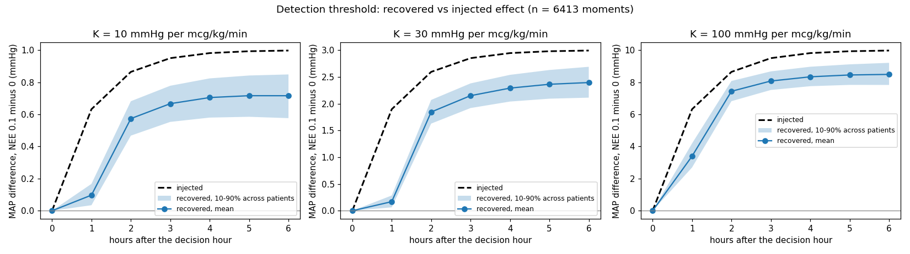

Training: K = 10 stopped early at epoch 135 and K = 30 at epoch 143. The checkpoint
kept for both was **epoch 120**. Epoch 128 had a validation loss lower by less than
0.0001, which the early-stopping rule doesn't count as an improvement. The run summary
printed 128 because it takes the plain minimum; the models we used are from epoch 120.
Each epoch took about 12 s on the T4.

**Answer: the smallest K that is clearly distinguishable is K = 10**, the smallest one
we tested. So the real threshold is **at or below +1 mmHg** at steady state for this
dose. We did not find where detection stops; we only know it is below K = 10.

**What else the table shows.**
- **The model finds most of the effect even when it is small.** At steady state it
  recovers 72% (K = 10), 80% (K = 30) and 85% (K = 100). The share grows with K, so a
  small effect is credited to the drug a bit less fully than a large one.
- **The first hour is the weak spot, and it gets worse as the effect shrinks.** At hour
  1 the share is 54% for K = 100 but only 15% for K = 10 and 9% for K = 30. That is
  0.1–0.2 mmHg. This matches Stage 10: the direct path from the *current* action into
  the prior barely works. The effect arrives an hour later, through the previous action
  in the next token. For small effects that path does almost nothing.
- **The patient spread is narrow.** This is expected: the injected effect does not
  depend on the patient, and the paired random numbers remove sampling noise.

**An important limit on "clearly distinguishable".** The 10–90% range measures
differences **between patients**, under one trained model of each kind. It doesn't
measure **training noise**. Two models trained on the *same* real data with different
seeds would also differ somewhat, and we haven't measured by how much on MIMIC. So the
0.10 mmHg at hour 1 for K = 10 may be within ordinary run-to-run variation. The
0.6–0.7 mmHg from hour 3 onward is more convincing, but it has not been tested against
that noise either. The clean control would be a "K = 0" run: retrain on the unmodified
data with another seed and measure the same paired difference. That gives the noise
floor any recovered effect has to beat. We did this next; see "The noise floor" below.

**What it teaches.**
- On a clean, planted effect the architecture is fairly sensitive: about 1 mmHg per
  0.1 mcg/kg/min is detected and about 70% recovered from hour 3 onward.
- That makes the near-zero effect on real MIMIC (Stage 8) even more a statement about
  the data than about the model.
- Two things still point at the model: the weak first hour, and the missing 15–30% at
  steady state.
- "Clearly distinguishable" is only as good as the noise you compare against.
  Patient-to-patient spread is one kind of noise. Training-run spread is another; the
  next part measures it.

### Stage 10b, continued - The noise floor: how different are two training runs?

**The question.** Train the same model twice on the *same* real data and change only
the **seed**, the number that sets the random starting weights and the order of the
batches. How different is the vasopressor effect the two models imagine? Any
"recovered" effect smaller than this difference could just be the luck of training.
That difference is the **noise floor**.

**What we did.**
- We trained the original model again on the unmodified MIMIC data (K = 0) with seed 1.
  Everything else matched the existing seed-0 model.
- On the same 6,413 moments, with the same random numbers, we took the imagined effect
  (NEE 0.1 minus 0) of the seed-1 model minus that of the seed-0 model, paired per
  moment.
- Training: the seed-1 model kept epoch 112 of 127, at about 12.5 s per epoch.

| hour | noise floor, mean | 10–90% across patients |
|---|---|---|
| 1 | −0.01 | −0.09 .. +0.06 |
| 3 | −0.19 | −0.34 .. −0.03 |
| 6 | −0.35 | −0.54 .. −0.15 |

All values are mmHg of MAP.

Two models trained on identical data disagree about the drug's effect by up to about
0.35 mmHg on average at 6 hours. They also disagree *systematically*: seed 1 imagines a
smaller effect than seed 0 for almost every patient. Seen alone, the real-data effect
looks like +0.12 / +0.22 / +0.06 mmHg at 1 / 3 / 6 h with seed 0. With seed 1 it is
+0.10 / +0.03 / −0.29. That is the same model on the same data, and even the sign
changes. So **the real-data vasopressor effect is indistinguishable from zero**.

**The criterion against the noise floor**, fixed before we saw the numbers. A recovered
effect *clearly exceeds* the noise floor at an hour if its whole 10–90% range lies
above the noise floor's 90th percentile. A looser version only asks that the recovered
*mean* lies above that 90th percentile.

**The Stage 10b table again, with the noise floor** (original model):

| K | hour | injected | recovered (10–90%) | noise floor 90th pct | clearly above? (strict / mean) |
|---|---|---|---|---|---|
| 10 | 1 | 0.63 | 0.10 (+0.03 .. +0.17) | +0.06 | **no** / yes |
| 10 | 3 | 0.95 | 0.67 (+0.55 .. +0.78) | −0.03 | yes / yes |
| 10 | 6 | 1.00 | 0.72 (+0.58 .. +0.85) | −0.15 | yes / yes |
| 30 | 1 | 1.90 | 0.17 (+0.06 .. +0.29) | +0.06 | yes / yes |
| 30 | 3 | 2.85 | 2.15 (+1.92 .. +2.38) | −0.03 | yes / yes |
| 30 | 6 | 2.99 | 2.39 (+2.11 .. +2.69) | −0.15 | yes / yes |
| 100 | 1 | 6.32 | 3.39 (+2.69 .. +4.19) | +0.06 | yes / yes |
| 100 | 3 | 9.50 | 8.08 (+7.52 .. +8.68) | −0.03 | yes / yes |
| 100 | 6 | 9.98 | 8.49 (+7.83 .. +9.21) | −0.15 | yes / yes |

Recovered values and the noise-floor percentile are in mmHg. Part B on the old models
was rerun inside the overnight job, and it reproduced the Stage 10b numbers exactly.

**Reading it.**
- Every cell clearly beats the noise floor except **K = 10 at hour 1**, where the
  recovered 0.10 mmHg overlaps it.
- So the earlier answer stands with one correction. **K = 10 is detected at hours 3 and
  6, but not at hour 1.** The smallest K that clears the noise floor at 1, 3 *and* 6 h
  is **K = 30**.
- One caveat: the noise floor comes from a single pair of seeds. A third or fourth seed
  would show how stable this 0.35 mmHg is.

---

## Stage 11 - Giving the current action its own path into the prior

**The problem.** Stages 10 and 10b showed the weak spot. In the first hour after a dose
change, the original model recovers only 54% of a strong effect (K = 100) and 9–15% of
small ones. In the original model the current dose `a_t` enters the prior as **3 raw
numbers** placed next to the 64 numbers of `h_t`. The prior's first layer can use them,
but they are a tiny part of its input. Most of the effect arrives an hour later, after
the dose has been written into the next token.

**The change.** We added an **action embedding** for the current action:

    act_now(a_t) = Linear(3 -> 64) -> GELU -> Linear(64 -> 64)

- The prior now gets `[h_t, act_now(a_t)]` instead of `[h_t, a_t]`.
- The posterior now gets `[h_t, act_now(a_t), x_{t+1}, mask_{t+1}]`.
- The decoder is unchanged and still never sees the action. The token, which carries
  the *previous* action, is unchanged too.
- The variant is switched on by a flag (`WorldModel(act_now=True)`), off by default. The
  original model and all its checkpoints are untouched.
- An **embedding** here is a small learned network that turns the 3 action numbers into
  64 numbers. The current dose then has as much room in the prior's input as the
  patient summary `h_t`.

**What we trained.** The variant used the same hyperparameters and seed 0 on four
datasets: real data, K = 10, K = 30 and K = 100. We also trained it with seed 1 on real
data, to get its own noise floor. Each epoch took about 13 s on a T4.

| Variant run | Kept epoch | Of | Validation loss |
|---|---|---|---|
| real data (K = 0), seed 0 | 174 | 189 | 2.345 |
| real data (K = 0), seed 1 | 178 | 193 | 2.343 |
| K = 10 | 150 | 165 | 2.358 |
| K = 30 | **56** | **71** | 2.400 |
| K = 100 | 106 | 121 | 2.283 |

The K = 30 run stopped much earlier than the others, and its validation loss is the
highest, so it may be under-trained. Its numbers below should be read with that in
mind. On real data the variant reaches a slightly lower validation loss than the
original (2.345 vs 2.374 for the seed-1 original). It uses 3 of 8 latent dimensions,
like the original.

**a) One-step forecast on the real test split** (prior, 50 samples):

| Vital | Naive MAE | Original MAE / RMSE / in 10–90% | Variant MAE / RMSE / in 10–90% |
|---|---|---|---|
| HR (bpm) | 5.53 | 5.145 / 7.671 / 77.8% | 5.144 / 7.657 / 77.9% |
| RR (/min) | 3.40 | 2.819 / 3.985 / 77.0% | 2.814 / 3.991 / 76.6% |
| SpO2 (%) | 1.53 | 1.349 / 2.139 / 79.1% | 1.346 / 2.128 / 77.7% |
| MAP (mmHg) | 8.33 | 7.021 / 10.078 / 78.3% | 7.014 / 10.066 / 77.6% |
| Temp (°C) | 0.30 | 0.266 / 0.390 / 80.1% | 0.265 / 0.389 / 78.6% |

The forecast is essentially identical. The change neither helped nor hurt one-step
accuracy, and coverage stays near the 80% it should be (a 10–90% band should contain
80% of outcomes).

**b) Semi-synthetic recovery, original vs variant** (each against its own real-data
model):

| K | hour | injected | original: recovered (share) | variant: recovered (share) | variant 10–90% |
|---|---|---|---|---|---|
| 10 | 1 | 0.63 | 0.10 (15%) | 0.08 (13%) | +0.02 .. +0.15 |
| 10 | 3 | 0.95 | 0.67 (70%) | 0.65 (68%) | +0.54 .. +0.77 |
| 10 | 6 | 1.00 | 0.72 (72%) | 0.70 (70%) | +0.55 .. +0.86 |
| 30 | 1 | 1.90 | 0.17 (9%) | 0.33 (18%) | +0.21 .. +0.47 |
| 30 | 3 | 2.85 | 2.15 (75%) | 2.19 (77%) | +1.93 .. +2.50 |
| 30 | 6 | 2.99 | 2.39 (80%) | 2.53 (85%) | +2.24 .. +2.87 |
| 100 | 1 | 6.32 | 3.39 (54%) | **7.07 (112%)** | +6.45 .. +7.77 |
| 100 | 3 | 9.50 | 8.08 (85%) | **9.33 (98%)** | +8.81 .. +9.89 |
| 100 | 6 | 9.98 | 8.49 (85%) | **9.61 (96%)** | +9.07 .. +10.19 |

Effects are in mmHg.

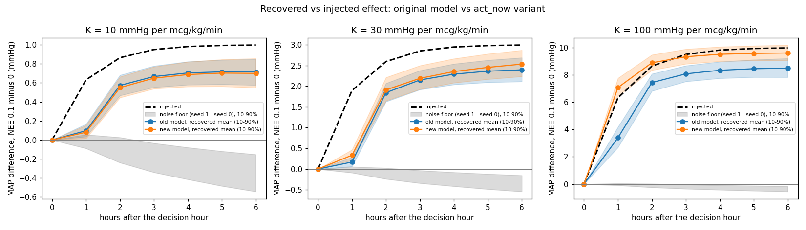

- **The variant's noise floor** (seed 1 minus seed 0 on real data) is +0.07 / +0.11 /
  +0.16 mmHg at 1 / 3 / 6 h. Its 90th percentile is +0.19 / +0.30 / +0.40.
- Against its own noise floor, the variant passes in every cell except K = 10 at hour 1.
  That is the same pattern as the original.

**c) Real data: imagined NEE 0.1 minus 0** (6,413 moments):

| Model | 1 h | 3 h | 6 h |
|---|---|---|---|
| original, seed 0 | +0.12 | +0.22 | +0.06 |
| original, seed 1 | +0.10 | +0.03 | −0.29 |
| variant, seed 0 | +0.16 | +0.21 | −0.08 |
| variant, seed 1 | +0.23 | +0.32 | +0.08 |

All values are mmHg.

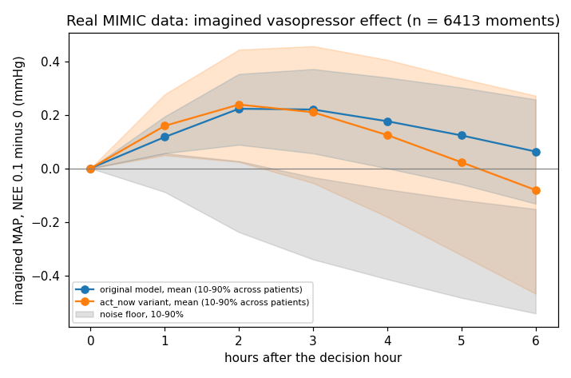

All four are within a few tenths of a mmHg of zero, and they disagree in sign at 6 h.
On real MIMIC data **no model, old or new, finds a vasopressor effect bigger than the
noise between training runs**. That matches Stage 9: the change in architecture didn't
create an effect the data doesn't support.

**d) Action ablation on real data** (MAP MAE change vs real actions):

| Action input | Original, all hours | Original, NEE-active hours | Variant, all hours | Variant, NEE-active hours |
|---|---|---|---|---|
| all zero | +0.2% | +0.5% | +0.2% | +0.6% |
| shuffled | +0.3% | +0.5% | +0.3% | +0.6% |
| NEE zero | +0.0% | +0.2% | +0.1% | +0.4% |

The prior's sensitivity to the dose (NEE 0 to 0.1, real history fixed) is the size of
the shift in `z`:
- original: 0.041, against a typical spread of 1.65; decoded MAP +0.07 mmHg;
- variant: 0.063, against a typical spread of 1.55; decoded MAP +0.04 mmHg.

On real data the variant still barely uses the actions. This is what we expect if the
data has no clear effect to learn.

**Step 4 - a check on the vasopressor units (report only, no code change).** The
extraction converts each vasopressor rate to norepinephrine-equivalent mcg/kg/min. It
divides by weight for 'mcg/min', divides by 60 for 'units/hour', and otherwise
multiplies by 1.0 (the "ELSE 1.0" branch). Rows per unit:

| itemid | drug | unit | rows | goes to ELSE 1.0 | correct? |
|---|---|---|---|---|---|
| 221906 | norepinephrine | mcg/kg/min | 459,798 | yes | yes, already per kg per min |
| 221906 | norepinephrine | mg/kg/min | 2 | yes | **no**, 1000× too small |
| 221289 | epinephrine | mcg/kg/min | 31,495 | yes | yes |
| 221662 | dopamine | mcg/kg/min | 18,085 | yes | yes |
| 221749 | phenylephrine | mcg/kg/min | 209,372 | yes | yes |
| 221749 | phenylephrine | mcg/min | 2 | no (÷ weight) | yes |
| 222315 | vasopressin | units/hour | 37,160 | no (÷ 60) | yes |
| 222315 | vasopressin | units/min | 3 | yes | yes, by coincidence |

For vasopressin in units/min, multiplying by 1.0 is right: the factor of 2.5 is defined
per unit per minute, and that is exactly what dividing units/hour by 60 recovers. Only
**2 norepinephrine rows** out of about 756,000 vasopressor rows (labelled mg/kg/min) are
converted wrongly, and they are almost certainly charting errors anyway. **The unit
conversion is not a source of error worth fixing.**

**What we learned in Stage 11.**
- **The new path fixes the first hour for a strong effect.** At K = 100, hour-1
  recovery went from 54% to 112% and steady-state recovery from 85% to 96%. The 112%
  means the variant slightly *over*shoots at hour 1, by 0.75 mmHg. It now credits the
  current dose directly, a little too eagerly.
- **It does not help small effects.** At K = 10 hour 1 stays near 13–15% and steady
  state near 70%. At K = 30 hour 1 doubles (9% to 18%) and steady state rises to 85%,
  but that run may be under-trained.
  - A likely reason, a hypothesis we haven't tested: at hour 1 a small effect is about
    0.6 mmHg, against hour-to-hour MAP noise of about 7 mmHg. Modelling it barely
    improves the likelihood, so the model has little reason to spend its latent budget
    on it.
- **Nothing else got worse.** The one-step forecast, coverage and the real-data
  ablation are essentially unchanged.
- **On real data the effect is still zero within the noise**, for both architectures
  and both seeds. Together with Stages 9–10b, this settles the diagnosis from Stage 10:
  the architecture had a real but limited weak spot (the first hour of a strong
  effect), and the variant fixes it. The absent vasopressor effect on MIMIC is a
  property of the data: confounding, titration and weak positivity. It is not a
  property of the model.

| | Original | act_now variant |
|---|---|---|
| Hour-1 recovery, K = 10 / 30 / 100 | 15% / 9% / 54% | 13% / 18% / 112% |
| Steady-state (6 h) recovery, K = 10 / 30 / 100 | 72% / 80% / 85% | 70% / 85% / 96% |
| One-step MAP error (MAE / RMSE, mmHg) | 7.021 / 10.078 | 7.014 / 10.066 |
| Real-data effect of NEE 0.1, 1 / 3 / 6 h (seed 0) | +0.12 / +0.22 / +0.06 | +0.16 / +0.21 / −0.08 |
| Real-data noise floor, 90th pct at 6 h | −0.15 (mean −0.35) | +0.40 (mean +0.16) |

From Stage 12 on, the act_now variant is the default (`WorldModel(act_now=True)`);
`act_now=False` gives the original model, and every older checkpoint still loads as the
original.

---

## Stage 12 - Hidden confounding: does a sicker-gets-the-drug signal fool the model?

**The question.** In real ICUs, patients get vasopressors *because* they are getting worse,
often for reasons the data does not record. This is **unmeasured (hidden) confounding**: a
cause of both the treatment and the outcome that the model never sees. If the model learns
"what usually happens after a vasopressor is started", it will mix the drug's effect with the
deterioration that triggered it. Stage 12 builds a benchmark where we know both parts exactly.

**The benchmark.** Real histories, real actions, real missingness. On top of the measured MAP:

    MAP'_t = MAP_t + K * e_t - G * u_t            (K = 30 mmHg per mcg/kg/min)

- `e_t` is the lagged dose from Stage 10: `e_{t+1} = e_t + (1 - exp(-1)) (NEE_t - e_t)`, `e_0 = 0`.
- `u_t` is a **hidden deterioration**, never given to the model. A vasopressor **start** is an
  hour `s` with `NEE_s > 0` and `NEE_{s-1} = 0`. Each start contributes a kernel `k(d)`, with
  `d = t - s`:
  - `k(d) = (d + 3) / 3` for `-3 <= d <= 0`: a linear ramp over the 3 h before, 1 at the start;
  - `k(d) = exp(-d / 4)` for `d > 0`: a decay with time constant 4 h after;
  - `k(d) = 0` otherwise.

  Then `u_t = max over starts s of k(t - s)`, so `u` stays between 0 and 1.
- Three runs: G = 0 (no confounding, the same data as Stage 11's K = 30), G = 5 and G = 15 mmHg.
- Same model (act_now, now the default), hyperparameters, seed 0, GPU and W&B. Everything is
  evaluated on the same 6,413 Part B moments, chosen once on the real data.

**The true causal effect.** The drug does not change `u`, so giving a constant dose `D` from
the decision hour `t` changes MAP only through the drug term:

    true_h = K * D * (1 - exp(-h))        = +1.90 / +2.85 / +2.99 mmHg at h = 1 / 3 / 6 (D = 0.1)

**The bias we predicted.** Suppose the model learns the observational relationship
`E[MAP' | history, actions]`. Part B compares "dose from hour t" with "no dose" for the
same history. For hour `t + h` the model has seen the actions of hours `t .. t+h-1`:
- **Dose arm:** a start at `t`. The moments have no vasopressor before `t`, so
  `u_{t+h} = exp(-h/4)`.
- **No-dose arm:** no start in `t .. t+h-1`, so `u_{t+h}` can only be the ramp of a start
  still to come. Its average, measured on the training split at moments chosen the same way,
  is `U0_h` = 0.026 / 0.014 / 0.010.

So the observational bias should be

    bias_obs_h = -G * (exp(-h/4) - U0_h)  = -3.76 / -2.29 / -1.07 (G = 5),  -11.29 / -6.88 / -3.20 (G = 15)

This prediction averages over the moments. It ignores what an individual history reveals
about `u`.

**Results** (learned = semi-synthetic model minus the real-data model, paired per moment):

| G | hour | true | learned (10–90% across patients) | bias = learned − true | predicted bias |
|---|---|---|---|---|---|
| 0 | 1 | +1.90 | +0.33 (+0.21 .. +0.47) | −1.56 | 0 |
| 0 | 3 | +2.85 | +2.19 (+1.93 .. +2.50) | −0.66 | 0 |
| 0 | 6 | +2.99 | +2.53 (+2.24 .. +2.87) | −0.46 | 0 |
| 5 | 1 | +1.90 | +0.17 (+0.05 .. +0.33) | −1.72 | −3.76 |
| 5 | 3 | +2.85 | +2.42 (+2.19 .. +2.68) | −0.43 | −2.29 |
| 5 | 6 | +2.99 | +2.78 (+2.50 .. +3.10) | −0.21 | −1.07 |
| 15 | 1 | +1.90 | −0.08 (−0.19 .. +0.02) | −1.98 | −11.29 |
| 15 | 3 | +2.85 | +2.49 (+2.19 .. +2.80) | −0.37 | −6.88 |
| 15 | 6 | +2.99 | +3.15 (+2.75 .. +3.60) | +0.16 | −3.20 |

All values are in mmHg. The noise floor (two real-data models with different seeds) has a
mean of +0.07 / +0.11 / +0.16 and a 10–90% range of −0.03..+0.19 / −0.08..+0.30 /
−0.07..+0.40 at 1 / 3 / 6 h.

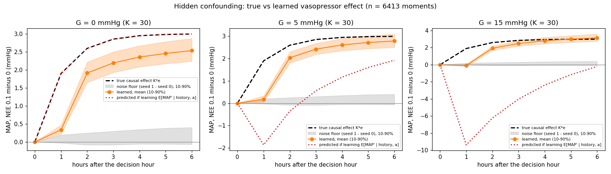

**Reading the table.**
- At G = 0 the bias is the hour-1 weakness we already knew from Stage 11: only 18% of the
  hour-1 effect is recovered at K = 30.
- The part that comes from confounding is the change from G = 0 to G = 15:
  −0.41 / +0.30 / +0.62 mmHg. The prediction was −11.29 / −6.88 / −3.20.
- So the model is biased far less than predicted, and in no consistent direction. We did
  not expect this.

The new G = 0 run reproduced Stage 11's K = 30 model exactly, to every digit, including its
early stop at epoch 71. Training here is deterministic. The kept epochs were 56 of 71 (G = 0),
143 of 158 (G = 5) and 106 of 121 (G = 15), at about 13 s per epoch.

### Checks: why is the G = 15 model not fooled?

**Check 1: is the confounder really in the data?** Around all 33,158 real vasopressor
starts, we took the mean of `MAP' - MAP` from 6 h before to 6 h after, over hours with a
measured MAP.

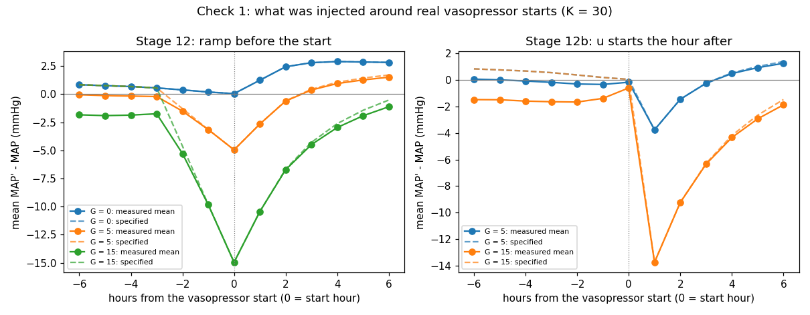

- **Stage 12, G = 15:** −1.74 at 3 h before the start, −14.95 at the start hour, −10.44 one
  hour after and −4.48 three hours after. This follows the specified curve (dashed) exactly
  once the hours approach the start.
- **Away from a start**, the measured line sits about 2.5 mmHg below the specified one.
  These are patients whose vasopressor was stopped and restarted, so an earlier start's
  decay is still present. That is the "max over starts" in the formula.
- **Confirmed:** the deterioration is injected as specified.

**Check 2: does the raw data show the predicted bias?** On the 6,413 moments we took the
measured MAP' at `t + h` for the 253 moments that started the vasopressor at `t` minus the
same for those that did not.

| data | h = 0 | h = 1 | h = 3 | h = 6 |
|---|---|---|---|---|
| real MAP | −1.07 | +0.41 | −1.34 | −1.29 |
| G = 0 (drug only) | −1.07 | +1.52 | +1.77 | +2.01 |
| G = 5 | −6.00 | −2.24 | −0.48 | +0.88 |
| G = 15 | −15.84 | −9.75 | −4.99 | −1.38 |

The rows are started minus not started, in mmHg.

- The extra difference caused by `u` is G = 15 minus G = 0: **−11.27 / −6.76 / −3.39** at
  h = 1 / 3 / 6.
- The formula `−G × (mean u started − mean u not started)` on the same measured hours gives
  **−11.27 / −6.75 / −3.39**.
- **Confirmed:** the observational data contains exactly the predicted bias. A model that
  learned `E[MAP' | history, a]` should show it. The model does not.

**Check 3: your hypothesis, that the confounder is visible in the history.** The ramp lowers
MAP' before the start, so the model might explain the later drop through the history rather
than the action. We split the moments in two ways:
- **ramp in history:** `u_t > 0` at the decision hour (426 moments). This is known only from
  the injected `u`.
- **observed fall:** the measured MAP'_t is at least 5 mmHg below the mean of the three
  hours before. This is what the model can see.

| G = 15 model | moments | learned at 1 / 3 / 6 h | change from G = 0, same group |
|---|---|---|---|
| ramp in history | 426 | −0.07 / +2.83 / +3.63 | −0.42 / +0.69 / +1.10 |
| no ramp in history | 5,987 | −0.08 / +2.46 / +3.12 | −0.41 / +0.27 / +0.59 |

- **Not confirmed.** Both groups are equally unbiased, far from the −11 mmHg predicted at
  hour 1.
- The "observed fall" split turned out not to be useful: 84% of the moments show a fall,
  because they are chosen as the first hour with MAP below 65. That split also shows no
  difference.
- Stage 12b tests a broader version of this idea next. My own variant: the confounder is
  fully visible at the decision hour of every *training* start, since `u` = 1 at the start
  hour.

## Stage 12b - A truly hidden confounder

**The change.** The deterioration should leave no trace in anything the model sees when the
dose is decided. In our model, MAP at the start hour `t` is already in the history when
`a_t` is chosen. So `u` must also be 0 at the start hour, not only before it:

    k(d) = exp(-(d - 1) / 4)  for d >= 1   (1 in the hour after the start)
    k(d) = 0                  for d <= 0

Check 1 confirms the data. For G = 15, nothing appears up to and including the start hour
(−0.6 mmHg, from earlier starts), −13.76 one hour after (−15 plus the drug's +1.24), and
−6.35 three hours after.

The no-dose arm now has `u_{t+h} = 0` exactly (`U0_h = 0`), so the predicted bias is

    bias_obs_h = -G * exp(-(h-1)/4)  = -5.00 / -3.03 / -1.43 (G = 5),  -15.00 / -9.10 / -4.30 (G = 15)

**Results** (the same table as Stage 12; G = 0 is the shared drug-only model):

| G | hour | true | learned (10–90% across patients) | bias | predicted bias |
|---|---|---|---|---|---|
| 0 | 1 / 3 / 6 | +1.90 / +2.85 / +2.99 | +0.33 / +2.19 / +2.53 | −1.56 / −0.66 / −0.46 | 0 |
| 5 | 1 | +1.90 | +0.13 (+0.02 .. +0.27) | −1.77 | −5.00 |
| 5 | 3 | +2.85 | +2.23 (+1.97 .. +2.53) | −0.62 | −3.03 |
| 5 | 6 | +2.99 | +2.78 (+2.46 .. +3.13) | −0.21 | −1.43 |
| 15 | 1 | +1.90 | −0.01 (−0.12 .. +0.11) | −1.90 | −15.00 |
| 15 | 3 | +2.85 | +1.98 (+1.78 .. +2.21) | −0.87 | −9.10 |
| 15 | 6 | +2.99 | +2.59 (+2.29 .. +2.97) | −0.40 | −4.30 |

All values are in mmHg. The noise floor is the same as in Stage 12.

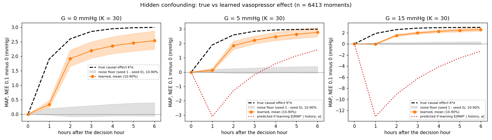

- **The raw data again shows exactly the predicted bias.** Started minus not started, with
  G = 0 subtracted, is −15.00 / −8.77 / −4.19 at h = 1 / 3 / 6. The formula on the same
  hours gives −15.00 / −8.78 / −4.20.
- **At the decision hour (h = 0)** the raw difference is identical to G = 0 (−1.07), so the
  history really carries no trace.
- **The model is still almost unbiased.** The change from G = 0 to G = 15 is −0.34 / −0.21 /
  +0.06 mmHg. The prediction was −15.00 / −9.10 / −4.30.
- **Training:** G = 15 kept epoch 125 of 140. G = 5 stopped early at epoch 71 (kept 56),
  the same early-stopping pattern as the K = 30 run.

### What the checks support, and what they rule out

| Explanation | Verdict | Evidence |
|---|---|---|
| The confounder was not injected, or is too weak | **ruled out** | Check 1: the injected curve matches the specification. Check 2: the raw data shows the predicted bias to within 0.01 mmHg. |
| The ramp in each moment's own history lets the model see it (your check 3) | **not confirmed** | Moments with and without a ramp in their history are equally unbiased. |
| The confounder is visible at the decision hour of every training start (my hypothesis) | **ruled out** | Stage 12b removes every trace before and at the decision hour; the model is still unbiased. |
| The model's one-step prior barely responds to a start, so it never imagines the post-start drop | **supported by measurement** | See below. |

**What the measurements show.**
- Hour 1 of Part B *is* the model's one-step prediction: the prior given the real history and
  a start at `t`.
- In the training data, the hour after a start is 15 mmHg lower at G = 15 (Stage 12b,
  check 2). The G = 15 model's hour-1 prediction moves by only −0.34 mmHg compared with
  G = 0. That is about 2% of what the data contains.
- This matches the weakness we already knew from Stage 11: only 18% of the drug's own hour-1
  effect is learned at K = 30.
- The model never produces the post-start drop in imagination. It therefore has nothing to
  "recover" from in the later hours.
- In training, the hours after a start are predicted from a history that already contains the
  observed drop. The model is trained one step at a time on the real previous hours, which is
  called **teacher forcing**. So the model can learn "low MAP tends to come back" as a
  property of the history, not of the action.
- That is why hours 3 and 6 are not biased either.

**What is *not* tested yet.** We don't know *why* the prior misses the drop after a start.
Two candidate reasons, both untested:
- **Rarity:** starts are only 0.93% of the 3.56 million valid hours.
- **An interaction:** a start means "dose now > 0 *and* dose an hour ago = 0". The
  current-action path `act_now(a_t)` sees only the current dose. The previous dose lives
  inside `h_t`, so the prior must learn the combination from few examples. The drug effect,
  by contrast, depends simply on the dose level.

**The lesson.** The model looks unconfounded **for the wrong reason**. It did not separate
drug from deterioration. It under-fits the first-hour response to a start, and in this
benchmark the whole confounder lives in exactly that response. A model that fitted the data
better would be biased by up to −15 mmHg, as the raw data and the formula agree.
- A counterfactual that comes out right is not evidence that the model understood the cause.
- A benchmark has to check the *mechanism*: what the model predicts one step after a start,
  and whether that matches the data.
- The more powerful and better-fitted the world model, the more it will reproduce hidden
  confounding like this. Stage 11's act_now path already moved hour-1 recovery from 54% to
  112% at K = 100.

**Read-only data check: MAP from cuff pressures.** We counted hours where neither MAP item
(220052 arterial, 220181 cuff) has a reading but both cuff systolic (220179) and diastolic
(220180) do.
- Result: **6,679 of 3,557,045 valid hours (0.19%)**, or 6,984 (0.20%) if only plausible MAP
  readings count as present.
- Deriving MAP from systolic and diastolic would fill very few hours. The extraction is
  unchanged.

---

## Negative control: does the real-data model "see" a drug effect on temperature?

**The idea.** A **negative control outcome** is something the treatment should not affect.
If a model nevertheless shows an "effect" on it, that effect must come from somewhere else:
most likely from **confounding** absorbed in training (sicker patients get the drug *and*
have different temperatures), not from the drug.
- Norepinephrine has about no direct effect on body temperature.
- So we reran the Stage 8 Part B counterfactual on the real-data model and looked at
  **every** vital, not only MAP.
- The setup is unchanged: the 6,413 moments, NEE 0.1 vs 0 for 6 h, other actions real, 50
  paired samples per arm.

The noise floor is the same paired difference between the two real-data models trained with
seeds 0 and 1. The original pre-Stage 11 model is shown as a check. Evaluation only.

**Imagined effect, NEE 0.1 minus 0** (default model, seed 0; mean, with the 10–90% range
across patients at 6 h):

| Vital | 1 h | 3 h | 6 h | 10–90% at 6 h | noise floor 10–90% at 6 h |
|---|---|---|---|---|---|
| Temp (°C) | +0.001 | −0.000 | −0.002 | −0.014 .. +0.008 | −0.012 .. +0.019 |
| SpO2 (%) | +0.04 | +0.08 | +0.13 | +0.04 .. +0.24 | −0.07 .. +0.07 |
| RR (/min) | +0.00 | +0.07 | +0.07 | −0.08 .. +0.21 | −0.10 .. +0.06 |
| HR (bpm) | +0.12 | +0.19 | +0.11 | −0.30 .. +0.50 | −0.06 .. +0.43 |
| MAP (mmHg) | +0.16 | +0.21 | −0.08 | −0.47 .. +0.27 | −0.07 .. +0.40 |

The MAP row is identical to Stage 11's Part B for this model, as it should be. The original
model gives the same picture (Temp −0.009 °C at 6 h).

**Raw observed difference** on the same moments: measured value at `t + h` for the 258
moments that started the vasopressor at `t`, minus the 6,155 that did not.

| Vital | h = 0 | h = 1 | h = 3 | h = 6 |
|---|---|---|---|---|
| Temp (°C) | −0.27 | −0.28 | −0.16 | +0.05 |
| SpO2 (%) | +0.94 | +1.29 | +0.84 | +1.04 |
| RR (/min) | −0.33 | −0.19 | −0.04 | +0.13 |
| HR (bpm) | +3.85 | +3.26 | +3.12 | +2.86 |
| MAP (mmHg) | −1.07 | +0.41 | −1.34 | −1.29 |

Temperature is measured rarely: about 100 of the 258 started moments have a reading in each
of these hours.

**Reading it.**
- **Temp: no effect, beyond the noise floor or otherwise.** The imagined change is a few
  thousandths of a degree, inside the noise floor at every hour, by both criteria (the whole
  10–90% range, or only the mean, outside the noise floor's range).
- **The raw data does differ, already at h = 0.** At the decision hour the drug can't have
  acted yet, but patients who get it are 0.27 °C cooler, with HR 3.9 bpm higher and SpO2
  0.9% higher. That is **selection** (who gets treated), i.e. confounding. The model did not
  turn it into an imagined drug effect.
- **SpO2 and RR** have imagined means slightly outside the noise floor's range: +0.13% and
  +0.07/min at 6 h. These pass only the loose criterion, never the strict one, and are
  clinically irrelevant.

**What the negative control can and cannot tell us here.**
- A negative control can only reveal absorbed confounding if the model responds to the action
  at all.
- The real-data model barely does, for any vital: Stage 9 showed this, and the MAP row above
  is within a few tenths of zero.
- So "no effect on temperature" is **consistent with** the model ignoring the vasopressor
  altogether. It is not evidence that the model separated drug from confounding.
- The check becomes informative for a model that *does* respond to actions. Stage 13's
  act_delta model is the obvious candidate: if it shows an imagined temperature "effect", the
  confounding has entered through the action path.

---

## Stage 13 - Let the model see a start: does it then become biased?

### The hypothesis, written before running anything

> **If the model is made able to predict the hour after a vasopressor start, it will become
> biased under hidden confounding.**

Stage 12b showed that the model was unbiased only because its one-step prediction barely
reacts to a start. A start is "dose now > 0 *and* dose an hour ago = 0". The current-action
path `act_now(a_t)` sees only the current dose; the previous dose is buried in `h_t`.

**The one change.** The input of `act_now` becomes `[a_t, a_t - a_{t-1}]`: 6 numbers
instead of 3. The second half is the change in each action since the hour before, so a
start (or a stop) is visible directly. Nothing else changes: same layers, decoder, loss,
hyperparameters and seed. The option is a flag (`act_delta=True`); the default stays as in
Stage 12.

**Training.** The new design is trained on three datasets:
- K = 30, G = 0 (the drug only, the same data as Stage 12's G = 0);
- Stage 12b, G = 15 (the hidden confounder);
- real data (K = 0).

The real-data model is needed for the one-step error on real data, and it is this design's
own reference for "learned effect".

**What we will measure.**
1. **Hour-1 fit at starts.** Around real vasopressor starts in the test split (−3 .. +3 h),
   compare the mean measured change of MAP into each hour with the mean change the one-step
   prior predicts. This is done for the current models and the new ones.
2. **K = 30, G = 0:** hour-1 and 6-h recovery, new vs current (18% / 85%). Does it fix hour 1?
3. **12b, G = 15:** the learned effect at 1 / 3 / 6 h against the true effect (+1.90 / +2.85 /
   +2.99) and against the observational prediction (true − 15.00 / − 9.10 / − 4.30, the red
   line). Does it move toward the red line?
4. **One-step MAP error on real data**, new vs current (MAE 7.014 mmHg).

**How the verdict will be decided** (fixed now). The **confounding shift** is the learned
effect at G = 15 minus the learned effect at G = 0, both with the new design, at hour 1.
The prediction for a model that fits the data is −15.00 mmHg; the current design gave −0.34.
- **Confirmed:** the new design captures at least half of the measured drop in the hour after
  a start (the step 1 check on the G = 15 data), *and* the confounding shift is −7.5 mmHg or
  more negative (at least half of the predicted bias).
- **Partly:** either one of these holds, or the shift is between −1.5 and −7.5 mmHg (10–50%
  of the predicted bias).
- **Rejected:** the shift stays above −1.5 mmHg (less than 10% of the predicted bias).

### Results

**Training.** The three act_delta models trained for about 12 s per epoch on the T4, with
W&B logging. They kept epochs 107 of 122 (K = 30), 89 of 104 (12b, G = 15) and 118 of 133
(real data), and used 3–4 of the 8 latent dimensions.

**1. Hour-1 fit at real starts** (test split, 4,549 starts with MAP measured in both hours;
mean change of MAP' into each hour):

| Data | | −2 | −1 | 0 (start) | **+1** | +2 | +3 |
|---|---|---|---|---|---|---|---|
| real | measured | −0.73 | −3.71 | −2.58 | **+1.47** | −0.26 | +0.05 |
| | current / act_delta | −0.72 / −0.83 | −0.51 / −0.63 | +0.99 / +0.83 | **+0.55 / +0.45** | −0.71 / −0.79 | −0.51 / −0.66 |
| K = 30, G = 0 | measured | −0.76 | −3.87 | −2.72 | **+2.67** | +0.98 | +0.44 |
| | current / act_delta | −0.85 / −1.06 | −0.70 / −0.87 | +0.80 / +0.58 | **+0.80 / +0.53** | −0.08 / −0.42 | −0.21 / −0.54 |
| 12b, G = 15 | measured | −0.77 | −3.65 | −2.38 | **−11.71** | +4.30 | +2.98 |
| | current / act_delta | −0.86 / −0.77 | −0.70 / −0.64 | +0.20 / +0.24 | **−1.62 / −1.41** | +5.82 / +5.94 | +2.89 / +2.71 |

All values are in mmHg.

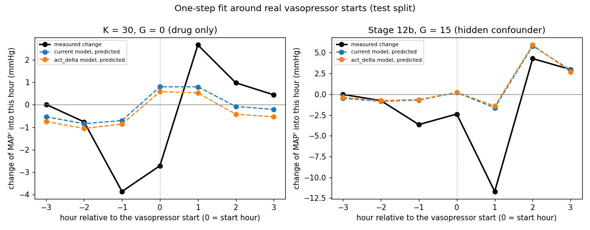

- **The hour after a start is still missed.** In the 12b data the hour after a start falls
  14.38 mmHg more than in the drug-only data. The current model predicts 2.42 of that (17%);
  the act_delta model predicts 1.94 (13%).
- Both models instead predict the *recovery* in the hour after (+5.8 to +5.9 vs +4.30
  measured), from the drop they have already seen. This is the Stage 12b explanation, now
  measured directly.
- **The hours before a start are missed on real data too.** MAP falls 3.7 mmHg in the hour
  before a start and 2.6 mmHg into the start hour. Neither model predicts it.
- That fall is *real* deterioration before treatment: the real-world version of the
  confounder we planted.

**2. K = 30, G = 0: does it fix hour 1?** Recovered effect (vs the current real-data model,
paired per moment):

| | 1 h | 3 h | 6 h | share at 1 h / 6 h |
|---|---|---|---|---|
| current model | +0.33 | +2.19 | +2.53 | 18% / 85% |
| act_delta model | **+1.37** | +2.39 | +2.59 | **72%** / 87% |
| act_delta, vs its own real-data model | +1.03 | +2.35 | +2.58 | 54% / 86% |
| true | +1.90 | +2.85 | +2.99 | |

- **In the Part B counterfactual, hour 1 is largely fixed:** 18% becomes 54–72%, depending
  on the reference model.
- **At real starts the gain is small.** The drug part of the change in the hour after a
  start is +1.20 mmHg measured (K = 30 minus real data). The act_delta model predicts only
  +0.08 (0.53 − 0.45); the current model predicts +0.25.
- So the model responds to a 0.1 dose given to a hypotensive patient with no earlier
  vasopressor, but much less at the real starts, which include restarts and smaller doses.
  **We have not explained this difference.**

**3. 12b, G = 15: does it move toward the red line?**

| | 1 h | 3 h | 6 h |
|---|---|---|---|
| true effect | +1.90 | +2.85 | +2.99 |
| observational prediction (red line) | −13.10 | −6.25 | −1.31 |
| current model, learned (10–90%) | −0.01 (−0.12 .. +0.11) | +1.98 (+1.78 .. +2.21) | +2.59 (+2.29 .. +2.97) |
| act_delta model, learned (10–90%) | +0.64 (+0.23 .. +1.09) | +2.19 (+1.96 .. +2.45) | +2.93 (+2.59 .. +3.33) |
| **confounding shift**, current (G = 15 − G = 0) | −0.34 | −0.21 | +0.06 |
| **confounding shift**, act_delta | **−0.73** | −0.20 | +0.34 |
| predicted confounding shift | −15.00 | −9.10 | −4.30 |

All values are in mmHg.

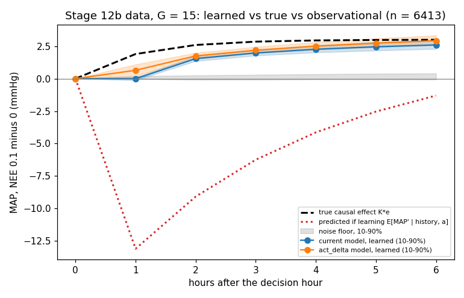

- The act_delta model's hour-1 confounding shift doubles, from −0.34 to −0.73 mmHg. That is
  in the predicted direction, but only 5% of the −15 mmHg the data contains.
- Both models stay close to the true effect, far from the red line.

**4. One-step error on real data** (prior; MAE / RMSE / share inside the 10–90% band):

| Vital | current | act_delta |
|---|---|---|
| HR (bpm) | 5.144 / 7.657 / 77.9% | 5.134 / 7.650 / 76.7% |
| RR (/min) | 2.814 / 3.991 / 76.6% | 2.825 / 3.978 / 76.1% |
| SpO2 (%) | 1.346 / 2.128 / 77.7% | 1.349 / 2.134 / 79.1% |
| MAP (mmHg) | 7.014 / 10.066 / 77.6% | 7.019 / 10.073 / 78.0% |
| Temp (°C) | 0.265 / 0.389 / 78.6% | 0.268 / 0.390 / 78.5% |

Unchanged.

**5. Negative control with the act_delta real-data model** (the same check as the section
above, side by side; imagined NEE 0.1 minus 0 on the 6,413 moments). The noise floor is the
current design's two seeds, because only one act_delta seed was trained.

| Vital | current model at 1 / 3 / 6 h | act_delta model at 1 / 3 / 6 h | beyond the noise floor (strict), act_delta |
|---|---|---|---|
| MAP (mmHg) | +0.16 / +0.21 / −0.08 | **+0.49** / +0.26 / −0.07 | **yes at 1 h** (+0.21 .. +0.84 vs noise up to +0.19); no at 3 and 6 h |
| Temp (°C) | +0.001 / −0.000 / −0.002 | +0.000 / +0.001 / +0.005 | **no** at any hour |
| SpO2 (%) | +0.04 / +0.08 / +0.13 | +0.08 / +0.08 / +0.12 | no |
| RR (/min) | +0.00 / +0.07 / +0.07 | −0.03 / +0.08 / +0.09 | no |
| HR (bpm) | +0.12 / +0.19 / +0.11 | −0.02 / +0.06 / +0.04 | no |

- The act_delta model **does respond** to the vasopressor for MAP in the first hour: +0.49
  mmHg, with its whole 10–90% range across patients above the noise floor.
- It does **not** "respond" on temperature: +0.000 to +0.005 °C, inside the noise floor at
  every hour.
- So, now that the action path carries a MAP response, the negative control is informative,
  and it finds no sign that confounding entered through the action path. The response it
  has is specific to MAP.
- It is small, though (+0.49 mmHg), and only one seed was trained.

### Verdict

By the rules fixed before the run:
- The act_delta model captures **13%** of the drop in the hour after a start. That is below
  the 50% needed.
- The confounding shift is **−0.73 mmHg**. That is above −1.5, i.e. less than 10% of the
  predicted −15.

**Verdict: rejected.**

**What this does and does not mean.** The hypothesis is conditional: *if* the model can
predict the hour after a start, *then* it will be biased. Step 1 shows the condition was
**not met**. Seeing `a_t − a_{t−1}` did not make the model predict the post-start drop (13%
vs 17% before). So Stage 13 rejects the idea that this one input change is enough. It does
**not** test, and does not refute, the conditional claim itself. What we did learn:
- The extra input clearly helps the *drug* effect in the counterfactual (hour 1 at K = 30:
  18% → 54–72%), and the real-data model now responds to the vasopressor in MAP only, not
  in temperature.
- It barely helps with the 15 mmHg drop after a start, even though the drop is large and
  the start is now visible in the input.
- So the obstacle is not that the start is invisible. Remaining candidates, all untested:
  - starts are rare: 0.93% of hours;
  - the KL term prices a missed prediction on those few hours too cheaply;
  - the decoder absorbs the error with a wider uncertainty band instead.
- On real data, MAP falls in the hours *before* a start: the real confounder. None of our
  models predicts that fall.

**Lesson.** Before testing "if the model could do X, then Y", check that the change really
made it able to do X. Here the one-step fit at starts was that check, and it failed.
Reporting only the downstream number (the confounding shift) would have looked like evidence
against the hypothesis, when the test never happened.

---

## Stage 13b - Force the model to fit the hours after a start

### Pre-registration (written and committed before running anything)

**Step 1 - diagnostic, evaluation only.** Models:
- the current design (act_now) and the Stage 13 act_delta design;
- each on K = 30 (G = 0) and on 12b G = 15 data;
- test split.

The three questions:
- **a) Does the model widen its uncertainty at starts instead of predicting the drop?**
  - We compare the hours just after a start (start hour +1 and +2) with all other valid
    hours.
  - For each group we report the mean predicted sigma for MAP in mmHg: the decoder's sigma
    at the prior mean, and the spread of 50 samples (z from the prior, then a decoder
    sample).
  - We also report the mean KL and the mean residual: measured minus predicted MAP.
- **b) Does a different point prediction explain the Stage 13 gap?**
  - We redo the Stage 13 start-fit with the point prediction taken as the mean of 50
    samples, instead of the decoder output at the prior mean.
  - The gap: hour-1 recovery was 54–72% in the counterfactual, but the drug part of the
    change in the hour after real starts was only +0.08 predicted vs +1.20 mmHg measured.
- **c) Are real start hours a different population from the 6,413 Part B moments?**
  - We compare the mean MAP trend over the 3 hours before, the MAP level, earlier
    vasopressor use and the starting dose.

**Gate for Step 2** (numeric version of "only if 1a shows sigma widening or clear
underfit"). Stage 13b trains if, for either 12b G = 15 model (current or act_delta), at
start hour +1:
- the 50-sample predictive spread of MAP is at least **1.2×** its mean over other hours
  (*sigma widening*); or
- the mean residual (measured − predicted MAP) is **−5 mmHg or lower** (*clear underfit*:
  the model misses at least a third of the roughly 14 mmHg drop).

Otherwise Step 2 is skipped and only Step 1 is reported.

**Step 2 - hypothesis.**

> **If the model is forced to fit the hours after a start, it will recover the hour-1 drug
> effect at K = 30 and become biased toward the observational line under 12b G = 15.**

**The one change from act_delta.** In the training loss, the reconstruction term of the
hours just after a start (start hour +1 and +2) gets **weight 10**; all other hours keep
weight 1. A start is an hour with NEE > 0 and NEE = 0 the hour before. The KL term,
architecture, hyperparameters and seed 0 stay the same. Validation, and therefore early
stopping, uses the same weighted loss. Evaluation uses the plain model; the weights exist
only during training.

We train this on K = 30 (G = 0), 12b G = 15 and real data.

**Verdict rules.**
- **(i) Fit:** the start-fit captures **at least 50%** of the 12b post-start drop. This is
  the same measure as Stage 13: the predicted change at start hour +1 on G = 15 data minus
  that on K = 30 data, divided by the same measured difference (14.38 mmHg). The point
  prediction is the decoder output at the prior mean; the 50-sample version is reported too.
- **(ii) Bias:** the 12b G = 15 learned hour-1 effect (vs the current real-data model,
  paired, as in Stage 13) moves at least **30%** of the way from the true effect +1.90
  toward the observational prediction −13.10. That means it must be **−2.60 mmHg or
  lower**.
- **Confirmed:** both (i) and (ii) hold.
- **Partly:** exactly one holds.
- **Rejected:** neither holds.

### Step 1 results (diagnostics, no training)

**a) At starts, does the model widen sigma instead of predicting the drop?** Test split. The
"hour after a start" and "2 h after" rows are 4,648 and 4,575 hours; "other" is 445,128
hours. All sigmas and residuals are for MAP, in mmHg.

| Model, data | hour group | decoder sigma | 50-sample spread | KL (nats) | residual (measured − predicted) |
|---|---|---|---|---|---|
| current, K = 30 | start +1 / +2 / other | 8.15 / 7.94 / 7.37 | 11.00 / 10.62 / 9.58 | 2.71 / 2.61 / 2.63 | +1.78 / +1.05 / +0.67 |
| current, 12b G = 15 | start +1 / +2 / other | 8.61 / 7.88 / 7.04 | 11.70 / 10.83 / 9.43 | 3.32 / 3.14 / 3.06 | **−10.21** / −1.62 / +0.89 |
| act_delta, K = 30 | start +1 / +2 / other | 8.15 / 7.83 / 7.14 | 11.77 / 10.99 / 9.72 | 2.97 / 2.86 / 2.68 | +2.06 / +1.41 / +0.74 |
| act_delta, 12b G = 15 | start +1 / +2 / other | 8.97 / 8.26 / 7.04 | 12.55 / 11.56 / 9.49 | 2.93 / 2.78 / 2.65 | **−10.41** / −1.74 / +0.66 |

**Answer:** both. In the hour after a start the predicted spread is 1.24–1.32× wider than
elsewhere, *and* the 12b drop is missed by about 10 mmHg. The model widens its uncertainty a
little instead of predicting the drop.

**b) Does a different point prediction close the gap?** The drug part is the change in the
hour after a start, K = 30 minus real data: measured +1.20 mmHg.

| Model | point prediction | drug part predicted | 12b drop captured |
|---|---|---|---|
| current | decoder at the prior mean | +0.25 | 17% |
| current | mean of 50 samples | +0.37 | 16% |
| act_delta | decoder at the prior mean | +0.08 | 13% |
| act_delta | mean of 50 samples | +0.32 | 17% |

**Answer:** no. Sampling adds at most about 0.25 mmHg. The gap is not about how the point
prediction is formed.

**c) Are real start hours and the Part B moments different populations?** Real data, test
split, MAP in mmHg.

| Group | n | MAP level | MAP minus mean of 3 h before | MAP minus MAP 3 h before | earlier vasopressor | MAP < 65 | start dose |
|---|---|---|---|---|---|---|---|
| real start hours | 4,869 | 72.0 | −4.6 | −6.3 | 25% | 31% | 0.066 |
| first starts with MAP < 65 | 558 | 57.0 | −12.0 | −14.6 | 0% | 100% | 0.056 |
| Part B moments | 6,413 | 59.4 | −16.1 | −18.8 | 0% | 100% | (0.1, set) |

**Answer:** yes, clearly.
- Most real starts happen at MAP around 72 after a modest fall, and a quarter are restarts.
- The Part B moments are first-time, hypotensive and falling fast.
- So the counterfactual (Part B) and the start-fit measure the model on different patients.
  That explains why Stage 13's 54–72% hour-1 recovery in Part B and its +0.08 at real starts
  can both be true.

**Gate: open.** For both 12b G = 15 models the spread ratio (1.24, 1.32) exceeds 1.2 and the
residual (−10.21, −10.41) is below −5. Step 2 therefore ran.

### Step 2 results: start-weighted training

**Training.** Three models, act_delta plus reconstruction weight 10 at start hour +1 and +2,
seed 0, about 13 s per epoch on the T4, with W&B logging. They kept epochs 105 of 120
(K = 30), 62 of 77 (12b G = 15) and 84 of 99 (real data).

**1. Start-fit** (decoder at the prior mean; mean change of MAP' into each hour around real
starts):

| Data | | −1 | 0 (start) | **+1** | +2 | +3 |
|---|---|---|---|---|---|---|
| K = 30 | measured | −3.87 | −2.72 | **+2.67** | +0.98 | +0.44 |
| | current / act_delta / **weighted** | −0.70 / −0.87 / −0.77 | +0.80 / +0.58 / +0.82 | **+0.80 / +0.53 / +1.86** | −0.08 / −0.42 / +0.14 | −0.21 / −0.54 / −0.51 |
| 12b G = 15 | measured | −3.65 | −2.38 | **−11.71** | +4.30 | +2.98 |
| | current / act_delta / **weighted** | −0.70 / −0.64 / −0.13 | +0.20 / +0.24 / +1.40 | **−1.62 / −1.41 / −7.29** | +5.82 / +5.94 / +4.85 | +2.89 / +2.71 / +3.53 |
| real | measured | −3.71 | −2.58 | **+1.47** | −0.26 | +0.05 |
| | current / act_delta / **weighted** | −0.51 / −0.63 / −0.53 | +0.99 / +0.83 / +1.00 | **+0.55 / +0.45 / +0.90** | −0.71 / −0.79 / −0.57 | −0.51 / −0.66 / −0.28 |

All values are in mmHg.

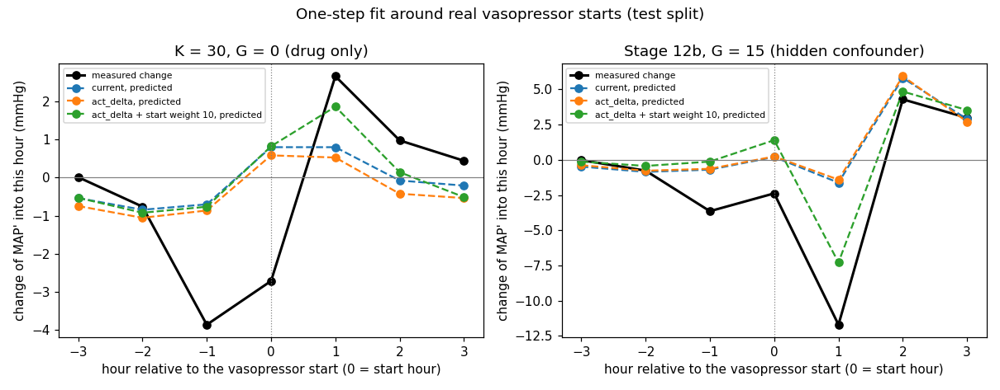

- **The 12b drop after a start is now largely predicted.** The weighted model captures
  −9.16 of −14.38 mmHg: **64%** (66% with the 50-sample mean). Before it was 13–17%.
- **The drug part at real starts** is +0.97 predicted vs +1.20 measured (81%). Before it was
  +0.08 to +0.25.
- **Still missed:** the fall in MAP *before* a start (−3.7 and −2.6 mmHg), on every dataset
  and by every model.

**2. K = 30: hour-1 drug effect (Part B, paired):**

| | 1 h | 3 h | 6 h | share at 1 h / 6 h |
|---|---|---|---|---|
| current (vs current real-data model) | +0.33 | +2.19 | +2.53 | 18% / 85% |
| act_delta (same reference) | +1.37 | +2.39 | +2.59 | 72% / 87% |
| weighted (same reference) | +3.14 | +2.59 | +2.31 | 165% / 77% |
| **weighted, vs its own real-data model** | **+1.43** | +1.78 | +1.74 | **75% / 58%** |
| true | +1.90 | +2.85 | +2.99 | |

All values are in mmHg.

- Against the shared reference the hour-1 effect overshoots (165%). That is because the
  weighted real-data model itself already imagines +1.86 mmHg at hour 1; see point 5.
- Against its own real-data model, hour 1 is 75%, but the steady state *drops* to 58%.
- Its 10–90% range across patients is also much wider at 3 h: +0.92 .. +2.61, against
  +1.93 .. +2.50 for the current model.

**3. 12b G = 15: learned vs true vs observational:**

| | 1 h | 3 h | 6 h |
|---|---|---|---|
| true | +1.90 | +2.85 | +2.99 |
| observational prediction (red line) | −13.10 | −6.25 | −1.31 |
| current, learned | −0.01 | +1.98 | +2.59 |
| act_delta, learned | +0.64 | +2.19 | +2.93 |
| **weighted, learned (10–90%)** | **−5.33 (−7.90 .. −2.98)** | −1.53 (−3.06 .. −0.11) | +0.04 (−1.32 .. +1.30) |
| confounding shift (G = 15 − G = 0), current / act_delta / **weighted** | −0.34 / −0.73 / **−8.47** | −0.21 / −0.20 / **−4.11** | +0.06 / +0.34 / **−2.28** |
| predicted confounding shift | −15.00 | −9.10 | −4.30 |

All values are in mmHg.

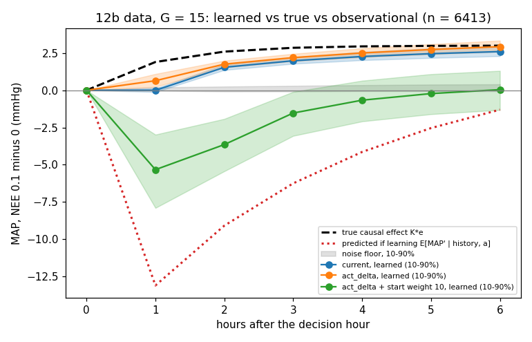

The weighted model's learned effect now goes **below zero**: giving the vasopressor *lowers*
imagined MAP by 5.3 mmHg at hour 1. Its confounding shift is 56% / 45% / 53% of the
predicted bias at 1 / 3 / 6 h. In plain words, the model now attributes the deterioration
that follows a start to the drug.

**4. One-step error on real data** (prior; MAE / RMSE / inside the 10–90% band):

| Vital | current | act_delta | weighted |
|---|---|---|---|
| HR (bpm) | 5.144 / 7.657 / 77.9% | 5.134 / 7.650 / 76.7% | 5.189 / 7.680 / 78.6% |
| RR (/min) | 2.814 / 3.991 / 76.6% | 2.825 / 3.978 / 76.1% | 2.869 / 3.997 / 79.9% |
| SpO2 (%) | 1.346 / 2.128 / 77.7% | 1.349 / 2.134 / 79.1% | 1.370 / 2.174 / 81.4% |
| MAP (mmHg) | 7.014 / 10.066 / 77.6% | 7.019 / 10.073 / 78.0% | 7.095 / 10.116 / 80.8% |
| Temp (°C) | 0.265 / 0.389 / 78.6% | 0.268 / 0.390 / 78.5% | 0.273 / 0.397 / 82.0% |

The weighted model is slightly worse on average (MAP MAE +1.2%) and its bands are slightly
wider than needed (coverage 80–82%, against 80% intended).

**5. Negative control on real data** (imagined NEE 0.1 minus 0 on the 6,413 moments; noise
floor from the current design's two seeds; "strict" means the whole 10–90% range lies
outside the noise floor's range):

| Vital | current | act_delta | weighted | weighted beyond noise (strict)? |
|---|---|---|---|---|
| MAP (mmHg), 1 / 3 / 6 h | +0.16 / +0.21 / −0.08 | +0.49 / +0.25 / −0.07 | **+1.86 / +1.02 / +0.49** | yes at 1 h; no at 3 and 6 h |
| Temp (°C), 1 / 3 / 6 h | +0.001 / −0.000 / −0.002 | +0.000 / +0.001 / +0.005 | −0.004 / +0.012 / +0.010 | **no** at any hour |
| HR (bpm), 1 / 3 / 6 h | +0.12 / +0.19 / +0.11 | −0.02 / +0.06 / +0.04 | −0.03 / +1.47 / +2.14 | no (the mean is outside the noise range at 3 and 6 h) |
| SpO2, RR | ≤ 0.13 | ≤ 0.12 | ≤ 0.18 | no |

On real data the weighted model now imagines a clear vasopressor effect on MAP in the first
hour: +1.86 mmHg. It shows no "effect" on temperature. That fits a model that reproduces what
happens in the data after real starts (MAP rises 1.47 mmHg in that hour, measured). Whether
that rise is the drug or recovery after the pre-start fall, this check cannot say.

### Verdict (pre-registered rules)

- **(i) Fit:** 64% of the 12b post-start drop is captured, against a target of 50%. **Met.**
- **(ii) Bias:** the 12b G = 15 learned hour-1 effect is −5.33 mmHg, against a target of
  −2.60 or lower. That is 48% of the way from the true effect to the observational line.
  **Met.**

**Verdict: confirmed.** Once the model is made to fit the hours after a start, it reproduces
the hidden confounding. Under 12b G = 15 it now imagines that the vasopressor *lowers* MAP by
5.3 mmHg at hour 1, while the true effect is +1.9.

### What the checks support, and the caveats

- **The conditional claim from Stage 12b and 13 now holds.** The earlier models looked
  unconfounded because they under-fitted the hour after a start. A better fit there brings the
  confounding in.
- **Caveat 1: the change was not local.**
  - The weighting changed the balance between reconstruction and KL everywhere, not only at
    starts.
  - Validation KL rose from 2.7 to 6.0–6.9 nats per hour, and 4 latent dimensions are used
    instead of 3.
  - The decoder's own MAP sigma fell from about 7 mmHg to about 1.5 mmHg on ordinary hours
    (0.1–0.3 at starts, where KL reached 18–19 nats).
  - The prior's predictive spread stayed about 10 mmHg.
  - So part of the effect may come from this global shift, which acts like a weaker KL
    penalty, rather than from the start hours specifically. A control with the same overall
    balance but no start weighting would separate the two. It hasn't been run.
- **Caveat 2: one seed per model.**
  - The noise floor comes from the current design.
  - The weighted models are noisier per patient: the 10–90% ranges are 3–5 mmHg wide at 3–6 h.
- **Caveat 3: the drug's steady-state effect got worse.**
  - At K = 30 it fell from 87% to 58% of the true effect, against its own reference.
  - Fitting the start hours helped hour 1 but did not improve the long-run effect.
- **What no model predicts:** the fall in MAP in the hours *before* a real start, which is
  the real-world confounder.

**Lesson.** The same architecture can look unbiased or clearly biased under hidden
confounding, depending only on how hard it is pushed to fit the hour after a treatment
starts. "No bias" in a world model can simply mean "didn't learn that part of the data".
**Hidden confounding cannot be removed by fitting better.** A better fit reproduces it more
faithfully.

---

## Stage 13c - Control for Stage 13b: start hours, or just the global shift?

### Pre-registration (written and committed before running anything)

**The question.** The Stage 13b weighting did two things at once:
- it made the hours after a start count 10× in the loss;
- it changed the balance between reconstruction and KL *everywhere*: validation KL went from
  about 2.7 to 6.0–6.9 nats per hour, and the decoder's MAP sigma from about 7 mmHg to about
  1.5.

Which of the two caused the 13b bias?

**The control model.** act_delta with **no start weighting**. Instead, `beta` (the KL weight
in the loss, 1.0 so far) is lowered so that validation KL reaches about the 13b level. Free
bits (1 nat), architecture, all other hyperparameters and seed 0 are unchanged.

**Choosing beta** (fixed now, applied automatically inside the job):
- First train on K = 30 with **beta = 0.3**.
- If its validation KL (at the kept epoch) lies in the **target band 5.0–8.5 nats/hour**,
  keep beta = 0.3.
- Otherwise adjust **once**: `beta_new = 0.3 × KL_observed / 6.5`, clipped to 0.05–0.9. A
  higher KL calls for a larger beta. Retrain K = 30 with `beta_new` and use it for every
  other run.
- If the KL is still outside the band after the adjustment, the control is reported as
  **off-target** and its result as inconclusive.

**Training.** K = 30 (G = 0), 12b G = 15, and real data. All use the same beta and seed 0.
The real-data model is needed for the one-step error on real data and as the control's own
reference.

**The hypothesis.**

> **The Stage 13b bias is specific to fitting the hours after a start. A control with the
> same global KL level but no start weighting will not capture the post-start drop and will
> stay close to the true effect under 12b G = 15.**

**Measures.** The same as Stage 13b, side by side with the 13b weighted models and the
current act_delta models:
- the start-fit, and the share of the 12b post-start drop captured;
- the 12b G = 15 learned effect at 1 / 3 / 6 h, against the true effect and the observational
  prediction;
- the **confounding shift** at hour 1 (G = 15 minus G = 0, same design, paired). For 13b it
  was −8.47 mmHg;
- K = 30 recovery;
- the one-step MAP error on real data;
- validation KL and decoder sigma, to check that the control reached the intended global
  shift.

**Verdict rules** (`S_c` = the control's hour-1 confounding shift):
- **Confirmed (specific to start hours):** `S_c > −1.5 mmHg` (less than 10% of the predicted
  −15, the Stage 13 level) *and* the control captures less than 50% of the post-start drop.
- **Rejected (global shift explains it):** `S_c ≤ −4.24 mmHg`, i.e. at least half of the 13b
  shift appears without start weighting.
- **Partly (both contribute):** anything in between.
- **Inconclusive:** the control is off-target (KL outside 5.0–8.5 after the one adjustment).

### Results

The job ran on a Kaggle T4 in 1.4 hours; all 8 steps succeeded. W&B runs: `i818p6ey`
(beta 0.3, K = 30), `56o3p06s` (beta 0.9, K = 30), `s5pogywp` (beta 0.9, 12b G = 15),
`yyx8ej0v` (beta 0.9, real data). Files: `outputs/kaggle_stage13c/` (not in git);
checkpoints in the release `v1.2-vae-stage13c`.

#### 1. Did the control reach the target KL? No.

| Beta | Data | Validation KL (nats/hour) | In band 5.0–8.5? |
|---|---|---|---|
| 0.3 (first try) | K = 30 | 19.89 | no → adjust once |
| 0.9 (= 0.3 × 19.89 / 6.5 = 0.92, clipped to 0.9) | K = 30 | 13.99 | no |
| 0.9 | 12b G = 15 | 14.19 | no |
| 0.9 | real data | 11.79 | no |

The one allowed adjustment went to the top of the allowed range, and the KL was still about
twice the 13b level. By the pre-registered rule the control is **off-target**.

Where the KL and the decoder's sigma ended up, per hour group (K = 30 models, test split):

| Model | KL, start hour +1 | KL, other hours | MAP sigma, start hour +1 | MAP sigma, other hours |
|---|---|---|---|---|
| act_delta (beta 1, Stage 13) | 2.97 | 2.68 | 8.15 mmHg | 7.14 mmHg |
| 13b: start weight 10 (beta 1) | 18.82 | 6.68 | 0.14 mmHg | 1.50 mmHg |
| **13c control: beta 0.9** | **14.50** | **13.96** | **0.14 mmHg** | **0.13 mmHg** |

Read this table carefully, because it changes what the control can tell us:
- 13b's shift was **not** uniform. At the start hours its KL was 19 nats and its decoder sigma
  0.14 mmHg; elsewhere 6.7 nats and 1.5 mmHg. The "6-7 nats" we aimed for was an average
  dominated by the ordinary hours.
- The control is uniform: about 14 nats and 0.13 mmHg everywhere. So **at the start hours the
  control is in nearly the same state as 13b**, and at all other hours it goes further.

*Why lowering beta from 1.0 to 0.9 moved the KL from 2.7 to 14, not a little:* KL measures how
much information `z` carries about the next hour (in nats). Storing one more nat in `z` costs
`beta` nats of KL and saves roughly one nat of reconstruction loss. With beta above 1, storing
is a bad deal and the model keeps `z` near the free-bits floor; with beta below 1 it pays to
store as much as possible, until the decoder sigma hits its lower limit (at beta 0.3 it sat
exactly at the limit, 0.10 mmHg; `LOG_SIGMA_MIN = -5` in `src/model.py`). So the KL does not
move smoothly with beta; it jumps near beta = 1. A KL of 6-7 would need a beta between 0.9 and
1.0, or a different tool (for example a fixed KL target). This is our explanation, consistent
with the numbers; we did not test it separately.

#### 2. Start-fit: the 12b post-start drop, and the drug part at K = 30

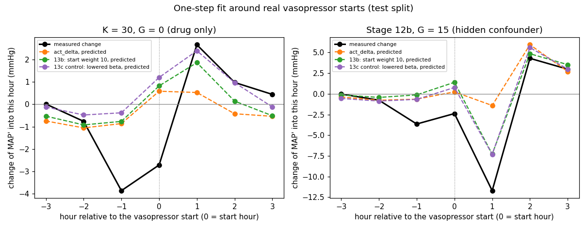

| Model | 12b drop captured (decoder at prior mean / mean of 50 samples) | K = 30 drug part at start hour +1 (K = 30 minus real data; measured +1.20) |
|---|---|---|
| act_delta | 13% / 17% | 0.08 |
| 13b: start weight 10 | 64% / 66% | 0.97 |
| **13c control** | **68% / 72%** | **1.95** |

Without any start weighting, the control fits the hour after a start as well as 13b does.

#### 3. 12b G = 15: learned vs true vs observational (mmHg, NEE 0.1 vs 0)

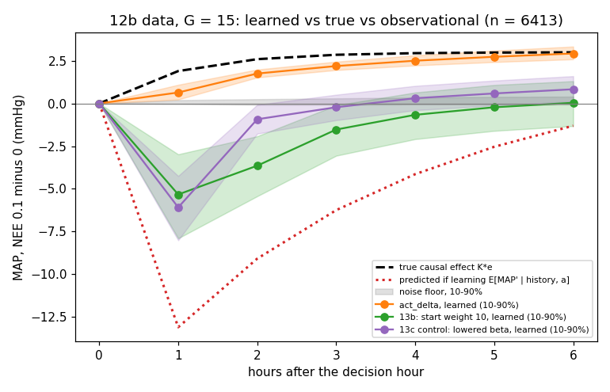

| | 1 h | 3 h | 6 h |
|---|---|---|---|
| True effect | +1.90 | +2.85 | +2.99 |
| Observational prediction (true + bias) | −13.10 | −6.25 | −1.31 |
| act_delta | +0.64 | +2.19 | +2.93 |
| 13b: start weight 10 | −5.33 | −1.53 | +0.04 |
| **13c control** | **−6.09** | **−0.22** | **+0.83** |

**Confounding shift** (learned at G = 15 minus learned at G = 0, same design, paired over the
6,413 moments; predicted full bias −15.00 / −9.10 / −4.30):

| | 1 h | 3 h | 6 h |
|---|---|---|---|
| act_delta | −0.73 | −0.20 | +0.34 |
| 13b | −8.47 | −4.12 | −2.28 |
| **13c control** | **−10.73** | **−3.08** | **−1.68** |

The control picks up the hidden confounding at hour 1 even more strongly than 13b (−10.7 of the
predicted −15), and lets go of it a little faster afterwards.

#### 4. K = 30 recovery (true +1.90 / +2.85 / +2.99)

| Model | 1 h | 3 h | 6 h | Own reference: 1 h | 3 h | 6 h |
|---|---|---|---|---|---|---|
| act_delta | 72% | 84% | 86% | 54% | 82% | 86% |
| 13b | 165% | 91% | 77% | 75% | 62% | 58% |
| **13c control** | **245%** | **100%** | **84%** | **172%** | **100%** | **93%** |

("Own reference" subtracts the same design's real-data model, so only the planted drug is left.)
The control gets the steady state right (100% at 3 h, 93% at 6 h) but overshoots hour 1 by
a factor of about 2 even against its own reference.

#### 5. One-step error on real data (test split, MAP)

| Model | Prior MAE | 80% band coverage | Posterior MAE |
|---|---|---|---|
| current (act_now) | 7.014 | 77.6% | 6.15 |
| act_delta | 7.019 | 78.0% | 6.42 |
| 13b | 7.095 | 80.8% | 0.25 |
| **13c control** | **7.046** | **79.4%** | **0.06** |

The forecast (prior) is almost unchanged in every model. The posterior column shows the shift:
in 13b and the control, the posterior has seen the next hour and `z` carries it almost exactly
(0.06 mmHg). That is what "KL 14 nats" looks like.

#### Verdict: **Inconclusive** (pre-registered rule: control off-target)

The control's hour-1 shift is `S_c = −10.73 mmHg` and it captures 68% of the drop. Those numbers
would fall under "rejected (the global shift explains it)", but the rules say an off-target
control gives no verdict, and we keep to that.

What we can still say, as an **exploratory** reading (not the verdict):
- Start weighting is **not necessary** for the bias: a model trained with no start weighting
  at all fits the post-start drop and picks up the hidden confounding.
- The question as posed ("start hours or global shift?") turned out not to separate cleanly.
  Both 13b and the control end up in the same state *at the start hours* (sharp decoder, `z`
  carrying the next value). What they share is that the start hours get fitted closely, and
  the bias comes with that fit, whatever causes it. This agrees with the Stage 13b lesson:
  fitting the post-start hour is what lets the hidden confounding in.
- A plausible mechanism (our hypothesis, not tested): once the posterior pins the next value
  sharply, the KL term acts like a sharp regression loss that pulls the prior toward the
  observed next value, including the confounded drop after a start.

**Caveats:** one seed; the control overshot the intended KL two-fold; the hour-1 drug effect
at K = 30 is overestimated by both sharp models, so their hour-1 numbers are less trustworthy
than the act_delta ones.

**Next:** a matched control would need a beta between 0.9 and 1.0 (or a fixed KL target) and
should be pre-registered with the per-hour-group KL, not the average; more seeds.

---

## Main finding so far (Stages 12-13c)

**In one sentence:** models that fit the hours just after a vasopressor start reproduce the
hidden confounding; models that do not fit those hours look unbiased only because they
underfit them.

The test bed is the Stage 12b data: a planted drug effect (+1.90 mmHg at 1 h) plus a hidden
"sicker patients get the drug" drop that starts the hour after a start. A model that learned
the data perfectly would report about −13.1 mmHg at 1 h (true effect + bias of −15).

| Model | Fits the post-start hour? (share of the 12b drop captured) | Hour-1 confounding shift (G = 15 minus G = 0; full bias −15) |
|---|---|---|
| act_now (current default, Stage 12b) | no (about 2%) | −0.34 |
| act_delta (Stage 13) | no (13%) | −0.73 |
| 13b: start hours weighted 10x | yes (64%) | −8.47 |
| 13c: beta lowered to 0.9, no weighting | yes (68%) | −10.73 |

- The two models that fit the post-start hour got there in **different ways** (start
  weighting in 13b, a lower KL weight in 13c), and both picked up most of the hidden
  confounding. The models that looked unbiased did so because their one-step prediction
  barely moved after a start: they were not right, they were not fitting that part of the data.
- **Lesson:** a world model that "shows no confounding bias" may simply be underfitting the
  hours where the confounding lives. A better fit to observational data cannot remove hidden
  confounding; it reproduces it.

**A key sensitivity: beta near 1.** Lowering the KL weight from 1.0 to 0.9 moved the
validation KL from about 2.7 to about 14 nats per hour (Stage 13c). The decoder's MAP sigma
fell from about 7 mmHg to about 0.13 mmHg, and the model went from not fitting the post-start
hour to fitting it. So whether this model looks unbiased can depend on a small change in one
hyperparameter. Any comparison between designs must hold beta (and the resulting KL) fixed,
or report it.

**Limits.** Every result above is **one seed per model** (seed 0). The Stage 10b noise floor
(seed 1 minus seed 0) is small for the default design, but it was not measured for the 13b
and 13c models. The 13c verdict itself is inconclusive by its pre-set rules (the control's KL
overshot the target); the table uses its numbers as an exploratory comparison.

---

## Stage 14 - A JEPA-style world model

### Pre-registration (written and committed before running anything)

**What changes, in plain words.** Until now the model predicted the next hour's **vitals**: the
decoder outputs a mean and a spread for each vital, and the loss scores how well they fit the
measured numbers (Gaussian NLL). A **JEPA** (Joint-Embedding Predictive Architecture) model
predicts an **embedding** of the next hour instead: a 64-number summary made by an encoder. The
loss is the distance between the predicted summary and the real one. The idea is that the model
no longer has to spend effort on every detail of the raw numbers, only on what the encoder keeps.

**The model** (new files `src/model_jepa.py`, `src/train_jepa.py`; shared code imported only).
Identical to the current default (act_now, Stage 11) wherever possible:
- same data, the same tokens `[x, mask, delta] + a_{t-1} + hour`, the same causal transformer
  (d = 64, 2 layers, 4 heads) and the same act_now path for the current action `a_t`;
- the same stochastic `z` (8 dims) with prior `p(z | h_t, a_t)`, posterior
  `q(z | h_t, a_t, x_{t+1}, mask_{t+1})` and KL term (beta = 1, free bits 1 nat);
- **new:** a **target encoder**, an EMA copy (exponential moving average, momentum 0.996 per
  step) of the token layers and the transformer. It receives no gradient ("stop-gradient"). Its
  output at hour t+1 is the target embedding `e_{t+1}`;
- **new:** a **predictor** `[h_t, act_now(a_t), z] -> ê_{t+1}` (an MLP with 2 hidden layers);
- **removed:** the decoder and the Gaussian NLL of the vitals.

**Loss** per predicted hour:
`0.5 × Σ_dims (ê − e)²  +  25 × variance term  +  1 × covariance term  +  beta × max(KL, 1)`.
- The first term is the Gaussian NLL with variance 1, up to a constant. So beta = 1 keeps its
  meaning from the VAE: one nat stored in `z` must buy one nat of prediction loss.
- **Variance and covariance terms** (from VICReg) guard against **collapse**, the failure where
  every hour gets the same embedding and the loss is trivially zero. The variance term pushes
  each dimension's spread across hours to at least 1; the covariance term keeps the dimensions
  from all saying the same thing. Both act on the online context embeddings `h_t` and on the
  predictions.
- Same optimizer, learning rate, batch size, patience (15) and maximum epochs as the VAE.

**Collapse check:** after every epoch, the per-dimension standard deviation (across validation
hours) of the target embeddings, the context embeddings and the predictions. It is logged to
W&B and kept in the history.

**Reading out vitals: the probe.** All benchmarks need vitals in mmHg, bpm and so on. After
training, the JEPA model is frozen and a small **probe** is trained on top: predicted embedding
-> mean and log-sigma of the 5 vitals (the same small network as the VAE decoder head, with a
Gaussian output so the 10–90% band and its coverage work). It is trained exactly the way the VAE
decoder is trained: masked Gaussian NLL of `x_{t+1}`, with `z` sampled from the posterior. In
forecasts `z` comes from the prior, as in the VAE. The probe is then used in place of the
decoder by the **same, unchanged evaluation code** as before.

**What we train** (one Kaggle job, seed 0 unless stated): JEPA on real data (seeds 0 and 1, for
the noise floor), on K = 10, 30 and 100 (Stage 10 data) and on 12b G = 15. The act_now models
already trained are evaluated in the same job as the comparison: real data (seeds 0 and 1),
K = 10 / 30 / 100 (Stage 11), K = 30 G = 0 (Stage 12) and 12b G = 15.

**Benchmarks**, side by side with act_now:
- Stage 7 one-step table (test split, real data, all 5 vitals);
- Stage 8A imagination over 12 hours with the real actions fed (MAP and HR);
- Stage 9 action ablation: on real data, and on K = 30 data where the drug really acts;
- Stage 10 recovery for K = 10 / 30 / 100 against the injected effect, with the noise floor
  (seed 1 minus seed 0, own design);
- Stage 12b G = 15: learned vs true vs observational, and the confounding shift
  (G = 15 minus G = 0).

**The hypothesis.**

> **A JEPA-style model forecasts about as well as the VAE, but responds less to actions,
> because embedding prediction is dominated by the patient's trend.**

**Verdict rules** (fixed now; computed automatically in the job):
- **H1, forecast parity:** JEPA one-step MAP MAE (prior, test split) ≤ 1.05 × act_now's.
- **A, Stage 9 "responds less":** on the K = 30 models, the increase in one-step MAP MAE on
  vasopressor-active hours when the vasopressor input is set to 0 is, for JEPA, below
  0.8 × act_now's increase.
- **B, Stage 10 "responds less":** the K = 30 recovered share, averaged over 1, 3 and 6 h, is
  for JEPA at least 10 percentage points below act_now's.
- **Confirmed:** H1, A and B all hold.
- **Rejected:** neither A nor B holds (JEPA responds as much as act_now or more), whatever H1.
- **Partly:** anything else (for example: it responds less but also forecasts worse).
- **Inconclusive:** the JEPA real-data or K = 30 model has collapsed (more than half of the 64
  target-embedding dimensions with standard deviation below 0.01 at the kept epoch), or a
  needed result is missing.

**Known caveats, written down in advance:**
- The target embedding of hour t+1 is made from the token of hour t+1. That token contains
  `a_t` (through `act_proj`), so part of the target is the action itself. The predictor also
  sees `a_t` and can copy that part. If the probe reads vitals partly from that direction,
  JEPA could look *more* action-responsive than it physiologically is.
- Early stopping uses the validation loss against a moving target (the EMA encoder changes),
  so "best epoch" means something slightly different from the VAE.
- One seed per model (two on real data, for the noise floor).
- The probe is trained after the fact; a poor probe would make JEPA's forecasts look worse than
  its embeddings are. The probe's validation NLL is reported.

### Results

One Kaggle job (T4 GPU, 1.9 h, all 9 steps OK). It trained 6 JEPA models plus probes and
evaluated them side by side with the 7 act_now models already trained. W&B runs: `mimic_jepa_*`
in project ICU-World-Model. All numbers below come from `outputs/jepa/stage14_metrics.json`;
figures are in `outputs/jepa/figures/`.

**Training and the collapse check.** No model collapsed: every one of the 64 embedding
dimensions kept a spread of about 1 (target embeddings: smallest per-dimension std 0.97-1.00,
median 1.05; 0 collapsed dimensions in any run). The VICReg variance term ended near 0
(0.0001), so it was satisfied, not fighting the loss.

| Run | Kept epoch / run | Val prediction loss | Val KL (nats/h) | Collapsed dims | Probe val NLL |
|---|---|---|---|---|---|
| real, seed 0 | 28 / 43 | 0.615 | 0.92 | 0 | 3.74 |
| real, seed 1 | 43 / 58 | 0.620 | 0.94 | 0 | 3.80 |
| K = 10 | 28 / 43 | 0.608 | 0.92 | 0 | 3.72 |
| K = 30 | 18 / 33 | 0.595 | 0.93 | 0 | 3.75 |
| K = 100 | 11 / 26 | 0.587 | 0.92 | 0 | 3.69 |
| 12b, G = 15 | 18 / 33 | 0.596 | 0.92 | 0 | 3.74 |

Two things stand out:
- **`z` is almost unused.** The KL sits just below the 1-nat free-bits floor (0.92-0.94),
  mostly in one of the 8 dimensions. Below the floor the KL term gives no gradient, so the model
  stores almost nothing extra about the next hour in `z`. The act_now VAE stores 2.8 nats. You
  see this in the one-step table: for JEPA the posterior (which may peek at the next hour) is
  barely better than the prior (MAP 7.66 vs 7.73), while for the VAE it is much better (6.15 vs
  7.01).
- **The probe converged.** In its last 5 epochs the validation NLL changed by about 0.001, so a
  longer-trained probe would not change the picture. Its NLL (3.7-3.8 nats per hour, summed
  over the vitals) is far above the VAE decoder's reconstruction NLL (-0.44). Partly that is the
  small `z` above, so it is not a pure forecast comparison; the MAE tables below are.

**Stage 7 one-step table** (test split, 13,894 stays, real data, prior = a real forecast; MAE in
the vital's unit; coverage of the 10-90% band, ideal 80%):

| Vital | act_now MAE | JEPA MAE | Naive MAE ("same as last hour") | act_now coverage | JEPA coverage |
|---|---|---|---|---|---|
| HR (bpm) | **5.14** | 6.07 | 5.53 | 78% | 83% |
| RR (/min) | **2.81** | 3.11 | 3.40 | 77% | 81% |
| SpO2 (%) | **1.35** | 1.54 | 1.53 | 78% | 85% |
| MAP (mmHg) | **7.01** | 7.73 | 8.33 | 78% | 82% |
| Temp (C) | **0.265** | 0.476 | 0.300 | 79% | 87% |

JEPA is worse than act_now on every vital: 10% worse on MAP, 18% on HR, and 80% on temperature.
On HR, SpO2 and temperature it is no better than, or worse than, simply repeating the last value.
Its bands are a little too wide (82-87% coverage instead of 80%).

**Stage 8A imagination over 12 hours** (19,990 windows from hours 12 and 24, real actions fed,
MAE):

| Hours ahead | MAP act_now | MAP JEPA | MAP naive | HR act_now | HR JEPA | HR naive |
|---|---|---|---|---|---|---|
| 1 | **6.92** | 7.45 | 8.09 | **5.10** | 5.82 | 5.37 |
| 3 | **7.80** | 8.22 | 9.44 | **6.70** | 7.42 | 7.19 |
| 6 | **8.21** | 8.68 | 10.10 | **7.97** | 8.72 | 8.62 |
| 12 | **8.96** | 9.48 | 11.05 | **9.39** | 10.30 | 10.38 |

The gap stays at about 0.5 mmHg for MAP over the 12 hours. JEPA beats "no change" on MAP at
every horizon, but on HR only from hour 9 on (and then barely). See `stage14_horizon.png`.

**Stage 9 action ablation.** Here is how much the MAP error grows on vasopressor-active hours when
the action input is damaged (a bigger number means the model relies more on the actions):

| Data | Model | MAE with real actions | All actions 0 | Actions shuffled | Vasopressor set to 0 |
|---|---|---|---|---|---|
| real | act_now | 6.50 | +0.65% | +0.62% | +0.43% |
| real | JEPA | 7.19 | +0.95% | +0.75% | -0.45% |
| K = 30 | act_now | 6.59 | +3.33% | +3.50% | **+2.82%** |
| K = 30 | JEPA | 7.31 | +3.75% | +3.95% | **+2.95%** |

On K = 30 data, where the drug really raises MAP, both models lean on the actions by the same
amount (2.8% vs 2.9%). JEPA does *not* respond less in this one-hour test.

**Stage 10 recovery of the planted effect.** "Recovered" is the effect the model imagines
(vasopressor 0.1 minus 0 at the same moment, 6,413 moments, mmHg). The **noise floor** is what two
seeds of the *same* design disagree by on real data, where nothing was planted:

| | Hour 1 | Hour 3 | Hour 6 |
|---|---|---|---|
| injected, K = 30 | 1.90 | 2.85 | 2.99 |
| act_now recovered, K = 30 | 0.33 (18%) | 2.19 (77%) | 2.53 (85%) |
| JEPA recovered, K = 30 | 0.97 (51%) | 1.12 (39%) | 0.94 (31%) |
| act_now recovered, K = 100 (share) | 112% | 98% | 96% |
| JEPA recovered, K = 100 (share) | 81% | 66% | 62% |
| act_now recovered, K = 10 (share) | 13% | 68% | 70% |
| JEPA recovered, K = 10 (share) | 7% | -14% | -41% |
| noise floor act_now (mean / p90) | 0.07 / 0.19 | 0.11 / 0.30 | 0.16 / 0.40 |
| noise floor JEPA (mean / p90) | -0.14 / 0.15 | 0.08 / 0.52 | 0.40 / 1.01 |

The two models differ in the *shape* of their response over time (`stage14_recovery.png`):
- **act_now** is slow at hour 1, then catches up to 77-85% of the true effect and stays there.
- **JEPA** is quicker at hour 1 (51% vs 18%), but its response does not build up; it fades
  back to about a third by hour 6.
- **JEPA's noise floor is 2-3 times wider.** Its two real-data seeds disagree by up to 1 mmHg
  at hour 6 (p90), against 0.4 for act_now. At K = 10, JEPA's "recovered" effect is inside its
  own noise floor, so it is not detected at all (act_now detects it). At K = 30, hours 5-6,
  JEPA's 0.94-0.98 mmHg is at the edge of its noise floor's p90 (0.86-1.01).

**Stage 12b, G = 15 (hidden confounder):** learned vs true vs observational (mmHg):

| | Hour 1 | Hour 2 | Hour 3 | Hour 6 |
|---|---|---|---|---|
| true causal effect | 1.90 | 2.59 | 2.85 | 2.99 |
| observational (true + bias) | -13.10 | -9.09 | -6.25 | -1.31 |
| act_now learned | -0.01 | 1.54 | 1.98 | 2.59 |
| JEPA learned | 0.21 | 0.58 | 0.70 | 0.94 |
| **confounding shift** act_now (G = 15 minus G = 0) | -0.34 | -0.37 | -0.21 | 0.06 |
| **confounding shift** JEPA (G = 15 minus G = 0) | **-0.77** | -0.58 | -0.42 | 0.00 |

Neither model comes near the observational curve. At hour 1, JEPA's estimate is pulled down
by the confounder about twice as much as act_now's (-0.77 vs -0.34 mmHg; JEPA's 10-90% range
-1.01 to -0.51 lies outside its noise floor). It is still a small fraction of the -15 mmHg
hidden drop. See `stage14_confounding.png`.

### Verdict (pre-registered rules)

| Rule | act_now | JEPA | Holds? |
|---|---|---|---|
| H1: one-step MAP MAE, JEPA ≤ 1.05 × act_now | 7.01 | 7.73 (1.10 ×) | **no** |
| A: K = 30 vasopressor-0 MAE increase, JEPA < 0.8 × act_now | 2.82% | 2.95% (1.05 ×) | **no** |
| B: K = 30 recovered share (mean of 1, 3, 6 h), JEPA ≤ act_now - 10 points | 59.7% | 40.6% (-19 points) | **yes** |
| Collapse (> 32 dims with std < 0.01) | - | 0 dims | no collapse |

**Verdict: partly.** Of the hypothesis "forecasts about as well, but responds less to actions":
- the **forecasting half is rejected**: JEPA is 10% worse on MAP, and worse on every vital;
- the **"responds less" half holds in one test and not the other**:
  - over several hours (B) JEPA recovers much less of the planted effect;
  - in the one-hour ablation (A) it leans on the action exactly as much as act_now.

### What the checks support, and the caveats

The following is an **exploratory reading**, not part of the pre-registered verdict:
- **"Dominated by the trend" fits the multi-hour pattern.** The planted effect builds up over
  about 3 hours (tau = 1 h). JEPA predicts the next embedding, which mostly carries the
  patient's state and trend, and its imagined effect does not accumulate. The VAE's does.
- **The quick hour-1 response may be the known leak.** The target embedding of hour t+1
  contains `a_t`, and the predictor sees `a_t` too (the caveat written before the run). That
  would explain why JEPA reacts at hour 1 (in the ablation and in the 51% recovery) but not
  later. We did not test this directly. A check would be a target encoder without the action
  token.
- **It fits the main finding.** The model that fits the first post-start hour more (JEPA, 51%
  vs 18% at hour 1) also picks up more of the hidden confounding at that hour (-0.77 vs -0.34).
- **Less stable across seeds.** JEPA's noise floor is 2-3 times act_now's, so any one JEPA
  number needs a wider margin.

Limits:
- One seed per model (two on real data).
- The VICReg weights (25, 1) and the EMA momentum (0.996) were not tuned.
- `z` stayed at the free-bits floor, so JEPA here is close to a deterministic predictor. A
  different free-bits setting could change the picture.

---

## Stage 14b - Close the action leak in the JEPA target

### Pre-registration (written and committed before running anything)

**Why.** In Stage 14 the JEPA model reacted quickly to the drug at hour 1 (51% of the planted
effect, act_now 18%), but its response faded over the next hours. We suspected a **leak**,
written down before Stage 14 ran. The target embedding of hour t+1 is built from that hour's
token, and the token contains the action `a_t` (`act_proj(a_t)` is added to it). The predictor
also receives `a_t`, so it can "predict" part of the target just by copying the action. That
can look like a response to the drug without any change in the vitals.

**The one change.** The target encoder builds its tokens **without any action input**: the
action term is left out (its `act_proj` is not applied), on the target side only. So the
target embedding of hour t+1 is made from the vitals, masks, time gaps and hour alone. The
online encoder, the predictor, the prior, the posterior, the loss, the probe and every
hyperparameter are exactly as in Stage 14. New files only:
- `src/model_jepa_b.py`: a subclass that overrides only the target embedding;
- `src/train_jepa_b.py`;
- `src/stage14b_runner.py`.

The Stage 14 code and results are not touched.

**Also logged: KL per hour.** For every real predicted hour on the validation split, we compute
the KL (summed over the 8 `z` dimensions). We log, every epoch:
- its mean;
- the share of hours below the 1-nat free-bits floor;
- the mean by hour of the stay.

The same profile is measured at the kept checkpoint for act_now, JEPA (14) and JEPA (14b).
This shows whether `z` is still unused. It is descriptive, not part of the verdict.

**What we train** (one Kaggle job, seed 0 unless stated):
- JEPA-14b on real data (seeds 0 and 1, for the noise floor), on K = 10, 30 and 100, and on
  12b G = 15, as in Stage 14.
- For comparison, the same job re-evaluates the act_now models and the six Stage 14 JEPA
  checkpoints, so all three designs are measured on the same moments.

**Benchmarks**, side by side for act_now, JEPA (14) and JEPA-14b, with the same figures as
Stage 14 plus one KL-per-hour figure:
- Stage 7 one-step table;
- Stage 8A 12-hour horizon;
- Stage 9 ablation (real and K = 30);
- Stage 10 recovery for K = 10 / 30 / 100 with the noise floor;
- Stage 12b G = 15 (learned vs true vs observational, confounding shift).

**The hypothesis.**

> **With the leak removed, JEPA's hour-1 response drops and its K = 30 recovery does not
> exceed act_now's; forecasts stay worse than act_now's.**

**Verdict rules** (fixed now; computed automatically in the job; thresholds as in Stage 14):
- **R1, the hour-1 response drops:** both of the following hold.
  - (a) The K = 30 recovered effect at hour 1 is, for 14b, at most 0.8 × JEPA-14's.
  - (b) The K = 30 Stage 9 increase in MAP MAE on vasopressor-active hours, when the
    vasopressor input is set to 0, is, for 14b, below 0.8 × JEPA-14's.
- **R2, recovery does not exceed act_now:** the K = 30 recovered share averaged over 1, 3 and
  6 h is, for 14b, at most act_now's.
- **R3, forecasts stay worse:** 14b's one-step MAP MAE (prior, test split) is above 1.05 ×
  act_now's. That is, Stage 14's parity rule H1 fails.
- **Confirmed:** R1, R2 and R3 all hold.
- **Rejected:** neither (a) nor (b) holds. The hour-1 response did not drop, so the leak was
  not what drove it.
- **Partly:** anything else.
- **Inconclusive:** any of these:
  - the 14b real-data or K = 30 model has collapsed (more than half of the 64
    target-embedding dimensions with standard deviation below 0.01);
  - JEPA-14's hour-1 effect or ablation increase is not positive in this job, so the 0.8
    factor has no meaning;
  - a needed result is missing.

**Known caveats, written down in advance:**
- JEPA's seed-to-seed spread at hour 1 is large: in Stage 14, its noise floor at hour 1 had a
  standard deviation of 0.23 mmHg, against an hour-1 effect of 0.97. So a 20% drop is within
  seed noise for a single model. We report the noise floor next to the result.
- The online encoder still adds `act_proj(a_{t-1})` to its tokens, and the predictor still
  sees `a_t`. That is intended: the model must be able to use the action. Only the *target*
  loses it.
- One seed per model (two on real data).

### Results

One Kaggle job (T4 GPU, 2.2 h, all 10 steps OK).
- **Models:** 6 leak-fixed JEPA models with probes. The act_now models and the six Stage 14
  JEPA checkpoints were re-evaluated in the same job.
- **Reproducibility check:** the Stage 14 JEPA numbers came out exactly as in Stage 14 (MAP MAE
  7.731, K = 30 hour-1 effect 0.972, ablation increase 2.948%). So the three designs are
  compared on identical moments.
- **Where to find things:** numbers in `outputs/jepa/stage14b/stage14b_metrics.json`, figures in
  `outputs/jepa/stage14b/figures/`, W&B runs `mimic_jepab_*`.

**Training, collapse and `z`.** No model collapsed:
- target-embedding std was at least 0.94 in every dimension, median 0.99-1.02, and 0 collapsed
  dimensions in every run;
- probe validation NLL was 3.99-4.12 (Stage 14: 3.69-3.80).

| Run | Kept epoch / run | Val prediction loss | Val KL (nats/h) | Hours with KL < 1 nat | Probe val NLL |
|---|---|---|---|---|---|
| real, seed 0 | 26 / 41 | 0.693 | 0.93 | 67% | 3.99 |
| real, seed 1 | 29 / 44 | 0.654 | 0.94 | 68% | 4.12 |
| K = 10 | 45 / 60 | 0.627 | 0.92 | 69% | 4.05 |
| K = 30 | 38 / 53 | 0.720 | 0.92 | 70% | 3.99 |
| K = 100 | 32 / 47 | 0.599 | 0.96 | 64% | 4.11 |
| 12b, G = 15 | 26 / 41 | 0.672 | 0.94 | 68% | 3.99 |

**KL per hour: `z` is still almost unused, and the leak was not the reason**
(`stage14b_kl_hours.png`, validation split):

| Model (real data) | Mean KL (nats/h) | Hours below the 1-nat floor | KL at hour 0 | KL, hours 10-39 |
|---|---|---|---|---|
| act_now VAE | 2.79 | 9% | 2.54 | 2.81 |
| JEPA (14) | 0.92 | 66% | 2.28 | 0.74 |
| JEPA-14b | 0.93 | 67% | 2.04 | 0.80 |

Both JEPA models use `z` only in the first few hours of a stay, when the history is short.
After about hour 5 they store less than the floor. The KL sits in essentially one of the 8
dimensions. So JEPA is a near-deterministic predictor with or without the leak.

**Stage 7 one-step table** (test split, real data, prior forecast, MAE; coverage of the 10-90%
band in brackets, ideal 80%):

| Vital | act_now | JEPA (14) | JEPA-14b | Naive |
|---|---|---|---|---|
| HR (bpm) | **5.14** (78%) | 6.07 (83%) | 6.67 (82%) | 5.53 |
| RR (/min) | **2.81** (77%) | 3.11 (81%) | 3.22 (80%) | 3.40 |
| SpO2 (%) | **1.35** (78%) | 1.54 (85%) | 1.63 (83%) | 1.53 |
| MAP (mmHg) | **7.01** (78%) | 7.73 (82%) | 8.21 (82%) | 8.33 |
| Temp (C) | **0.265** (79%) | 0.476 (87%) | 0.384 (83%) | 0.300 |

Without the leak, forecasts got worse again: MAP is 17% worse than act_now (Stage 14: 10%) and
only 1.4% better than "same as last hour". The leaked action was carrying real information
about the next hour, and the probe was using it.

**Stage 8A imagination over 12 hours** (MAE):

| Hours ahead | MAP act_now | MAP JEPA (14) | MAP JEPA-14b | MAP naive | HR act_now | HR JEPA (14) | HR JEPA-14b | HR naive |
|---|---|---|---|---|---|---|---|---|
| 1 | **6.92** | 7.45 | 8.14 | 8.09 | **5.10** | 5.82 | 6.62 | 5.37 |
| 3 | **7.80** | 8.22 | 8.68 | 9.44 | **6.70** | 7.42 | 8.58 | 7.19 |
| 6 | **8.21** | 8.68 | 9.03 | 10.10 | **7.97** | 8.72 | 9.75 | 8.62 |
| 12 | **8.96** | 9.48 | 9.79 | 11.05 | **9.39** | 10.30 | 11.26 | 10.38 |

JEPA-14b is no better than "no change" for MAP at hour 1, and worse than "no change" for HR at
every horizon.

**Stage 9 action ablation:** how much the MAP error grows on vasopressor-active hours when the
action input is damaged:

| Data | Model | MAE, real actions | All actions 0 | Shuffled | Vasopressor 0 |
|---|---|---|---|---|---|
| real | act_now | 6.50 | +0.65% | +0.62% | +0.43% |
| real | JEPA (14) | 7.19 | +0.95% | +0.75% | -0.45% |
| real | JEPA-14b | 7.49 | +0.20% | +0.15% | +0.10% |
| K = 30 | act_now | 6.59 | +3.33% | +3.50% | **+2.82%** |
| K = 30 | JEPA (14) | 7.31 | +3.75% | +3.95% | **+2.95%** |
| K = 30 | JEPA-14b | 7.86 | +0.53% | +0.51% | **+0.54%** |

**Stage 10 recovery of the planted effect** (mmHg, share of the injected effect in brackets;
`stage14b_recovery.png`):

| | Hour 1 | Hour 3 | Hour 6 |
|---|---|---|---|
| injected, K = 30 | 1.90 | 2.85 | 2.99 |
| act_now, K = 30 | 0.33 (18%) | 2.19 (77%) | 2.53 (85%) |
| JEPA (14), K = 30 | 0.97 (51%) | 1.12 (39%) | 0.94 (31%) |
| JEPA-14b, K = 30 | 0.22 (12%) | 0.33 (12%) | 0.37 (13%) |
| act_now, K = 100 (share) | 112% | 98% | 96% |
| JEPA (14), K = 100 (share) | 81% | 66% | 62% |
| JEPA-14b, K = 100 (share) | 13% | 10% | 9% |
| JEPA-14b, K = 10 (share) | 7% | 7% | 4% |
| noise floor act_now (mean / p90) | 0.07 / 0.19 | 0.11 / 0.30 | 0.16 / 0.40 |
| noise floor JEPA (14) (mean / p90) | -0.14 / 0.15 | 0.08 / 0.52 | 0.40 / 1.01 |
| noise floor JEPA-14b (mean / p90) | -0.03 / 0.11 | -0.04 / 0.19 | -0.05 / 0.18 |

- Without the leak, JEPA hardly responds to the drug at all. Even the huge K = 100 effect
  (10 mmHg) comes out as under 1 mmHg.
- The K = 30 response is small but steady (0.2-0.4 mmHg) and above the noise floor. The K = 10
  response is inside the noise floor, so it is not detected.
- **Paired check against the caveat.** At the same moments, 14b's K = 30 effect at hour 1 is
  0.96 mmHg below JEPA-14's (10-90% range -1.22 to -0.68). That is about 4 times JEPA-14's
  hour-1 noise-floor standard deviation (0.23). So the drop is not seed noise.
- 14b's noise floor is the narrowest of the three, because there is little response left to
  disagree about.

**Stage 12b, G = 15:** learned vs true vs observational (mmHg; `stage14b_confounding.png`):

| | Hour 1 | Hour 2 | Hour 3 | Hour 6 |
|---|---|---|---|---|
| true causal effect | 1.90 | 2.59 | 2.85 | 2.99 |
| observational (true + bias) | -13.10 | -9.09 | -6.25 | -1.31 |
| act_now learned | -0.01 | 1.54 | 1.98 | 2.59 |
| JEPA (14) learned | 0.21 | 0.58 | 0.70 | 0.94 |
| JEPA-14b learned | -0.06 | -0.01 | -0.01 | -0.07 |
| confounding shift act_now | -0.34 | -0.37 | -0.21 | 0.06 |
| confounding shift JEPA (14) | -0.77 | -0.58 | -0.42 | 0.00 |
| confounding shift JEPA-14b | -0.28 | -0.32 | -0.35 | -0.44 |

JEPA-14b learns no effect on the confounded data. Its shift (-0.3 to -0.4) is the small K = 30
effect it had, cancelled.

### Verdict (pre-registered rules)

| Rule | act_now | JEPA (14) | JEPA-14b | Holds? |
|---|---|---|---|---|
| R1a: K = 30 hour-1 effect, 14b ≤ 0.8 × JEPA-14 | 0.33 | 0.97 | 0.22 (0.23 ×) | **yes** |
| R1b: K = 30 vasopressor-0 increase, 14b < 0.8 × JEPA-14 | 2.82% | 2.95% | 0.54% (0.18 ×) | **yes** |
| R2: K = 30 share (mean 1, 3, 6 h), 14b ≤ act_now | 59.7% | 40.6% | 12.0% | **yes** |
| R3: one-step MAP MAE, 14b > 1.05 × act_now | 7.01 | 7.73 | 8.21 (1.17 ×) | **yes** |
| Collapse | - | 0 dims | 0 dims | no collapse |

**Verdict: confirmed.** With the leak removed, JEPA's hour-1 response drops (by 77% in
recovery, and by 82% in the ablation). Its K = 30 recovery stays far below act_now's, and its
forecasts stay worse.

### What the checks support, and the caveats

The following is an **exploratory reading**, not part of the pre-registered verdict:
- **Most of Stage 14's action response was the leak.** The fast hour-1 response in Stage 14 came
  from the action sitting inside the target embedding. Once the target no longer carries the
  action, the remaining response is small even for a 10 mmHg effect.
- **Stage 14's hypothesis now fits better than it did in Stage 14.** That hypothesis was that
  embedding prediction is dominated by the patient's trend. Leak-free, the model predicts the
  embedding of the next hour, and the drug's effect on MAP is a small part of that 64-number
  summary. A loss on the embedding gives it little weight. The VAE, scored directly on the
  vitals, recovers 85-96%.
- **The leak also helped forecasts.** Removing it made MAP 6% worse (7.73 -> 8.21). The action
  is real information about the next hour; the leak-free JEPA reads it less, so it forecasts
  worse. Temperature is the exception: 0.476 -> 0.384, better without the leak.
- **`z` is unused in both JEPA variants.** The KL is above the floor only in the first ~5 hours
  of a stay, so the leak was not what kept `z` unused.

Limits:
- One seed per model (two on real data).
- The VICReg weights, EMA momentum and free bits were not tuned.
- The probe is small (one hidden layer) and was trained after the fact. A stronger probe might
  read more drug effect from the embeddings. The poor recovery at K = 100 suggests the
  information is mostly not in the predicted embedding, but we did not test that directly.

---

## Stage 14c - Tune beta so the JEPA model actually uses `z`

### Open issue (applies to Stages 14 and 14b)

beta = 1 was chosen for the VAE, where the loss is the Gaussian NLL of the vitals in nats. The
JEPA loss is a squared error between 64-number embeddings. We wrote it as `0.5 × Σ (ê − e)²`,
which equals a Gaussian NLL with variance 1 per dimension, so "one nat in `z` buys one nat of
loss" holds on paper. But that variance of 1 is an arbitrary scale: the embeddings are pushed to
a spread of about 1 by VICReg, not measured in a natural unit. So beta = 1 is not calibrated for
the JEPA loss.

In both JEPA stages the KL sat below the 1-nat free-bits floor, so `z` was almost unused.
**The Stage 14 and 14b results hold for beta = 1 only.**

### Pre-registration (written and committed before running anything)

**What changes.** Only beta, the weight on the KL term. The model is JEPA-14b (target encoder
without action input) with everything else unchanged. New files only: `src/stage14c_runner.py`.
beta is set for the duration of each training only, the same way Stage 13c did it.

**Step 1, calibration.** Train JEPA-14b on real data (seed 0) with beta = 0.3, 0.1 and 0.03, at
most 30 epochs each, with everything else the same. At the kept epoch, measure two numbers on
the validation split: the mean KL per predicted hour, and the share of hours whose KL is below
the 1-nat free-bits floor.
- A beta **fits** if its mean KL is between 1.5 and 4.0 nats per hour (the "about 2-3, like the
  VAE" range, widened a little) and fewer than 25% of hours are below the floor.
- Among the betas that fit, the one whose KL is closest to 2.5 nats per hour is used.
- **If none fits, the job stops after calibration** and we report the three results.

The KL can jump rather than move smoothly when beta changes (Stage 13c), which is why the range
is fixed in advance.

**Step 2, with the chosen beta:** full training (same limits as Stage 14) on real data (seeds 0
and 1), K = 10 / 30 / 100 and 12b G = 15. The same job re-evaluates act_now, the six JEPA-14
and the six JEPA-14b checkpoints, so all four designs are measured on the same moments.

**Benchmarks**, side by side for act_now, JEPA (14), JEPA-14b and JEPA-14c, with the same
figures as Stage 14b and the KL-per-hour figure:
- Stage 7 one-step table;
- Stage 8A 12-hour horizon;
- Stage 9 ablation (real and K = 30);
- Stage 10 recovery for K = 10 / 30 / 100 with the noise floor;
- Stage 12b G = 15.

**The hypothesis.**

> **With beta tuned so `z` is used (mean KL about 2-3 nats/h, like the VAE), JEPA-14b still
> recovers less of the K = 30 effect than act_now and forecasts worse.**

**Verdict rules** (fixed now; computed automatically in the job; thresholds as in Stage 14b):
- **Precondition, `z` used:** the 14c real-data model (seed 0) at its kept epoch has a mean KL
  between 1.5 and 4.0 nats per hour and fewer than 25% of hours below the floor.
- **R2, recovers less:** the K = 30 recovered share averaged over 1, 3 and 6 h is, for 14c,
  below act_now's.
- **R3, forecasts worse:** 14c's one-step MAP MAE (prior, test split) is above 1.05 ×
  act_now's.
- **Confirmed:** the precondition holds, and R2 and R3 both hold.
- **Rejected:** the precondition holds, and neither R2 nor R3 holds.
- **Partly:** the precondition holds, and exactly one of R2 and R3 holds.
- **Inconclusive:** any of these:
  - calibration found no fitting beta (the job stops);
  - the precondition fails in the full run (`z` off-target, as in Stage 13c);
  - the 14c real-data or K = 30 model has collapsed (more than 32 of the 64 target-embedding
    dimensions with standard deviation below 0.01);
  - a needed result is missing.

Reported but not part of the verdict: hour-1 effect and Stage 9 ablation against JEPA-14b, KL by
hour of stay, and the probe NLL.

**Known caveats, written down in advance:**
- With a lower beta, the validation loss used for early stopping weighs the KL less, so "best
  epoch" again means something slightly different.
- A `z` that carries more information comes from the posterior, which sees the real next hour.
  In forecasts, `z` comes from the prior. Using `z` more helps the posterior fit, not
  necessarily the forecast (the VAE showed the same gap: posterior MAP 6.15, prior 7.01).
- Calibration uses one seed and at most 30 epochs, so the full-length run can land at a
  different KL. That is why the precondition is checked again on the full run.
- One seed per model (two on real data).

### Results

One Kaggle job (T4 GPU, 2.7 h, all 14 steps OK).
- **Models:** 3 calibration runs, then 6 full JEPA-14c models with probes. act_now, JEPA-14 and
  JEPA-14b were re-evaluated in the same job, and their numbers came out exactly as before
  (MAP MAE 7.014 / 7.731 / 8.211).
- **Where to find things:** numbers in `outputs/jepa/stage14c/stage14c_metrics.json`, figures
  in `outputs/jepa/stage14c/figures/`, W&B runs `mimic_jepac_*`.

**Step 1, calibration** (real data, seed 0, at most 30 epochs; `stage14c_calibration.png`):

| beta | Validation KL (nats/h) | Hours below the 1-nat floor | Fits the rule? |
|---|---|---|---|
| 0.3 | 0.99 | 69% | no (KL too low) |
| 0.1 | 1.27 | 66% | no (KL too low) |
| **0.03** | **2.81** | **18%** | **yes**: chosen |

Unlike Stage 13c, the KL rose smoothly as beta fell. It took a beta about 30 times smaller than
the VAE's to make the model use `z` as much as the VAE does. That fits the open issue above:
JEPA's whole prediction loss is only about 0.5-0.7 per hour, so a nat in `z` must be very cheap
before it pays.

**Step 2, full runs with beta = 0.03.** No collapse: the smallest target-embedding std was
0.94-0.97, with 0 collapsed dimensions in every run.

| Run | Kept epoch / run | Val prediction loss | Val KL (nats/h) | Hours with KL < 1 nat | Probe val NLL |
|---|---|---|---|---|---|
| real, seed 0 | 26 / 41 | 0.518 | 2.81 | 18% | 3.32 |
| real, seed 1 | 29 / 44 | 0.601 | 3.42 | 10% | 3.34 |
| K = 10 | 26 / 41 | 0.477 | 2.73 | 22% | 3.35 |
| K = 30 | 26 / 41 | 0.533 | 2.74 | 24% | 3.44 |
| K = 100 | 26 / 41 | 0.519 | 2.95 | 20% | 3.10 |
| 12b, G = 15 | 30 / 45 | 0.509 | 2.98 | 13% | 3.23 |

**The precondition holds:** `z` is now used.
- The seed-0 real-data model has a mean KL of 2.81 nats per hour, and 18% of hours are below
  the floor.
- The KL now spreads over several of the 8 dimensions (three main ones), instead of one.
- It is highest at the start of a stay (5.9 nats at hour 0) and stays at about 2.3 later.
  See `stage14c_kl_hours.png`.

| Model (real data) | Mean KL (nats/h) | Hours below the floor | KL at hour 0 | KL, hours 10-39 |
|---|---|---|---|---|
| act_now VAE | 2.79 | 9% | 2.54 | 2.81 |
| JEPA (14), beta 1 | 0.92 | 66% | 2.28 | 0.74 |
| JEPA-14b, beta 1 | 0.93 | 67% | 2.04 | 0.80 |
| JEPA-14c, beta 0.03 | 2.81 | 18% | 5.91 | 2.35 |

**Stage 7 one-step table** (test split, real data, prior forecast, MAE; coverage of the 10-90%
band in brackets):

| Vital | act_now | JEPA (14) | JEPA-14b | JEPA-14c | Naive |
|---|---|---|---|---|---|
| HR (bpm) | **5.14** (78%) | 6.07 (83%) | 6.67 (82%) | 7.05 (81%) | 5.53 |
| RR (/min) | **2.81** (77%) | 3.11 (81%) | 3.22 (80%) | 3.37 (80%) | 3.40 |
| SpO2 (%) | **1.35** (78%) | 1.54 (85%) | 1.63 (83%) | 1.60 (80%) | 1.53 |
| MAP (mmHg) | **7.01** (78%) | 7.73 (82%) | 8.21 (82%) | 8.50 (81%) | 8.33 |
| Temp (C) | **0.265** (79%) | 0.476 (87%) | 0.384 (83%) | 1.182 (88%) | 0.300 |

- **Forecasts got worse again.** MAP is 21% worse than act_now, and now worse than "same as
  last hour" (8.50 vs 8.33). Temperature is four times worse than naive.
- **The posterior now beats the prior, as in the VAE.** The posterior forecast is MAP 7.96,
  Temp 0.28. So `z` carries real information about the next hour.
- **But the prior cannot supply that information.** In a forecast, `z` is drawn from the prior,
  and the wider `z` adds noise instead. This was the caveat written in advance.

**Stage 8A imagination over 12 hours** (MAE):

| Hours ahead | MAP act_now | MAP 14 | MAP 14b | MAP 14c | MAP naive | HR act_now | HR 14 | HR 14b | HR 14c | HR naive |
|---|---|---|---|---|---|---|---|---|---|---|
| 1 | **6.92** | 7.45 | 8.14 | 8.31 | 8.09 | **5.10** | 5.82 | 6.62 | 7.01 | 5.37 |
| 3 | **7.80** | 8.22 | 8.68 | 9.11 | 9.44 | **6.70** | 7.42 | 8.58 | 9.02 | 7.19 |
| 6 | **8.21** | 8.68 | 9.03 | 9.55 | 10.10 | **7.97** | 8.72 | 9.75 | 10.05 | 8.62 |
| 12 | **8.96** | 9.48 | 9.79 | 9.99 | 11.05 | **9.39** | 10.30 | 11.26 | 11.54 | 10.38 |

**Stage 9 action ablation:** how much the MAP error grows on vasopressor-active hours:

| Data | Model | MAE, real actions | All actions 0 | Shuffled | Vasopressor 0 |
|---|---|---|---|---|---|
| real | act_now | 6.50 | +0.65% | +0.62% | +0.43% |
| real | JEPA-14b | 7.49 | +0.20% | +0.15% | +0.10% |
| real | JEPA-14c | 7.87 | +0.32% | +0.21% | -0.03% |
| K = 30 | act_now | 6.59 | +3.33% | +3.50% | **+2.82%** |
| K = 30 | JEPA (14) | 7.31 | +3.75% | +3.95% | **+2.95%** |
| K = 30 | JEPA-14b | 7.86 | +0.53% | +0.51% | **+0.54%** |
| K = 30 | JEPA-14c | 7.71 | +2.44% | +2.46% | **+2.70%** |

With `z` used, the one-hour ablation comes back almost to act_now's level (+2.70% vs +2.82%).

**Stage 10 recovery of the planted effect** (mmHg, share in brackets; `stage14c_recovery.png`):

| | Hour 1 | Hour 3 | Hour 6 |
|---|---|---|---|
| injected, K = 30 | 1.90 | 2.85 | 2.99 |
| act_now, K = 30 | 0.33 (18%) | 2.19 (77%) | 2.53 (85%) |
| JEPA (14), K = 30 | 0.97 (51%) | 1.12 (39%) | 0.94 (31%) |
| JEPA-14b, K = 30 | 0.22 (12%) | 0.33 (12%) | 0.37 (13%) |
| JEPA-14c, K = 30 | 0.55 (29%) | 0.37 (13%) | 0.14 (5%) |
| JEPA-14c, K = 100 (share) | 43% | 35% | 34% |
| JEPA-14c, K = 10 (share) | 0% | -6% | -10% |
| noise floor JEPA-14c (mean / p90) | -0.70 / -0.30 | -0.96 / -0.50 | -0.88 / -0.45 |
| noise floor act_now (mean / p90) | 0.07 / 0.19 | 0.11 / 0.30 | 0.16 / 0.40 |

- **K = 100 is recovered better than with beta 1** (34-43% vs 9-13%), but still far below
  act_now (96-112%) and below JEPA (14) (62-81%).
- **The noise floor is a problem.** The two real-data seeds of JEPA-14c disagree *on average* by
  -0.7 to -0.96 mmHg, with a standard deviation of about 0.4. That is three times act_now's
  spread and shifted off zero.
- So at K = 30 only hour 1 is clearly positive (10th percentile above 0). From hour 2 on, the
  K = 30 "effect" cannot be told apart from seed noise. K = 10 is not detected.

**Stage 12b, G = 15** (mmHg; `stage14c_confounding.png`):

| | Hour 1 | Hour 2 | Hour 3 | Hour 6 |
|---|---|---|---|---|
| true causal effect | 1.90 | 2.59 | 2.85 | 2.99 |
| observational (true + bias) | -13.10 | -9.09 | -6.25 | -1.31 |
| act_now learned | -0.01 | 1.54 | 1.98 | 2.59 |
| JEPA-14b learned | -0.06 | -0.01 | -0.01 | -0.07 |
| JEPA-14c learned | -0.15 | -0.32 | -0.32 | -0.18 |
| confounding shift act_now | -0.34 | -0.37 | -0.21 | 0.06 |
| confounding shift JEPA-14c | -0.70 | -0.81 | -0.69 | -0.31 |

JEPA-14c learns no positive effect from the confounded data. Its shift of -0.3 to -0.8 is about
the size of its own seed noise (sd about 0.4), so we do not read it as confounding.

### Verdict (pre-registered rules)

| Rule | act_now | JEPA-14c (beta 0.03) | Holds? |
|---|---|---|---|
| Calibration: a beta fits | - | 0.03 (KL 2.81, 18% below floor) | yes |
| Precondition: full real-data run KL 1.5-4.0, < 25% below floor | - | 2.81, 18% | **yes** |
| R2: K = 30 share (mean 1, 3, 6 h) below act_now's | 59.7% | 15.4% | **yes** |
| R3: one-step MAP MAE above 1.05 × act_now | 7.01 | 8.50 (1.21 ×) | **yes** |
| Collapse | - | 0 dims | no collapse |

**Verdict: confirmed.** With beta tuned so `z` is used about as much as in the VAE, the
leak-free JEPA still recovers much less of the K = 30 effect than act_now (15% vs 60%) and
forecasts worse (MAP MAE 8.50 vs 7.01).

### What the checks support, and the caveats

The following is an **exploratory reading**, not part of the pre-registered verdict:
- **beta was a real problem, but not the main one.** Using `z` brought the one-hour ablation
  back (+2.70%) and tripled the K = 100 recovery. But it did not close the gap to the VAE. The
  drug's multi-hour effect is still mostly missing, and forecasts got worse, not better.
- **A used `z` helps the posterior, not the forecast.** The posterior forecasts better (MAP
  7.96), the prior worse (8.50). The prior cannot predict what the posterior stores, so
  sampling `z` from the prior adds noise. Temperature shows it most (prior 1.18 vs posterior
  0.28).
- **Less stable across seeds.** The two seeds use partly different `z` dimensions and disagree about
  the drug effect by about 0.9 mmHg on average. The noise floor is shifted off zero, so a
  single seed's effect estimate needs a wide margin.
- **Across Stages 14-14c, the VAE that predicts the vitals directly stays clearly better:** it
  forecasts better and recovers a planted drug effect much more fully.

Limits:
- One seed per model (two on real data).
- One calibration seed, 30 epochs.
- The VICReg weights, EMA momentum and free bits were not tuned.
- A beta between 0.03 and 0.1 was not tried.
- The probe was trained after the fact.

---

## Stage 15 - A beta sweep with several seeds: is the main finding robust?

### Pre-registration (written and committed before running anything)

**Why.** The main finding is that models which fit the hours after a vasopressor start reproduce
the hidden confounding, while "unbiased" models were underfitting. It rests on one seed per
model. It also rests on one surprising step: lowering beta from 1.0 to 0.9 moved the
validation KL from about 2.7 to about 14 nats per hour (Stage 13c). If that jump is a fluke of
one seed, the story weakens. Stage 15 repeats it with three seeds and a finer beta grid.

**Setup.** Everything is as in Stage 12b, except beta and the seed:
- the default act_now model and all other hyperparameters;
- data: 12b G = 15 (a K = 30 drug effect plus a hidden confounder that starts the hour after
  a start);
- test on the same 6,413 moments.

The grid is beta ∈ {1.0, 0.97, 0.95, 0.92, 0.9} × seed ∈ {0, 1, 2}, so 15 runs. beta is set
for the duration of each training only, as in Stage 13c. New file only:
`src/stage15_runner.py`.

**Reused run:** beta 1.0, seed 0 is the existing Stage 12b G = 15 model, not retrained. Its
setup is identical:
- same seed, data and hyperparameters;
- since Stage 12b, the only code change is the `act_delta` option, which is off by default and
  leaves the act_now path unchanged.

A retrain would not be bit-identical (GPU arithmetic is not exactly repeatable), so this run is
the original, not a copy. The other 14 runs are trained in one Kaggle job. Estimate: 20-30 min
per training plus about 5 min of evaluation, so about 7-8 h. The runs most needed for H1
(beta 0.9 and 1.0 for every seed) are trained first.

**Measured for every run** (test split of the 12b data unless stated):
- **validation KL:** mean KL per predicted hour (nats), and the share of hours below the
  1-nat free-bits floor. Measured at the kept checkpoint with the same code as Stage 14b.
- **share of the post-start drop predicted (start-fit).** This is the one change from Stage 13,
  chosen to keep the job at 15 trainings:
  - Stage 13 compared each G = 15 model with a K = 30 model trained the same way.
  - Here the reference is the **measured** change in the K = 30 data at the hour after a start,
    which is what a perfect drug-only model would predict.
  - share = (model's predicted change at start hour +1 on 12b data − measured change on K = 30
    data) / (measured change on 12b data − measured change on K = 30 data), using the decoder
    at the prior mean.
  - On the Stage 13c control both definitions agree (69% vs 68%). For a model that underfits
    the drug's own hour-1 rise, it can read a few points high.
- **learned effect** at 1, 3 and 6 h (imagined vasopressor 0.1 vs 0, minus the act_now
  real-data seed-0 model, as in Stage 12b), against the true effect (+1.90 / +2.85 / +2.99)
  and the observational answer (true + bias: −13.10 / −6.25 / −1.31).
- **one-step MAP MAE** (prior) on the 12b test split.

The Stage 13 (act_delta), 13b (start weighting) and 13c (beta 0.9, act_delta) G = 15 models are
re-evaluated in the same job with the same definitions, as extra points for the scatter plot.
They are not part of the verdict.

**The hypotheses.**

> **(H1)** Validation KL jumps sharply somewhere between beta 1.0 and 0.9, and the jump is
> consistent across seeds.
> **(H2)** Across all runs, the learned hour-1 effect becomes more biased as the share of the
> post-start drop the model predicts grows (negative correlation).

**Verdict rules** (fixed now; computed automatically in the job):
- **H1 confirmed** if both of the following hold.
  - (a) For every seed, KL at beta 0.9 is at least 2 × KL at beta 1.0.
  - (b) The seed-to-seed spread of KL (max − min over the three seeds) at every beta is
    smaller than the change in mean KL between neighbouring betas. "Change between
    neighbouring betas" is read as the jump: the largest change in mean KL between two
    neighbouring grid values. So the jump must stand out above seed noise at every beta.

  **H1 rejected** if (a) fails for at least one seed. **H1 partly** if (a) holds but (b) fails.
- **H2 confirmed** if the Spearman rank correlation between "share of the post-start drop
  predicted" and "learned hour-1 effect", over all completed grid runs, is ≤ −0.6.
  **H2 rejected** if it is > −0.6.
- **Overall:**
  - **confirmed:** H1 and H2 both confirmed;
  - **rejected:** both rejected;
  - **partly:** anything else;
  - **inconclusive:** a beta 1.0 or 0.9 run is missing for some seed (H1 needs all six), or
    fewer than 10 of the 15 runs completed (H2).

Also reported, not part of the verdict:
- for each seed, where the largest KL step lies;
- the per-run table;
- the three figures: KL vs beta by seed; share vs learned hour-1 effect, with the 13 / 13b / 13c
  points; learned hour-1 effect vs beta.

**Known caveats, written down in advance:**
- The share uses a measured reference (see above), so it is not exactly Stage 13's number.
- The learned effect is measured against one real-data model (act_now, seed 0), as in Stage
  12b. Its seed noise is part of every run's number.
- Spearman's correlation over 15 runs that are grouped by beta can be driven by the beta
  groups more than by variation within a group. The figure shows both.

*Results: added after the run, below.*

---

## Stage 8 - What we learned

### The main lessons

1. **A world model is a learned simulator, and the action enters through the prior.**
   Everything the model believes about a treatment is in how `p(z_{t+1} | h_t, a_t)`
   moves when `a_t` changes. Asking "what does the model think the drug does?" means
   imagining with different actions and comparing.

2. **Predicting the next hour well is not the same as knowing what treatment does.**
   Both models predicted the next hour's MAP equally well (2.35 and 2.38 mmHg, about 80%
   band coverage). Twelve hours after starting a vasopressor they predicted effects of
   22.7 and 31.4 mmHg, against a true 40.9. Standard validation metrics cannot see this.

3. **Confounding by things the model observes can be handled; missing data on actions
   cannot.** Our clinician decided from observed MAP only, so conditioning on the history
   removed the confounding: the raw data said the drug *lowers* MAP by 4.5 mmHg, yet
   both models got the right sign and the right one-hour size. What they could not fix
   was positivity: treatment sequences that (almost) never happened in the data, such as
   12 hours without treatment at low MAP.

4. **Exploration in the data helps, but only for what it explores.** The explore model
   got the vasopressor arm right to within 0.2 mmHg. Even with 60% random actions, a
   12-hour run of no treatment at low MAP was too rare to learn, so its untreated arm
   was 9 mmHg too high.

5. **Errors compound in imagination.** Small one-step errors grow with every imagined
   hour fed back in as if it were real.

6. **Ensembles measure disagreement, not error.** Five models differing only in seed
   agreed closely (spread 0.6-0.8 mmHg) exactly where they were most wrong (7-9 mmHg),
   because they all filled the gap in the same way. The truth was inside the ensemble's
   range for only 3-9% of patients in the untreated arm.

7. **The latent `z` was barely used.** KL sat at the free-bits floor with 1 of 8
   dimensions active, encoding mostly measurement noise. In this simple world the
   history `h` already carried the predictable part. A richer world may need more.

### What a world model on real ICU data can and cannot tell us

**It can:**
- forecast vitals under the care patients actually receive, and flag deterioration;
- simulate "what usually happens next" for patients like this one under usual care;
- compare *small* departures from usual care, where similar patients really were
  treated differently (for example, starting a vasopressor an hour earlier or later);
- give a compact summary of patient state (`h`) for other tasks.

**It cannot, without strong extra assumptions:**
- give the effect of strategies clinicians rarely or never use (no positivity). It will
  still produce a confident-looking answer;
- remove confounding by information that is not in the tables: what the clinician saw
  at the bedside, read in the notes or heard from the patient. Our simulated clinician
  used only charted MAP; real ones do not;
- separate physiology from hospital habits. When and how often something is measured
  depends on how sick the patient is, and the model learns both;
- be checked against the truth. There is no simulator for real patients, so neither
  validation loss nor ensemble agreement can confirm a counterfactual.

### Open questions for a PhD proposal

1. **Detecting missing positivity for action sequences.** How can a world model tell,
   for a given history and a planned sequence of actions, whether the data supports the
   question, and refuse to answer when it does not? (Sequential propensity models,
   density estimation over `(h, a)` pairs.)
2. **Uncertainty that catches shared extrapolation.** Seed ensembles failed here. Do
   ensembles with different architectures or training data, Bayesian approaches, or
   conformal prediction for rollouts do better, measured on simulators where the truth
   is known?
3. **Validation without ground truth.** Semi-synthetic benchmarks (real patient
   histories with simulated treatment effects), natural experiments such as changes in
   hospital protocols, and agreement with randomised trials of MAP targets
   (e.g. SEPSISPAM, the 65 trial) as external checks.
4. **Unmeasured confounding.** How sensitive are a world model's counterfactuals to
   confounders it cannot see, and can clinical notes or other proxies reduce it?
5. **Hybrid models.** Our simulator has simple physiological structure. Can building
   known physiology into the model (grey-box or mechanistic components) make the
   untreated arm extrapolate correctly where a purely learned model did not?
6. **Informative measurement.** Modelling *when* things are measured together with
   *what* is measured, so that the measurement process is not mistaken for physiology.
7. **From prediction to decisions.** When is evaluating a treatment strategy with a
   world model (model-based off-policy evaluation) more reliable than reweighting the
   observed data, and how should the two be combined?
8. **Transfer and resolution.** Does a model trained on one hospital (MIMIC) hold in
   another (e.g. eICU)? Do continuous-time models avoid problems that hourly binning
   creates?

---

## Glossary

| Term | Meaning | First defined |
|---|---|---|
| World model | A learned model of how an environment changes, used to predict "what happens next" | Introduction |
| Action-conditioned | Predicts what happens under each possible action | Introduction |
| Hidden state | The true variables of the system that we never observe directly | Stage 1 |
| Confounding | Something drives both the treatment and the outcome, so their raw association misleads | Stage 1 |
| Positivity (overlap) | Every action you ask about was actually taken in comparable situations | Stage 1, Stage 5 |
| z-score | (value - mean) / standard deviation | Stage 2 |
| h | The transformer's summary of everything up to hour t | Stage 3 |
| Latent z | Variables the model invents to describe what happens next | Stage 3 |
| Prior | Distribution over z before seeing the next observation | Stage 3 |
| Posterior | Distribution over z after seeing the next observation (training only) | Stage 3 |
| KL divergence | How far one distribution is from another, in nats | Stage 4 |
| Free bits | KL below this amount is not penalised | Stage 4 |
| Posterior collapse | The posterior copies the prior and z carries nothing | Stage 4 |
| Aleatoric uncertainty | Randomness in the world itself; more data does not remove it | Stage 4 |
| Rollout (imagination) | Letting the model run forward, feeding its own predictions back in | Stage 5 |
| Counterfactual | What would have happened to the same patient under a different action | Stage 5 |
| Epistemic uncertainty | Uncertainty about the model, from limited data; more data can reduce it | Stage 6 |
| Norepinephrine equivalent | Vasopressor doses converted to the norepinephrine dose with similar effect | Stage 7 |
