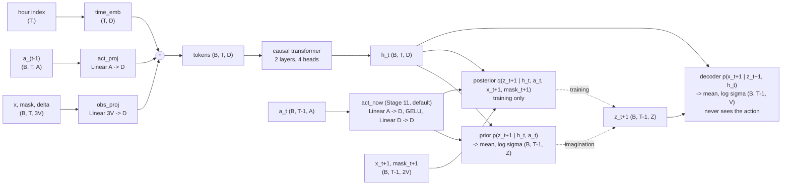

# The journey: building an ICU world model, stage by stage (1-14b)

This is the short map of the project. [LEARNING.md](../LEARNING.md) has the full explanations,
numbers and figures for every stage; this file shows how the stages connect, what each one
asked, and what we concluded. Numbers are in mmHg of mean arterial pressure (MAP) unless
stated otherwise.

## Overview

```mermaid
flowchart TD
    subgraph SIM["Simulated ICU (known truth)"]
        S1["1 Simulator<br/>hidden state, clinician policy"] --> S2["2 Tensors<br/>x, mask, delta, a"]
        S2 --> S3["3 Model<br/>transformer + prior/posterior/decoder"]
        S3 --> S4["4 Training<br/>NLL + KL with free bits"]
        S4 --> S5["5 Causal test<br/>imagine u=0 vs u=1"]
        S5 --> S6["6 Ensemble<br/>epistemic uncertainty"]
    end
    subgraph REAL["Real ICU data (MIMIC-IV, no known truth)"]
        S7["7 MIMIC-IV hourly data<br/>+ training, test evaluation"] --> S8["8 Imagination on real stays<br/>vasopressor check: ~0 effect"]
        S8 --> S9["9 Ablation<br/>actions barely used"]
    end
    subgraph SEMI["Semi-synthetic (real data + planted truth)"]
        S10["10 Plant K = 100<br/>85% recovered"] --> S10b["10b Threshold + noise floor<br/>K = 30 clear at 1, 3, 6 h"]
        S10b --> S11["11 act_now path<br/>fixes hour 1 for strong effects"]
        S11 --> S12["12 Confounder with a visible ramp"]
        S12 --> S12b["12b Confounder hidden until after the start<br/>unbiased for the wrong reason"]
        S12b --> S13["13 Let it see a start<br/>still misses the post-start drop"]
        S13 --> S13b["13b Weight the post-start hours<br/>fit -> biased, as predicted"]
        S13b --> S13c["13c Control: lower beta, no weighting<br/>KL overshot -> inconclusive"]
    end
    subgraph ARCH["Another architecture"]
        S14["14 JEPA-style world model<br/>predict the next embedding:<br/>worse forecasts, fading drug response"]
        S14 --> S14b["14b Remove the action from the target<br/>drug response nearly gone:<br/>most of 14's response was a leak"]
    end
    S6 --> S7
    S9 --> S10
    S13c --> S14
```

## The model, with shapes

B = patients in a batch, T = 48 hours, V = vitals (2 simulated, 5 in MIMIC: HR, RR, SpO2,
MAP, Temp), A = actions (2 simulated, 3 in MIMIC: vasopressor dose, fluid bolus,
ventilation), D = 64 (model width), Z = 8 (latent size).

Loss per predicted hour: Gaussian negative log-likelihood of the observed vitals (missing
ones count 0) + 1.0 x max(KL(posterior || prior), 1 nat). Imagination feeds sampled vitals
back in as if observed and uses the prior only.

## Stage by stage

Each stage: **Question**, **Hypothesis** (what we expected before running it), **Method**,
**Baseline** (what we compared against), **Result**, **Hypothesis right?**, **Lesson**, **Next**.

### Stage 1 - A simulated ICU
- **Question:** Can we build a small ICU where the true effect of every treatment is known?
- **Hypothesis:** A 4-number hidden state (MAP, sepsis severity, vasopressor effect, fluid
  volume) and a clinician who treats low MAP give realistic confounding.
- **Method:** 2,000 patients x 48 h. A clinician policy (vasopressor when MAP is low) and an
  "explore" policy (random actions 60% of the time). 10% of observations missing.
- **Baseline:** none; this stage creates the ground truth.
- **Result:** Treated patients look *worse* than untreated ones in the raw data, although
  the drug raises MAP: textbook confounding by indication. The policy had to be tuned
  (beta = 5) to give enough treated hours.
- **Hypothesis right?** Yes.
- **Lesson:** The raw association between a treatment and an outcome can have the wrong sign.
- **Next:** Turn patients into model inputs.

### Stage 2 - Turning patients into tensors
- **Question:** What exactly does the model see each hour?
- **Hypothesis:** Values, a missingness mask and "hours since last seen" are enough to
  handle missing data honestly.
- **Method:** x (vitals, 0 where missing), mask, delta, a (actions); split by patient
  70/15/15; one normalisation from the policy training split.
- **Baseline:** none.
- **Result:** Tensors of shape (patients, 48, vitals); missing values cannot leak.
- **Hypothesis right?** Yes.
- **Lesson:** Split by patient, never by hour; tell the model what is missing.
- **Next:** The model.

### Stage 3 - The model
- **Question:** How do we build a model that can be asked "what if I did a?"
- **Hypothesis:** A causal transformer summary h_t plus a latent z_{t+1} drawn from a prior
  that depends on the action, with a decoder that never sees the action, forces any
  action effect to go through z.
- **Method:** The diagram above; a forward pass printing every shape; causality checks.
- **Baseline:** none.
- **Result:** Changing hour 30 does not change h before hour 30; changing the action at hour
  30 changes only the prior for hour 31.
- **Hypothesis right?** Yes (structurally).
- **Lesson:** Test causality of the architecture directly; it is easy to leak the future.
- **Next:** Train it.

### Stage 4 - Training
- **Question:** Does the model learn to forecast, and does the latent carry information?
- **Hypothesis:** It will beat a naive forecast; free bits will prevent posterior collapse.
- **Method:** One model on policy data, one on explore data, same settings, early stopping.
- **Baseline:** Naive "last value carried forward".
- **Result:** One-step MAP error 2.35 / 2.38 mmHg; the 10-90% band contains 77-78% of
  outcomes; KL sits at the free-bits floor with 1 of 8 latent dimensions used.
- **Hypothesis right?** Partly: forecasts are good, but the latent is barely used.
- **Lesson:** Good one-step forecasts say nothing yet about treatment effects.
- **Next:** Ask it a causal question.

### Stage 5 - Imagination and the causal test
- **Question:** Does the model know what the vasopressor does?
- **Hypothesis:** The explore model will recover the true effect better than the policy model.
- **Method:** From hour 24, imagine 12 h with u = 0 and with u = 1 (paired random numbers).
- **Baseline:** The simulator's true effect (3.0 / 11.7 / 24.2 / 40.9 at +1 / +3 / +6 / +12 h).
- **Result:** Policy model 2.6 / 9.1 / 15.8 / 22.7; explore model 2.6 / 9.8 / 18.6 / 31.4.
  Both get the sign and the first hour right and fall short later.
- **Hypothesis right?** Yes: exploration helps, mostly in the long, rarely seen plans.
- **Lesson:** Conditioning on the full history removes measured confounding; long action
  sequences the data never contains (no positivity) are where it fails.
- **Next:** Can the model tell us when it is unsure?

### Stage 6 - Epistemic uncertainty with an ensemble
- **Question:** Do 5 models trained with different seeds disagree where data is missing?
- **Hypothesis:** Yes, so the ensemble spread flags unreliable counterfactuals.
- **Method:** 5 seeds per dataset; spread of their medians vs spread within a model.
- **Baseline:** The true effect from the simulator.
- **Result:** The ensemble is confidently wrong in the untreated arm: error 7-9 mmHg with a
  spread of only 0.6-0.8 mmHg; the truth is inside the 5 models' range for 1-9% of patients.
- **Hypothesis right?** No.
- **Lesson:** Models trained on the same data extrapolate the same way; seed ensembles do not
  detect missing positivity.
- **Next:** Real data.

### Stage 7 - Real ICU data (MIMIC-IV)
- **Question:** Does the same model train on real, messy ICU data?
- **Hypothesis:** It will forecast better than the naive baseline.
- **Method:** DuckDB extraction of 93,224 stays: 5 hourly vitals, norepinephrine-equivalent
  dose, fluid boluses, ventilation; outliers filtered before averaging; doses capped
  (363 + 108 hours); trained on a Kaggle GPU with W&B logging.
- **Baseline:** Naive carry-forward.
- **Result:** The prior beats naive by 7-17% MAE on every vital (MAP 7.02 vs 8.33);
  coverage 77-80%; 3 of 8 latent dimensions used.
- **Hypothesis right?** Yes.
- **Lesson:** Real data needs cleaning before averaging; one implausible reading can spoil an hour.
- **Next:** Ask the real model a causal question.

### Stage 8 - Imagination on real stays, and a vasopressor check
- **Question:** Does imagined MAP rise when the model "gives" a vasopressor to hypotensive patients?
- **Hypothesis:** A small positive effect, in the clinically expected direction.
- **Method:** 6,413 test moments with MAP < 65 and no earlier vasopressor; imagine NEE 0.1
  vs 0 for 6 h with paired random numbers.
- **Baseline:** Naive "started vs not started" comparison in the data.
- **Result:** +0.12 / +0.22 / +0.06 at 1 / 3 / 6 h: essentially zero. Multi-hour forecasts
  still beat naive.
- **Hypothesis right?** No.
- **Lesson:** A good forecaster can know almost nothing about the effect of an action.
- **Next:** Is the model ignoring the actions?

### Stage 9 - Does the model use the actions at all?
- **Question:** Does removing or shuffling the actions hurt the forecast?
- **Hypothesis:** If the model used them, it would.
- **Method:** Replace actions with zeros, shuffled actions, or zero vasopressor; measure the
  prior's sensitivity to the dose.
- **Baseline:** The real actions.
- **Result:** At most +0.5% MAP error; a dose change moves z by 0.04 against a spread of 1.65.
- **Hypothesis right?** The model barely uses the actions.
- **Lesson:** Ablation shows *whether* inputs matter; it cannot say whether the cause is the
  model or the data.
- **Next:** Plant a known effect to tell the two apart.

### Stage 10 - Semi-synthetic benchmark, K = 100
- **Question:** Is the near-zero effect an architecture problem or a data problem?
- **Hypothesis:** If the architecture can learn effects, it will recover a planted one.
- **Method:** Real MIMIC histories, MAP' = MAP + K * lagged dose (K = 100 mmHg per
  mcg/kg/min, +10 mmHg at steady state for dose 0.1); same model and training.
- **Baseline:** The planted effect, and the real-data model.
- **Result:** 54% recovered at hour 1, 85% from hour 2; ablation now matters (+27.6%).
- **Hypothesis right?** Yes, mostly: mainly a data problem, with a weak first hour.
- **Lesson:** Semi-synthetic data keeps real-data difficulty but plants a known answer.
- **Next:** How small an effect can it find?

### Stage 10b - Detection threshold and noise floor
- **Question:** What is the smallest planted effect that stands out from noise?
- **Hypothesis:** Somewhere between K = 10 and K = 100.
- **Method:** K = 10, 30, 100; then a second real-data model with another seed to measure how
  much two training runs disagree (the noise floor).
- **Baseline:** The real-data model; the seed-to-seed noise floor (up to 0.35 mmHg at 6 h).
- **Result:** Steady-state recovery 72 / 80 / 85%. K = 10 clears the noise floor at 3 and
  6 h but not at hour 1; K = 30 clears it at 1, 3 and 6 h. The real-data effect changes
  sign between seeds.
- **Hypothesis right?** Yes, with the threshold at K = 30 for all three hours.
- **Lesson:** "Distinguishable" needs a noise floor from repeated training, not only the
  spread across patients.
- **Next:** Fix the weak first hour.

### Stage 11 - The act_now path
- **Question:** Does giving the current action its own learned embedding fix hour 1?
- **Hypothesis:** Yes, for all K.
- **Method:** act_now(a_t) = Linear-GELU-Linear into prior and posterior; same training.
- **Baseline:** The original model, and each architecture's own noise floor.
- **Result:** K = 100: hour 1 54% -> 112%, steady state 85% -> 96%. K = 10: no change.
  Forecast accuracy and the real-data effect unchanged. Unit conversion checked: only 2
  wrong rows.
- **Hypothesis right?** Partly: fixed for strong effects, not for small ones.
- **Lesson:** An architecture change can fix a capacity problem without creating an
  effect the data does not contain.
- **Next:** What happens when there is a confounder the model cannot see? (act_now is now
  the default.)

### Stage 12 - Hidden confounding with a visible ramp
- **Question:** Does an unmeasured deterioration that drives treatment bias the learned effect?
- **Hypothesis:** The model learns the observational relationship, so the effect is biased by
  about -G * exp(-h/4) (G = 15: -11.3 / -6.9 / -3.2 mmHg at 1 / 3 / 6 h).
- **Method:** K = 30 plus -G * u, u ramping up over the 3 h before each vasopressor start
  and decaying (tau 4 h) after; G = 0, 5, 15.
- **Baseline:** True effect +1.9 / +2.9 / +3.0; the G = 0 model; the noise floor.
- **Result:** G = 15 learned -0.08 / +2.49 / +3.15; the part due to confounding (vs G = 0)
  is only -0.41 / +0.30 / +0.62. Checks: the confounder is injected as specified, and the raw
  data shows exactly the predicted bias (-11.27 / -6.76 / -3.39). Splitting moments by whether
  their history shows the ramp changes nothing.
- **Hypothesis right?** No: the model is not biased as predicted, although the data is.
- **Lesson:** Check the data first: the bias is really there, so the model is missing it.
  "The confounder is visible in the history" was not confirmed by the split.
- **Next:** Remove every trace of the confounder before and at the decision hour (Stage 12b).

### Stage 12b - A truly hidden confounder
- **Question:** If the deterioration leaves no trace before treatment, is the effect biased?
- **Hypothesis:** Yes, by -G * exp(-(h-1)/4).
- **Method:** u = 0 up to and including the start hour, 1 the hour after, decaying with tau
  4 h; G = 5, 15.
- **Baseline:** As in Stage 12.
- **Result:** Raw data bias -15.00 / -8.77 / -4.19, as predicted; the model's
  confounding-driven change is only -0.34 / -0.21 / +0.06 (G = 15). Its one-step prediction
  after a start moves by about 2% of the 15 mmHg drop in the data.
- **Hypothesis right?** No. "Visible at the decision hour" is ruled out as the explanation.
  The measured explanation: the one-step prior barely responds to a start (the same hour-1
  weakness as for the drug), so imagination never produces the drop. Later hours are learned,
  by teacher forcing, as recovery from an observed low MAP, a property of the history.
  Why the prior misses starts (rare: 0.93% of hours; needs current AND previous dose) is untested.
- **Lesson:** A counterfactual can be right for the wrong reason. Here, under-fitting hides the
  confounding; a better-fitted model would be biased by up to -15 mmHg. Benchmarks must check
  the mechanism (the one-step response to the action), not only the final number.
- **Next:** Test why the prior misses starts (one-step residuals at real starts; a start
  indicator or more capacity on the current-action path), knowing that fixing it should
  *expose* the bias, which is what a confounding benchmark is for.

### Stage 13 - Let the model see a start
- **Question:** If the model can predict the hour after a vasopressor start, does it become
  biased under hidden confounding?
- **Hypothesis** (written before running, with verdict rules): yes. Making `act_now` see
  `[a_t, a_t - a_{t-1}]` (a start or stop is visible directly) will let it predict the
  post-start drop and move the 12b G = 15 effect toward the red line.
- **Method:** That one input change (`act_delta=True`); trained on K = 30 (G = 0), 12b
  G = 15 and real data; same seed and hyperparameters. Checks: one-step fit around real
  starts, Part B recovery and bias, one-step error, and the temperature negative control.
- **Baseline:** The current (act_now) models; the predicted confounding shift of -15 / -9.1 /
  -4.3 mmHg; the noise floor.
- **Result:** The hour after a start is still missed: 13% of the 14.4 mmHg drop is predicted
  (17% before). The confounding shift is -0.73 mmHg at 1 h (-0.34 before). In the counterfactual
  the drug's hour-1 effect at K = 30 improves from 18% to 54-72%. One-step error is unchanged
  (MAP 7.019 vs 7.014). On real data the model now responds to the vasopressor in MAP at
  1 h (+0.49, above the noise floor) but not in temperature (negative control passed).
- **Hypothesis right?** Rejected by the pre-set rules, but the precondition was never met:
  the change did not make the model predict the hour after a start. The conditional claim
  remains untested; "one input change is enough" is rejected.
- **Lesson:** Check that an intervention on the model achieved its intermediate goal before
  reading the downstream result; otherwise a non-test looks like a negative result. Seeing
  the start is not the obstacle; rarity (0.93% of hours), the KL budget or the decoder's
  variance are the untested candidates.
- **Next:** Make the post-start hour learnable on purpose (e.g. weight start hours in the
  loss, or check what the decoder variance does there), then rerun the 12b test; and model
  the real pre-start fall in MAP, the real-world confounder none of the models predicts.

### Stage 13b - Force the model to fit the hours after a start
- **Question:** Why does the model miss the hour after a start, and if it is forced to fit it,
  does hidden confounding appear?
- **Hypothesis** (pre-registered, with a numeric gate and verdict rules): forcing the fit will
  recover the hour-1 drug effect at K = 30 and pull the 12b G = 15 effect at least 30% of the
  way toward the observational line.
- **Method:** Step 1, evaluation only: predicted spread, KL and residual at start hours;
  the start-fit with two point predictions; real starts vs Part B moments. Step 2, because
  the gate opened: act_delta with the reconstruction of start hour +1 and +2 weighted 10x,
  trained on K = 30, 12b G = 15 and real data.
- **Baseline:** The current and act_delta models; the true effect; the observational
  prediction; the noise floor.
- **Result:** Step 1: at starts the model widens its spread (1.24-1.32x) *and* misses the
  12b drop by 10 mmHg; the point-prediction method is not the cause; real starts (MAP 72,
  25% restarts) differ clearly from the Part B moments (MAP 59, first-time, falling fast).
  Step 2: 64% of the post-start drop is captured (was 13-17%); the 12b G = 15 hour-1 effect
  becomes -5.33 mmHg (true +1.90; confounding shift -8.47 vs predicted -15). On real data the
  model now imagines +1.86 mmHg for MAP at 1 h and nothing for temperature. One-step MAP MAE
  +1.2%.
- **Hypothesis right?** Confirmed by the pre-set rules. Caveats: the weighting also changed
  the reconstruction/KL balance everywhere (KL 2.7 -> 6-7 nats), so part of the effect may be
  that global shift; one seed; the drug's steady-state effect at K = 30 fell to 58%.
- **Lesson:** "No bias" in a world model can just mean "did not fit that part of the data".
  Fit it, and hidden confounding comes in. A better fit cannot remove hidden confounding;
  it reproduces it.
- **Next:** A control with the same global KL balance but no start weighting; multiple seeds;
  and the real pre-start fall in MAP, which no model predicts yet.

### Stage 13c - Control: start hours, or just the global KL shift?
- **Question:** 13b changed two things: the start hours counted 10x, and the KL/reconstruction
  balance moved everywhere (KL 2.7 -> 6-7 nats). Which one caused the bias?
- **Hypothesis** (pre-registered): the bias is specific to fitting the start hours; a control
  with the same global KL but no start weighting will stay close to the true effect.
- **Method:** act_delta, no start weighting, beta lowered from 1 so the validation KL reaches
  5.0-8.5 nats: beta 0.3 first, one pre-set adjustment. Trained on K = 30, 12b G = 15 and real
  data.
- **Baseline:** act_delta and the 13b models; the true effect; the observational prediction.
- **Result:** KL jumped instead of moving smoothly: beta 0.3 -> 19.9 nats, beta 0.9 (the
  adjustment, at its upper limit) -> 14.0, still twice the target. At the start hours the
  control is in nearly the same state as 13b (KL 14.5 vs 18.8, MAP sigma 0.14 mmHg in both);
  elsewhere it goes further. It captures 68% of the post-start drop and its 12b hour-1
  confounding shift is -10.73 mmHg (13b: -8.47). K = 30: hour 1 overshot (245%), 3-6 h right.
  One-step MAP MAE 7.046 (current 7.014).
- **Hypothesis right?** Inconclusive by the pre-set rules (control off-target). Exploratory
  reading: start weighting is not needed for the bias; a lower beta alone also makes the model
  fit the post-start hour, and the bias comes with that fit.
- **Lesson:** Near beta = 1 the KL does not move smoothly: storing a nat in `z` costs beta and
  saves about one nat of reconstruction, so below 1 the model stores almost everything. And
  check a "global" shift per hour group before matching it: 13b's average hid a big
  difference between start hours and other hours.
- **Next:** a matched control (beta between 0.9 and 1, or a fixed KL target, matched per hour
  group); more seeds.

### Stage 14 - A JEPA-style world model
- **Question:** what if the model predicts an *embedding* of the next hour (a 64-number summary
  made by a slowly-moving copy of its own encoder) instead of the vitals themselves?
- **Hypothesis** (pre-registered): it forecasts about as well as the VAE but responds less to
  actions, because embedding prediction is dominated by the patient's trend.
- **Method:** same tokens, transformer, act_now path and `z` as the default. The decoder is
  replaced by an EMA target encoder plus a predictor; loss = squared embedding error + VICReg
  variance/covariance terms (against collapse) + KL. A probe reads vitals from the predicted
  embedding, so all earlier benchmarks run through the unchanged evaluation code.
- **Baseline:** the act_now VAE (Stage 11 default), evaluated in the same job.
- **Result:** no collapse (all 64 dimensions keep a spread of about 1). `z` stays at the
  free-bits floor (KL 0.92 nats vs 2.8 for the VAE).
  - One-step MAP MAE 7.73 vs 7.01 (10% worse); worse on every vital, and on HR worse than
    "same as last hour".
  - K = 30 ablation: leans on the vasopressor as much as act_now (+2.95% vs +2.82%).
  - K = 30 recovery: 51% at hour 1 (act_now 18%), but it fades to 31% by hour 6 (act_now 85%).
    K = 10 is not detected; the noise floor is 2-3 times wider.
  - 12b hour-1 confounding shift: -0.77 vs -0.34.
- **Hypothesis right?** Partly. Forecasting parity: no. "Responds less": yes over several hours
  (recovery -19 points), no in the one-hour ablation.
- **Lesson:** predicting embeddings did not help here; it lost forecast accuracy, and its
  imagined drug effect does not build up over hours the way the real one does. Its quick
  hour-1 response may come from the action leaking into the target embedding (an untested
  caveat written before the run).
- **Next:** a target encoder without the action token; tune the free bits / VICReg weights;
  more seeds.

### Stage 14b - Close the action leak in the JEPA target
- **Question:** was Stage 14's quick hour-1 drug response real, or a leak? The target embedding
  of hour t+1 contained the action `a_t`, which the predictor also sees and could just copy.
- **Hypothesis** (pre-registered): with the leak removed, the hour-1 response drops, K = 30
  recovery stays at or below act_now's, and forecasts stay worse than act_now's.
- **Method:** one change: the target encoder builds its tokens with no action term. Everything
  else as in Stage 14. KL per hour logged to check whether `z` is used. act_now, JEPA (14) and
  JEPA-14b were all evaluated in one job (Stage 14 numbers reproduced exactly).
- **Baseline:** act_now VAE and the Stage 14 JEPA.
- **Result:**
  - K = 30 hour-1 effect: 0.97 -> 0.22 mmHg. The paired drop is about 4 times the seed noise.
  - K = 30 vasopressor ablation: +2.95% -> +0.54%.
  - K = 30 recovery: 12-13% at every hour (act_now 77-85%). Even K = 100 is only 9-13%.
  - Forecasts got worse: one-step MAP MAE 8.21 (act_now 7.01, JEPA-14 7.73). It is no better
    than "no change" at hour 1.
  - On 12b data it learns no effect at all.
  - `z` is still unused: KL 0.93 nats per hour, below the floor in 67% of hours, the same as
    in Stage 14.
- **Hypothesis right?** Confirmed by all four pre-set rules.
- **Lesson:**
  - Most of Stage 14's action response was the leak.
  - A leak-free JEPA that predicts embeddings is almost blind to a drug effect that the VAE
    recovers almost fully: the effect is a small part of the embedding it predicts.
  - Check what the target can "see" before reading a response as learned.
- **Next:** a loss that also scores the vitals (a hybrid), or a probe on richer features; more
  seeds.

## How we got from "no effect" to an answer (Stages 8-13c)

```mermaid
flowchart TD
    A["Stage 8: imagined vasopressor effect on real data ~ 0"] --> B{"Stage 9: does the model<br/>use the actions?"}
    B -- "barely (+0.5% error without them)" --> C{"Stage 10: can it learn a<br/>planted effect (K = 100)?"}
    C -- "yes, 85% from hour 2" --> D["Mainly a DATA problem<br/>(confounding, titration, positivity)"]
    C -- "only 54% at hour 1" --> E["Weak path from the current action"]
    D --> F{"Stage 10b: how small an effect,<br/>above which noise?"}
    F -- "K = 30 clear at 1, 3, 6 h;<br/>real-data effect within seed noise" --> G["Real-data effect is zero within noise"]
    E --> H{"Stage 11: act_now embedding"}
    H -- "K = 100 hour 1: 54% -> 112%;<br/>small K unchanged" --> I["Architecture weak spot fixed for strong effects"]
    G --> J{"Stage 12: confounder with<br/>a visible ramp"}
    I --> J
    J -- "learned ~ true, not biased as predicted" --> K{"Checks 1-3"}
    K -- "1: injected as specified<br/>2: raw data shows the full bias" --> K2["The data is confounded;<br/>the model does not reproduce it"]
    K -- "3: ramp in history or not:<br/>no difference" --> K3["'Visible in the history' not confirmed"]
    K2 --> L{"Stage 12b: no trace before<br/>or at the decision hour"}
    K3 --> L
    L -- "raw bias -15 at 1 h;<br/>model still ~unbiased" --> M["'Visible at decision hour' ruled out"]
    M --> N["Measured: one-step prior barely responds to a start (2% of the drop)<br/>=> unbiased for the wrong reason (under-fitting)"]
    N --> P{"Stage 13: let it see a start<br/>(act_now gets a_t - a_(t-1))"}
    P -- "hour after a start still missed (13%)" --> Q["Precondition not met:<br/>conditional hypothesis untested"]
    P -- "drug hour 1 at K = 30: 18% -> 54-72%;<br/>real data: MAP responds, Temp does not" --> R["Better drug path, no sign of<br/>confounding through the action"]
    Q --> S13b{"Stage 13b: weight the hours<br/>after a start 10x in the loss"}
    R --> S13b
    S13b -- "post-start drop captured 64%;<br/>12b hour-1 effect +1.9 -> -5.3" --> V["Confirmed: fit the post-start hour<br/>and hidden confounding appears"]
    V --> W{"Stage 13c: no weighting,<br/>lower beta (KL target 5-8.5 nats)"}
    W -- "KL 14 at beta 0.9: off-target;<br/>drop captured 68%, hour-1 shift -10.7" --> X["Inconclusive by the rules;<br/>exploratory: fitting the start hours brings the bias,<br/>whatever causes the fit"]
    X --> O["Next: matched control (beta 0.9-1 or KL target), more seeds,<br/>and the real pre-start fall in MAP"]
```

## Main finding so far (Stages 12-13c)

Models that fit the hours just after a vasopressor start reproduce the hidden confounding;
models that do not fit them look unbiased only because they underfit.

| Model | Post-start drop captured | Hour-1 confounding shift (full bias −15) |
|---|---|---|
| act_now (12b) | ~2% | −0.34 |
| act_delta (13) | 13% | −0.73 |
| 13b start weighting | 64% | −8.47 |
| 13c lower beta (0.9) | 68% | −10.73 |

- Two different routes to a close fit (start weighting, lower beta) both brought in most of the
  bias.
- **Key sensitivity:** beta 1.0 -> 0.9 moved the validation KL from 2.7 to 14 nats per hour
  and switched the model from underfitting to fitting the post-start hour.
- **Limits:** one seed per model; the 13c verdict is inconclusive by its rules (KL off-target),
  so its numbers here are exploratory.

## Glossary

- **World model:** a model that predicts how a system evolves, and how it would evolve under
  actions we choose, so it can be used to *imagine* outcomes.
- **Latent (z):** an unobserved summary the model invents; here 8 numbers per hour.
- **Prior / posterior:** the latent distribution without / with sight of the next observation.
- **KL, free bits:** how far posterior and prior differ; free bits let the model keep 1 nat
  of information without penalty, to avoid posterior collapse (latent ignored).
- **Imagination (rollout):** predicting forward hour by hour from the prior, feeding samples back.
- **Counterfactual, paired random numbers:** the same patient and the same randomness under two
  different plans, so the difference is due to the plan only.
- **Confounding:** a factor that drives both treatment and outcome (sicker patients get the
  drug), so the raw association is not the effect. **Unmeasured (hidden) confounding:** that
  factor is not in the data.
- **Positivity:** every plan we ask about must actually occur in the data for similar patients.
- **Aleatoric / epistemic uncertainty:** randomness of the patient / the model's own ignorance.
- **Ablation:** removing an input to see whether the model relies on it.
- **Semi-synthetic benchmark:** real data plus a planted effect of known size.
- **Noise floor:** how much two training runs on identical data disagree; an effect must beat it.
- **Negative control outcome:** an outcome the treatment should not affect (here temperature);
  an imagined "effect" on it points to confounding, not to the drug.
- **Teacher forcing:** training each one-step prediction on the real previous hours, not on
  the model's own predictions.
- **NEE:** norepinephrine-equivalent vasopressor dose, mcg/kg/min.
- **MAP:** mean arterial pressure, mmHg.

## Open questions

1. **Hidden confounding in practice.** How large is unmeasured confounding in real ICU data,
   and can proxies (notes, lab trends, measurement frequency) make it visible to the model?
2. **Positivity for action sequences.** How can a world model detect, for a given history and
   plan, that the data does not support the question, and refuse to answer?
3. **Uncertainty that catches shared extrapolation.** Seed ensembles failed (Stage 6); do
   diverse ensembles, Bayesian or conformal methods do better?
4. **First-hour response.** Why does the prior barely respond in the first hour, both to small
   drug effects and to the drop after a start (rarity? the start being an interaction of the
   current and previous dose? the KL budget?), and how big does the confounding bias become
   once it does respond?
5. **Validation without ground truth.** Semi-synthetic benchmarks, natural experiments and
   randomised trials (e.g. MAP-target trials) as external checks.
6. **Hybrid models.** Does built-in physiology make untreated arms extrapolate correctly?
7. **Transfer and resolution.** Does a MIMIC model hold in another hospital (eICU)? Would
   continuous time avoid hourly-binning artefacts?
